# POSTpractice3

글·댓글 게시판 REST API의 **CRUD(다건조회·단건조회·작성·수정·삭제)** 를 TDD로 만드는 실습입니다.
**기능 하나 = 커밋 하나**로 나누고, 커밋마다 `001`, `002` … 태그를 달아 나중에 그 시점의 코드를 바로 꺼내 볼 수 있게 했습니다.

- 참고: [slog.gg/p/14172](https://www.slog.gg/p/14172/raw) 1부(1강 ~ 32강) REST API, 2부(33강 ~ 56강) REST API by TDD
- 기술: Java 25, Spring Boot 4.1.2, Spring Data JPA, H2, Lombok, JUnit 5 + MockMvc
- 용어: [GLOSSARY.md](GLOSSARY.md)
- 테스트 실행: `./gradlew test` (리포트: `build/reports/tests/test/index.html`)
- 캡처 도구: ego lite 브라우저

## 코드 확인하는 법

| 보고 싶은 것 | 방법 |
|---|---|
| 지금(최신) 코드 | 이 폴더를 IntelliJ로 열기 |
| 특정 커밋에서 바뀐 내용 | `git show 003` |
| 특정 커밋 시점의 코드 전체 | `git checkout 003` → 다 보면 `git checkout main` |
| 커밋 목록 | `git log --oneline --decorate` |

## 진행 상황

> **006부터 강의 순서에 맞춰 계획을 바꿨다.** 001~005는 강의 4~9강과 내용이 같아 그대로 두고,
> 이후는 강의 목차 순서(댓글 조회 → 삭제 → 작성 → 수정)를 따른다. 단, 모든 커밋에서 테스트를 먼저 쓰는 방식은 유지한다.

| 태그 | 기능 | 강의 | 상태 |
|---|---|---|---|
| `001` | 빈 Spring Boot 프로젝트 + 용어집 + README 뼈대 | 1강 | ✅ 완료 |
| `002` | JPA·H2 설정 + `Post` 엔티티 + 샘플 글 3개 | 3강 | ✅ 완료 |
| `003` | `PostComment` 엔티티 + 샘플 댓글 5개 | 3강 | ✅ 완료 |
| `004` | 글 다건조회 | 4강, 8~9강, 45강 | ✅ 완료 |
| `005` | 글 단건조회 | 5강, 44강 | ✅ 완료 |
| `006` | 404 처리 리팩터링: 컨트롤러는 `.get()` 만, 예외 처리기가 `NoSuchElementException` 처리 | 48~49강 | ✅ 완료 |
| `007` | 댓글 다건조회, 단건조회 | 10강, 54강 | ✅ 완료 |
| `008` | 댓글 삭제 | 11~12강 | ✅ 완료 |
| `009` | 글 삭제 (댓글도 함께 삭제) | 16강, 42강 | ✅ 완료 |
| `010` | 글 작성 + 입력값 검증(400) | 22~24강, 50~52강 | ✅ 완료 |
| `011` | `ResponseAspect`: `RsData` 의 `resultCode` 로 HTTP 상태코드 자동 설정 | 27~28강 | ✅ 완료 |
| `012` | 글 수정 (입력값 검증 포함) | 31강, 36강 | ✅ 완료 |
| `013` | 댓글 수정 (입력값 검증 포함) | 32강, 55강 | ✅ 완료 |
| `014` | 댓글 작성 + 최종 결과 정리 | 56강 | ✅ 완료 |

## 만들 API

| 메서드 | URL | 기능 | 성공 응답 | 태그 |
|---|---|---|---|---|
| GET | `/api/v1/posts` | 글 다건조회 (최신순) | 200, 글 배열 | `004` |
| GET | `/api/v1/posts/{id}` | 글 단건조회 | 200, 글 | `005` |
| GET | `/api/v1/posts/{postId}/comments` | 댓글 다건조회 (작성순) | 200, 댓글 배열 | `007` |
| GET | `/api/v1/posts/{postId}/comments/{id}` | 댓글 단건조회 | 200, 댓글 | `007` |
| DELETE | `/api/v1/posts/{postId}/comments/{id}` | 댓글 삭제 | 200, `RsData` | `008` |
| DELETE | `/api/v1/posts/{id}` | 글 삭제 | 200, `RsData` | `009` |
| POST | `/api/v1/posts` | 글 작성 | 201, `RsData` | `010`, `011` |
| PUT | `/api/v1/posts/{id}` | 글 수정 | 200, `RsData` | `012` |
| PUT | `/api/v1/posts/{postId}/comments/{id}` | 댓글 수정 | 200, `RsData` | `013` |
| POST | `/api/v1/posts/{postId}/comments` | 댓글 작성 | 201, `RsData` | `014` |

### 응답 규칙
- **조회 성공**: 데이터(DTO)를 그대로 응답한다.
- **조회 실패, 작성·수정·삭제**: `RsData` 로 감싼다. → `{"resultCode": "200-1", "msg": "1번 글이 수정되었습니다.", "data": null}`
- `resultCode` 는 `HTTP상태코드-세부번호` 형식이다.

| 상황 | HTTP | resultCode | msg 예시 |
|---|---|---|---|
| 작성 성공 | 201 | `201-1` | `4번 글이 작성되었습니다.` |
| 수정 성공 | 200 | `200-1` | `1번 글이 수정되었습니다.` |
| 삭제 성공 | 200 | `200-1` | `1번 글이 삭제되었습니다.` |
| 입력값 오류 | 400 | `400-1` | `title-Size-size must be between 2 and 100` |
| 없는 대상 | 404 | `404-1` | `해당 데이터가 존재하지 않습니다.` (006부터, 강의 48강) |

### 입력값 규칙
| 항목 | 규칙 |
|---|---|
| 글 제목 | 공백 불가, 2 ~ 100자 |
| 글 내용 | 공백 불가, 2 ~ 5000자 |
| 댓글 내용 | 공백 불가, 2 ~ 1000자 |

---

## 001 - 빈 Spring Boot 프로젝트 + 용어집 + README 뼈대

### 작업 내용

| 파일 | 역할 |
|---|---|
| `build.gradle.kts` | 사용할 라이브러리 목록. 지금은 웹(`webmvc`), Lombok, DevTools, 테스트 라이브러리만 넣었다. DB(JPA·H2)는 002에서 추가한다. |
| `settings.gradle.kts` | 프로젝트 이름 `POSTpractice3` |
| `gradlew`, `gradlew.bat`, `gradle/wrapper/` | Gradle을 따로 설치하지 않아도 빌드할 수 있게 해 주는 래퍼 |
| `.gitignore`, `.gitattributes` | git에 올리지 않을 파일(빌드 결과, DB 파일 등)과 줄바꿈 규칙 |
| `src/main/resources/application.yaml` | 앱 설정. 지금은 앱 이름만 |
| `src/main/java/com/back/BackApplication.java` | 앱의 시작점(`main` 메서드) |
| `src/test/java/com/back/BackApplicationTests.java` | 앱이 에러 없이 뜨는지 확인하는 테스트 |
| `GLOSSARY.md` | 이 프로젝트에서 쓰는 말(글, 댓글, 다건조회, 단건조회, 샘플 데이터)의 뜻 |
| `README.md` | 전체 계획(API 목록, 응답·입력값 규칙)과 커밋별 기록 |

### 핵심 포인트
- `@SpringBootApplication` 이 붙은 클래스의 패키지(`com.back`) **아래에** 있는 클래스만 스프링이 찾아낸다. 그래서 앞으로 만들 모든 클래스는 `com.back.…` 안에 둔다.
- `@SpringBootTest` 는 테스트할 때 스프링을 실제 실행처럼 통째로 띄운다. 테스트 메서드가 비어 있어도, 띄우는 도중에 에러가 나면 실패한다.
- 이 단계는 아직 "기능"이 없어서 RED(실패) 단계가 없다. 앞으로 만들 모든 테스트의 출발점인 "앱이 뜬다"를 먼저 확인해 둔다.

### 테스트

| 테스트 | 검증 내용 |
|---|---|
| `BackApplicationTests.contextLoads` | 앱(스프링)이 에러 없이 실행된다 |

### 결과 스크린샷

전체 결과 — 1건 실행, 실패 0, 성공률 100%


`BackApplicationTests` 상세


---

## 002 - JPA·H2 설정 + `Post` 엔티티 + 샘플 글 3개

### 작업 내용

| 파일 | 변경 | 역할 |
|---|---|---|
| `build.gradle.kts` | 수정 | JPA(`data-jpa`), H2 DB(`h2`), H2 웹 콘솔(`h2console`) 3줄 추가 |
| `src/main/resources/application.yaml` | 수정 | DB 접속 정보(`db_dev` 파일), H2 콘솔 켜기, 테이블 자동 생성(`ddl-auto: update`), SQL 출력 |
| `src/test/resources/application-test.yaml` | 추가 | 테스트 전용 설정. 파일 DB 대신 **메모리 DB** 사용, 테스트마다 테이블을 새로 만듦 |
| `BackApplication.java` | 수정 | `@EnableJpaAuditing` 추가 → 작성일·수정일 자동 기록 켜기 |
| `global/jpa/entity/BaseEntity.java` | 추가 | 모든 엔티티의 공통 칸: `id`, `createDate`, `modifyDate` |
| `domain/post/post/entity/Post.java` | 추가 | 글 엔티티 → DB의 `post` 테이블 (`title`, `content`) |
| `domain/post/post/repository/PostRepository.java` | 추가 | DB 접근 담당. 인터페이스만 선언하면 `save`, `count`, `findAll` 등이 생긴다 |
| `domain/post/post/service/PostService.java` | 추가 | 글 기능 담당: `count()`, `write()`, `findAll()` |
| `global/initData/BaseInitData.java` | 추가 | 앱이 시작되면 샘플 글 3개를 만든다 (이미 있으면 안 만든다) |
| `BackApplicationTests.java` | 수정 | `@ActiveProfiles("test")` 추가 → 메모리 DB 사용 |
| `global/initData/BaseInitDataTest.java` | 추가 | 샘플 글 3개 검증 테스트 3건 |

### 봐야 할 부분 (읽는 순서)

1. **[`BaseInitDataTest.java`](src/test/java/com/back/global/initData/BaseInitDataTest.java)** — 테스트를 **먼저** 읽는다. "앱이 시작되면 글이 3개 있어야 한다"는 기대가 코드로 적혀 있다. 테스트 안에서 글을 직접 만들지 않는다는 점이 핵심이다.
2. **[`BaseEntity.java`](src/main/java/com/back/global/jpa/entity/BaseEntity.java)** → **[`Post.java`](src/main/java/com/back/domain/post/post/entity/Post.java)** — 자바 클래스가 어떻게 DB 테이블이 되는지. `Post` 에는 `id` 가 안 보이는데 `BaseEntity` 를 상속해서 갖게 된다.
3. **[`PostRepository.java`](src/main/java/com/back/domain/post/post/repository/PostRepository.java)** → **[`PostService.java`](src/main/java/com/back/domain/post/post/service/PostService.java)** — 몸통 없는 인터페이스 하나로 `save()`, `count()` 를 쓸 수 있는 이유.
4. **[`BaseInitData.java`](src/main/java/com/back/global/initData/BaseInitData.java)** — RED를 GREEN으로 바꾼 **유일한 코드**. 이 파일만 없으면 테스트가 실패한다.
5. **[`application-test.yaml`](src/test/resources/application-test.yaml)** — 테스트가 개발용 DB 파일을 건드리지 않는 이유.

### 핵심 포인트

- **엔티티 = 테이블**: `@Entity` 를 붙이면 JPA가 클래스를 보고 `CREATE TABLE post (id, create_date, modify_date, title, content)` 를 대신 실행한다(`ddl-auto`). SQL을 직접 쓰지 않는다.
- **`@MappedSuperclass`**: `BaseEntity` 는 테이블이 되지 않고, 자기 칸(`id`, 날짜 2개)을 자식 엔티티 테이블에 물려준다. 003의 댓글도 이걸 상속한다.
- **`@NoArgsConstructor(access = PROTECTED)`**: JPA는 DB에서 꺼낸 값을 담으려고 빈 생성자가 필요하다. 하지만 우리가 `new Post()` 로 제목 없는 글을 만들면 안 되므로 `protected` 로 막고, 밖에서는 `new Post(title, content)` 만 쓰게 한다.
- **`JpaRepository<Post, Long>`**: "Post를 다루고 id는 Long" 이라고만 알려 주면 스프링이 구현 클래스를 자동으로 만든다.
- **계층**: `BaseInitData` → `PostService` → `PostRepository` → DB. 004부터는 맨 앞에 컨트롤러가 붙는다.
- **`ApplicationRunner`**: 앱이 다 뜬 직후 1번 실행된다. 테스트에서 `@SpringBootTest` 로 스프링을 띄울 때도 실행되기 때문에, 테스트가 글을 직접 만들지 않아도 3개가 있다.
- **`if (count() > 0) return;`**: 개발용 DB(`db_dev.mv.db`)는 파일이라 앱을 껐다 켜도 남는다. 이 줄이 없으면 재시작할 때마다 글이 3개씩 늘어난다.
- **`@ActiveProfiles("test")` + `application-test.yaml`**: 테스트는 메모리 DB(`jdbc:h2:mem:db_test`)를 쓴다. 그래서 테스트가 아무리 글을 지우고 바꿔도 개발용 DB는 그대로다.
- **`@Transactional` (테스트 클래스)**: 테스트 메서드가 끝나면 그 안에서 바꾼 DB 내용을 되돌린다(롤백). 테스트끼리 서로 영향을 주지 않는다.

### TDD 과정

**RED** — `BaseInitDataTest` 를 먼저 쓰고 실행. 샘플 데이터를 만드는 코드가 없어서 3건 모두 실패.
`t1` 실패 메시지: `expected: 3L but was: 0L` → "글이 3개여야 하는데 0개다"


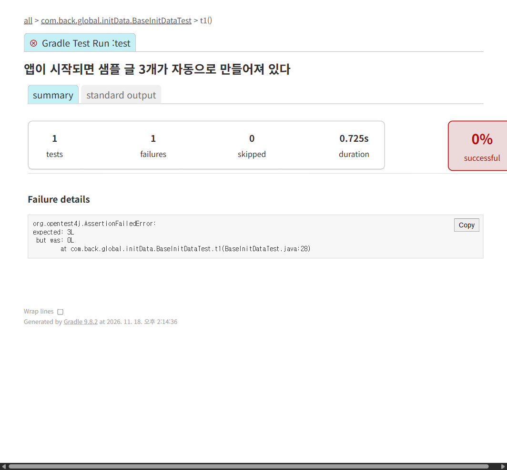

**GREEN** — `BaseInitData` 추가 후 다시 실행. 3건 모두 통과.

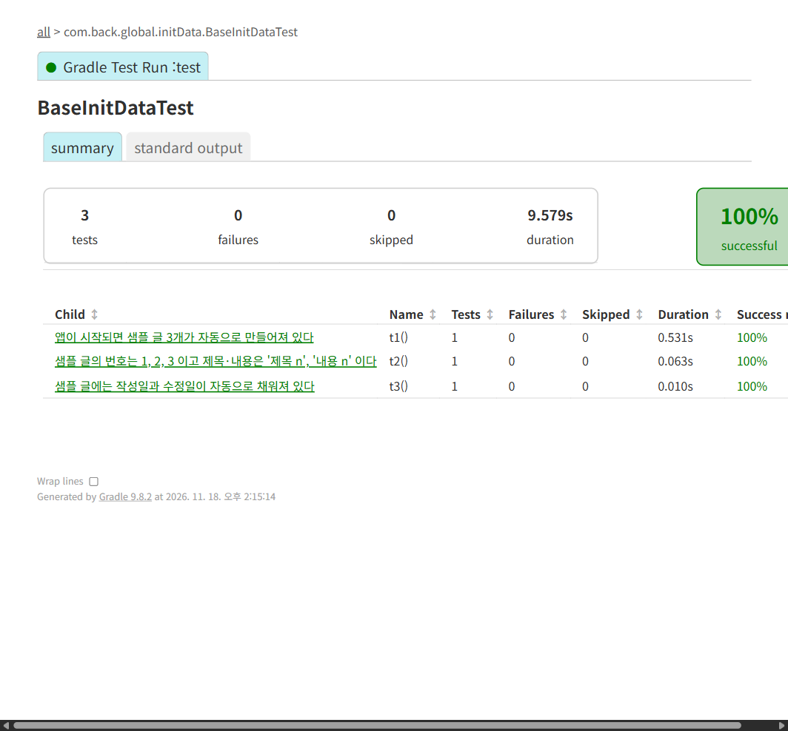

### 테스트

| 테스트 | 검증 내용 |
|---|---|
| `BaseInitDataTest.t1` | 앱이 시작되면 샘플 글 3개가 자동으로 만들어져 있다 |
| `BaseInitDataTest.t2` | 샘플 글의 번호는 1, 2, 3 이고 제목·내용은 '제목 n', '내용 n' 이다 |
| `BaseInitDataTest.t3` | 샘플 글에는 작성일과 수정일이 자동으로 채워져 있다 |

### 결과 스크린샷

전체 결과 — 4건 실행, 실패 0, 성공률 100%


---

## 003 - `PostComment` 엔티티 + 샘플 댓글 5개

### 작업 내용

| 파일 | 변경 | 역할 |
|---|---|---|
| `domain/post/postComment/entity/PostComment.java` | 추가 | 댓글 엔티티 → DB의 `post_comment` 테이블 (`post_id`, `content`) |
| `domain/post/post/entity/Post.java` | 수정 | `comments` 목록(`@OneToMany`) + 댓글을 만드는 `addComment()` 추가 |
| `global/initData/BaseInitData.java` | 수정 | 샘플 댓글 5개 생성, `@Transactional` + `self` 호출로 변경 |
| `global/initData/BaseInitDataTest.java` | 수정 | 샘플 댓글 검증 테스트 3건(`t4` ~ `t6`) 추가 |

### 봐야 할 부분 (읽는 순서)

1. **[`BaseInitDataTest.java`](src/test/java/com/back/global/initData/BaseInitDataTest.java) `t4` ~ `t6`** — 댓글이 "몇 개", "어느 글에", "몇 번으로" 저장되어야 하는지.
2. **[`PostComment.java`](src/main/java/com/back/domain/post/postComment/entity/PostComment.java)** 의 `@ManyToOne private Post post;` — DB의 `post_id` 외래키가 되는 필드.
3. **[`Post.java`](src/main/java/com/back/domain/post/post/entity/Post.java)** 의 `@OneToMany(mappedBy = "post", cascade = PERSIST)` 와 `addComment()` — 글과 댓글을 양쪽에서 이어 주는 방법.
4. **[`BaseInitData.java`](src/main/java/com/back/global/initData/BaseInitData.java)** 의 `@Transactional` 과 `self.work1()` — 아래 "함정"에서 왜 필요한지 확인.

### 핵심 포인트

- **관계의 주인은 댓글**: DB에서 "이 댓글은 몇 번 글 것인가"는 `post_comment.post_id` 칸에 적힌다. 그 칸을 만드는 건 `PostComment.post` 필드(`@ManyToOne`)다. `Post.comments` 는 `mappedBy = "post"` 라서 칸을 만들지 않고, 자바에서 "이 글의 댓글 목록"을 편하게 보려고 둔 거울이다.
- **`addComment()` 로만 댓글을 만든다**: 한쪽만 연결하면(예: `post_id` 만 넣고 `comments` 목록엔 안 넣으면) 같은 트랜잭션 안에서 `post.getComments()` 가 비어 보인다. 양쪽을 한 메서드에서 같이 연결해 실수를 막는다.
- **`cascade = PERSIST`**: 글이 저장될 때 `comments` 에 새로 들어온 댓글도 같이 저장한다. 그래서 댓글은 `save()` 를 따로 부르지 않는다.
- **`fetch = LAZY`**: 댓글을 꺼낼 때 글은 바로 가져오지 않고, `comment.getPost()` 로 실제로 쓸 때 가져온다(필요할 때만 SQL 실행).

### 함정: `@Transactional` 이 없으면 댓글이 저장되지 않는다

처음에는 `work1()` 에 `addComment()` 다섯 줄만 추가했다. 그런데 테스트는 그대로 실패했다(`expected: 5 but was: 0`).

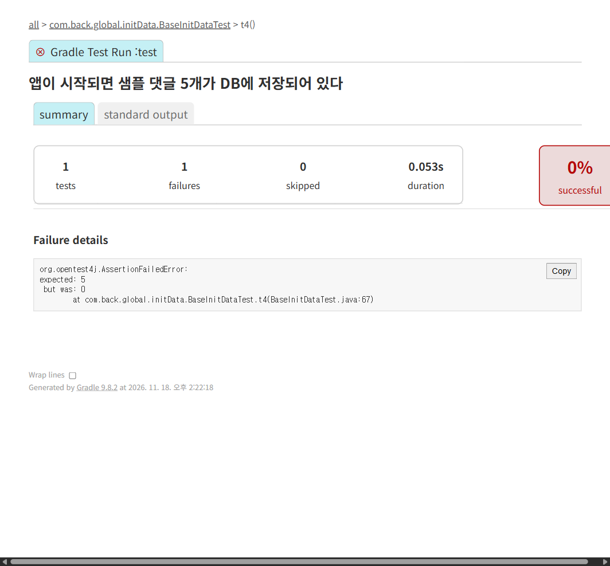

| | 트랜잭션 없음 (실패) | 트랜잭션 있음 (성공) |
|---|---|---|
| `postService.write()` | `save()` 한 번 = 작은 트랜잭션 하나가 열리고 바로 닫힌다 | `work1()` 전체가 트랜잭션 하나 |
| `post1` 상태 | 트랜잭션이 끝나 JPA가 **더 이상 지켜보지 않는** 객체 | 트랜잭션 안이라 JPA가 **계속 지켜보는** 객체 |
| `addComment()` | 자바 리스트에 넣기만 하고 끝 → DB 변화 없음 | 트랜잭션이 끝날 때 JPA가 바뀐 것을 발견 → cascade로 `INSERT` 5번 |

- **왜 `self.work1()` 인가**: `@Transactional` 은 스프링이 만든 대리 객체(프록시)를 거쳐 호출해야 동작한다. 같은 클래스 안에서 `work1()`(= `this.work1()`)로 부르면 프록시를 안 거쳐서 어노테이션이 무시된다. 그래서 자기 자신을 프록시로 주입받아(`self`) 그걸로 부른다.
- **`@Lazy`**: 자기 자신을 주입받으면 "나를 만들려면 내가 필요한" 순환이 생긴다. `@Lazy` 로 실제로 쓸 때 주입받아 이 문제를 피한다.

### TDD 과정

**RED** — 댓글 테스트 3건을 먼저 쓰고 실행. 샘플 댓글이 없어서 3건 실패 (`expected: 5 but was: 0`).


**GREEN** — `@Transactional` + `self.work1()` 로 고친 뒤 실행. 모두 통과.


### 테스트

| 테스트 | 검증 내용 |
|---|---|
| `BaseInitDataTest.t4` | 앱이 시작되면 샘플 댓글 5개가 DB에 저장되어 있다 |
| `BaseInitDataTest.t5` | 1번 글에 댓글 3개, 2번 글에 댓글 2개, 3번 글에는 댓글이 없다 |
| `BaseInitDataTest.t6` | 샘플 댓글의 번호는 1 ~ 5 이고, 각 댓글은 자기가 속한 글을 알고 있다 |

### 결과 스크린샷

전체 결과 — 7건 실행, 실패 0, 성공률 100%


---

## 004 - 글 다건조회 `GET /api/v1/posts`

### 작업 내용

| 파일 | 변경 | 역할 |
|---|---|---|
| `domain/post/post/controller/ApiV1PostController.java` | 추가 | 글 API 컨트롤러. `getItems()` 가 `GET /api/v1/posts` 를 처리 |
| `domain/post/post/dto/PostDto.java` | 추가 | 응답용 글 데이터(record): `id`, `createDate`, `modifyDate`, `title`, `content` |
| `domain/post/post/repository/PostRepository.java` | 수정 | `findAllByOrderByIdDesc()` 추가 → 최신순 조회 |
| `domain/post/post/service/PostService.java` | 수정 | `findAllNewestFirst()` 추가 |
| `domain/post/post/controller/ApiV1PostControllerTest.java` | 추가 | MockMvc 로 API 를 호출해 응답을 검증하는 테스트 2건 |

### 봐야 할 부분 (읽는 순서)

1. **[`ApiV1PostControllerTest.java`](src/test/java/com/back/domain/post/post/controller/ApiV1PostControllerTest.java) `t1`** — 컨트롤러 테스트의 2단계 구조: ① `mvc.perform(get(...))` 로 요청 → ② `andExpect(...)` 로 응답 검증. `jsonPath("$[*].id").value(contains(3, 2, 1))` 이 "최신순"을 검증하는 줄.
2. **같은 파일 `t2`** — 응답의 모든 필드를 DB 값과 비교하고, `comments` 가 **없음**을 확인(`doesNotExist()`).
3. **[`ApiV1PostController.java`](src/main/java/com/back/domain/post/post/controller/ApiV1PostController.java)** — `@RestController`, `@RequestMapping`, `@GetMapping` 세 어노테이션이 "주소 → 메서드"를 연결하는 방법. 그리고 엔티티 목록을 `PostDto` 목록으로 바꾸는 `stream().map(PostDto::new)`.
4. **[`PostDto.java`](src/main/java/com/back/domain/post/post/dto/PostDto.java)** — 엔티티를 바로 응답하지 않고 DTO 로 바꾸는 이유(주석).
5. **[`PostRepository.java`](src/main/java/com/back/domain/post/post/repository/PostRepository.java)** — 메서드 **이름**만으로 `ORDER BY id DESC` 쿼리가 만들어지는 쿼리 메서드.

### 핵심 포인트

- **`@RestController`** = `@Controller` + `@ResponseBody`. 메서드가 돌려준 `List<PostDto>` 를 Jackson 이 JSON 배열로 바꿔 응답 본문에 넣는다.
- **`@RequestMapping("/api/v1/posts")` + `@GetMapping`**: 클래스의 주소 접두어 + 메서드의 HTTP 방식. 합쳐서 "GET /api/v1/posts 가 오면 `getItems()` 실행".
- **DTO 를 쓰는 이유**: `Post` 엔티티를 그대로 응답하면 `post.comments` → `comment.post` → `post.comments` … 로 무한히 이어져 JSON 변환이 터진다(순환참조). 또 엔티티에 칸을 추가하면 API 응답까지 바뀐다. 그래서 **보여 줄 칸만 고른 상자(`PostDto`)** 에 옮겨 담는다.
- **조회 성공은 `RsData` 로 감싸지 않는다**: 데이터 자체가 결과라서 `resultCode`/`msg` 가 필요 없다. (README 응답 규칙)
- **쿼리 메서드**: `findAll` + `By` + `OrderBy` + `Id` + `Desc` → 스프링이 이름을 읽고 `SELECT * FROM post ORDER BY id DESC` 를 만든다. 구현 코드를 쓰지 않는다.
- **`@Transactional(readOnly = true)`**: 읽기만 하는 작업이라고 알려 준다. JPA 가 "바뀐 데이터가 있나" 검사(변경 감지)를 건너뛰어 조금 가벼워진다.
- **MockMvc**: 서버(8080)를 실제로 켜지 않고 컨트롤러에 HTTP 요청을 흉내 내서 보낸다. 빠르고, 응답 상태코드·JSON 을 그대로 검증할 수 있다.
- **`handler().handlerType(...)`, `handler().methodName(...)`**: "어느 컨트롤러의 어느 메서드가 처리했는가"까지 검증한다. 이 줄 때문에 컨트롤러 클래스 껍데기를 먼저 만들었다(없으면 테스트가 컴파일되지 않는다).

### TDD 과정

**RED** — 비어 있는 `ApiV1PostController` 껍데기 + 테스트를 먼저 작성. 2건 실패.
실패 메시지: `Handler type expected: ApiV1PostController but was: ResourceHttpRequestHandler` → "이 주소를 처리할 컨트롤러 메서드가 없어서 정적 파일 처리기로 넘어갔다(=404)"


**GREEN** — `PostDto`, `findAllByOrderByIdDesc()`, `findAllNewestFirst()`, `getItems()` 구현 후 통과.


### 테스트

| 테스트 | 검증 내용 |
|---|---|
| `ApiV1PostControllerTest.t1` | `GET /api/v1/posts` → 200, 글 3개, 번호가 3, 2, 1 순서(최신순) |
| `ApiV1PostControllerTest.t2` | 각 글의 `id`, `createDate`, `modifyDate`, `title`, `content` 가 DB 값과 같고 `comments` 는 없다 |

### 결과 스크린샷

전체 결과 — 9건 실행, 실패 0, 성공률 100%


앱 실행 후 브라우저에서 `http://localhost:8080/api/v1/posts` 접속 — 3번 글이 맨 위(최신순), `comments` 없음

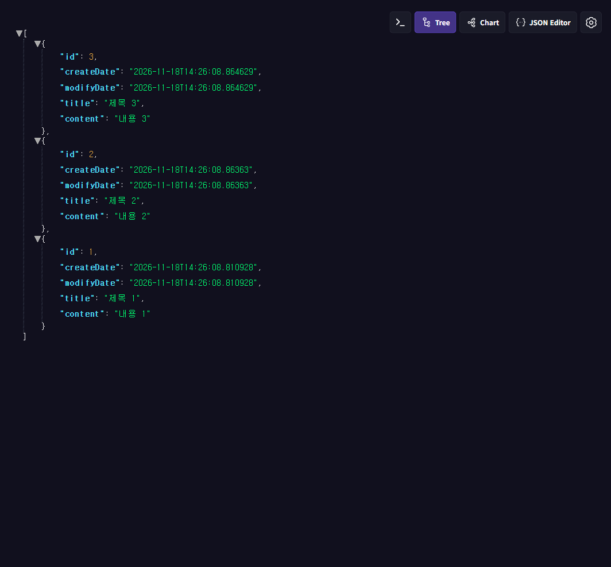

---

## 005 - 글 단건조회 `GET /api/v1/posts/{id}` + 404 처리(`RsData`)

### 작업 내용

| 파일 | 변경 | 역할 |
|---|---|---|
| `domain/post/post/controller/ApiV1PostController.java` | 수정 | `getItem()` 추가: `GET /api/v1/posts/{id}`. 없으면 `ServiceException` 던짐 |
| `domain/post/post/service/PostService.java` | 수정 | `findById()` 추가 → `Optional<Post>` |
| `global/rsData/RsData.java` | 추가 | 결과 응답 상자: `resultCode`, `msg`, `data` |
| `global/exception/ServiceException.java` | 추가 | "처리할 수 없다"를 알리는 예외. `resultCode` 와 `msg` 를 들고 다닌다 |
| `global/globalExceptionHandler/GlobalExceptionHandler.java` | 추가 | `ServiceException` 을 받아 HTTP 상태코드 + `RsData` 응답으로 바꾼다 |
| `ApiV1PostControllerTest.java` | 수정 | 단건조회 성공(`t3`), 없는 글 404(`t4`) 테스트 추가 |

### 봐야 할 부분 (읽는 순서)

1. **[`ApiV1PostControllerTest.java`](src/test/java/com/back/domain/post/post/controller/ApiV1PostControllerTest.java) `t3`, `t4`** — 성공은 `$.id` 처럼 객체를 바로 읽고, 실패는 `$.resultCode`, `$.msg`, `$.data` 를 읽는다. 응답 **모양이 다르다**는 것이 핵심.
2. **[`ApiV1PostController.java`](src/main/java/com/back/domain/post/post/controller/ApiV1PostController.java) `getItem()`** — `@PathVariable` 로 주소의 숫자를 받고, `orElseThrow()` 로 "없으면 예외" 를 한 줄에 처리.
3. **[`ServiceException.java`](src/main/java/com/back/global/exception/ServiceException.java)** → **[`GlobalExceptionHandler.java`](src/main/java/com/back/global/globalExceptionHandler/GlobalExceptionHandler.java)** — 던진 예외가 어디서 받아져서 404 응답이 되는지 따라가 보기.
4. **[`RsData.java`](src/main/java/com/back/global/rsData/RsData.java)** — `"404-1"` 에서 `404` 를 뽑는 `statusCode()` 와, 그게 JSON 에 안 나오게 하는 `@JsonIgnore`.

### 핵심 포인트

- **`@GetMapping("/{id}")` + `@PathVariable long id`**: 주소의 `{id}` 자리에 온 값(`/api/v1/posts/1` → `1`)을 메서드 매개변수로 받는다.
- **`Optional`**: "있을 수도, 없을 수도 있는 값"을 담는 상자. `findById(1000)` 은 빈 상자를 돌려준다. `orElseThrow(() -> 예외)` 는 "비어 있으면 이 예외를 던지고, 있으면 꺼내 줘".
- **예외로 흐름 끊기**: 컨트롤러는 실패 응답을 직접 만들지 않는다. `throw` 하면 메서드가 그 자리에서 끝나고, 스프링이 `@RestControllerAdvice` 에서 그 예외를 처리하는 `@ExceptionHandler` 메서드를 찾아 실행한다. 컨트롤러 코드는 "성공 흐름"만 남아 짧아진다.
- **`ResponseEntity`**: 응답 본문만 돌려주면 상태코드는 항상 200 이다. 404 를 보내려면 `ResponseEntity.status(404).body(...)` 로 상태코드까지 정해야 한다.
- **`RsData` 의 `resultCode` 형식 `"404-1"`**: 앞은 HTTP 상태코드, 뒤는 같은 상태코드 안에서 상황을 구분하는 번호. `statusCode()` 가 앞부분을 잘라 실제 HTTP 상태코드로 쓴다.
- **`@JsonIgnore`**: record 는 메서드도 JSON 칸으로 내보낼 수 있다. `statusCode()` 는 내부용이라 JSON 에서 뺀다. (브라우저 캡처에 `statusCode` 칸이 없는 것으로 확인)
- **성공과 실패의 모양이 다르다**: 성공은 `{"id":1, ...}`, 실패는 `{"resultCode":"404-1", ...}`. 조회 성공은 데이터 자체가 결과라서 감싸지 않는다(README 응답 규칙). 006 작성부터는 성공도 `RsData` 로 감싼다.
- **`GlobalExceptionHandler` 는 앞으로 계속 재사용된다**: 007 수정, 008 삭제, 009 ~ 013 댓글 API 에서 "없는 대상"은 모두 `throw new ServiceException("404-1", ...)` 한 줄로 끝난다.

### TDD 과정

**RED** — `t3`, `t4` 를 먼저 작성. `getItem` 메서드가 없어서 2건 실패.


**GREEN** — `findById()`, `getItem()`, `RsData`, `ServiceException`, `GlobalExceptionHandler` 구현 후 통과.

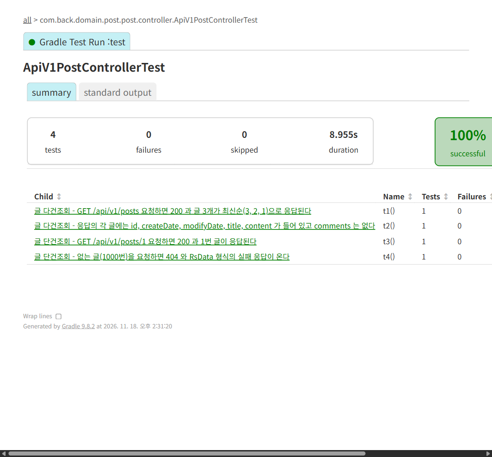

### 테스트

| 테스트 | 검증 내용 |
|---|---|
| `ApiV1PostControllerTest.t3` | `GET /api/v1/posts/1` → 200, 1번 글의 모든 필드, `comments` 없음 |
| `ApiV1PostControllerTest.t4` | `GET /api/v1/posts/1000` → 404, `resultCode` = `404-1`, `msg` = `1000번 글은 존재하지 않습니다.`, `data` = `null` |

### 결과 스크린샷

전체 결과 — 11건 실행, 실패 0, 성공률 100%


브라우저 `http://localhost:8080/api/v1/posts/1` — 1번 글 객체 하나

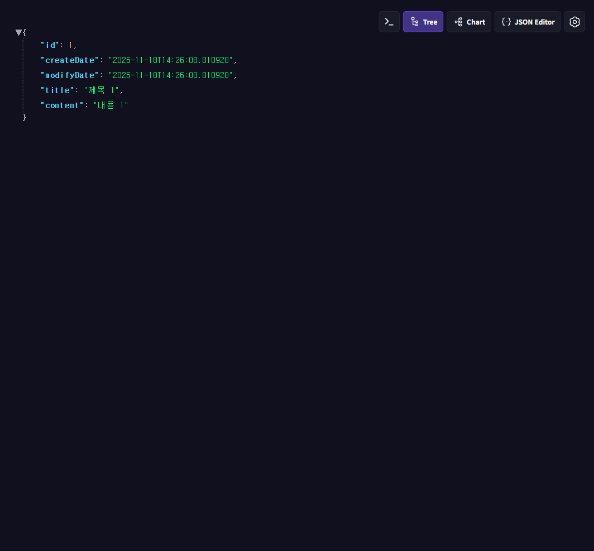

브라우저 `http://localhost:8080/api/v1/posts/1000` — 404, `RsData` 형식 (`statusCode` 칸은 나오지 않음)


---

## 006 - 404 처리 리팩터링: 컨트롤러는 예외 처리를 하지 않는다 (강의 48~49강)

### 왜 바꿨나
005에서는 컨트롤러가 `orElseThrow(() -> new ServiceException("404-1", "1000번 글은 ..."))` 로 실패 응답을 직접 준비했다.
강의(48강)는 컨트롤러가 `.get()` 만 부르고, 데이터가 없을 때 저절로 나는 `NoSuchElementException` 을 **전역 예외 처리기가 받아서** 404 로 바꾼다.
컨트롤러에는 "성공 흐름"만 남고, "없을 때 어떻게 응답하나"는 한곳(`GlobalExceptionHandler`)에서만 정한다.
이 커밋부터 진행 순서도 강의 목차에 맞췄다(위 "진행 상황" 표 참고).

### 작업 내용

| 파일 | 변경 | 역할 |
|---|---|---|
| `ApiV1PostControllerTest.java` | 수정 | `t4` 의 기대 메시지를 `해당 데이터가 존재하지 않습니다.` 로 **먼저** 변경 |
| `ApiV1PostController.java` | 수정 | `getItem()`: `orElseThrow(...)` → `.get()`. 예외 관련 코드 제거 |
| `GlobalExceptionHandler.java` | 수정 | 처리 대상 `ServiceException` → `NoSuchElementException`, 공통 메시지 |
| `global/exception/ServiceException.java` | 삭제 | 더 이상 쓰는 곳이 없음 |
| `README.md` | 수정 | 006 ~ 014 계획을 강의 순서로 변경, 404 메시지 규칙 변경 |

### 봐야 할 부분 (읽는 순서)

1. **[`ApiV1PostControllerTest.java`](src/test/java/com/back/domain/post/post/controller/ApiV1PostControllerTest.java) `t4` 의 `$.msg` 줄** — 바뀐 것은 이 한 줄뿐. **요구사항이 바뀌면 테스트부터 고친다**(강의 40강).
2. **[`ApiV1PostController.java`](src/main/java/com/back/domain/post/post/controller/ApiV1PostController.java) `getItem()`** — 005 와 비교해 보기: `git diff 005 006 -- src/main`
3. **[`GlobalExceptionHandler.java`](src/main/java/com/back/global/globalExceptionHandler/GlobalExceptionHandler.java)** — `@ExceptionHandler(NoSuchElementException.class)` 로 받는 예외가 바뀐 부분.

### 핵심 포인트

- **`Optional.get()`**: 값이 있으면 꺼내고, **비어 있으면 `NoSuchElementException` 을 던진다.** 그래서 컨트롤러가 `if` 나 `orElseThrow` 를 쓰지 않아도 "없음"이 예외로 표현된다.
- **예외는 위로 올라간다**: `getItem()` 안에서 난 예외를 아무도 잡지 않으면 스프링 MVC 까지 올라가고, 스프링은 `@RestControllerAdvice` 에서 그 예외 타입을 처리하는 `@ExceptionHandler` 메서드를 찾아 실행한다.
- **공통 메시지의 대가**: 예외 처리기는 "몇 번 무엇이" 없었는지 모른다. 그래서 메시지가 `해당 데이터가 존재하지 않습니다.` 로 일반적이 된다. 대신 앞으로 만들 댓글 조회·삭제·수정의 "없음"도 **컨트롤러 코드 추가 없이** 같은 404 응답을 받는다.
- **리팩터링과 테스트**: 성공 응답(`t1` ~ `t3`)은 바뀌지 않았고 그대로 통과한다. 테스트가 있어서 "다른 기능을 망가뜨리지 않았다"를 바로 확인할 수 있다(강의 37강).

### TDD 과정

**RED** — `t4` 의 기대 메시지만 먼저 바꾸고 실행. 1건 실패.
`JSON path "$.msg" expected:<해당 데이터가 존재하지 않습니다.> but was:<1000번 글은 존재하지 않습니다.>`


**GREEN** — 컨트롤러를 `.get()` 으로, 예외 처리기를 `NoSuchElementException` 으로 바꾼 뒤 통과.


### 테스트

| 테스트 | 검증 내용 |
|---|---|
| `ApiV1PostControllerTest.t4` (수정) | `GET /api/v1/posts/1000` → 404, `404-1`, `해당 데이터가 존재하지 않습니다.`, `data` = `null` |

### 결과 스크린샷

전체 결과 — 11건 실행, 실패 0, 성공률 100%


브라우저 `http://localhost:8080/api/v1/posts/1000`


---

## 007 - 댓글 다건조회 `GET /api/v1/posts/{postId}/comments`, 단건조회 `GET /api/v1/posts/{postId}/comments/{id}` (강의 10강, 54강)

### 작업 내용

| 파일 | 변경 | 역할 |
|---|---|---|
| `domain/post/postComment/controller/ApiV1PostCommentController.java` | 추가 | 댓글 API. `getItems()`(다건), `getItem()`(단건) |
| `domain/post/postComment/dto/PostCommentDto.java` | 추가 | 응답용 댓글 데이터: `id`, `createDate`, `modifyDate`, `postId`, `content` |
| `domain/post/post/entity/Post.java` | 수정 | `@OrderBy("id ASC")` 로 댓글 순서 고정, `findCommentById()` 추가 |
| `domain/post/postComment/controller/ApiV1PostCommentControllerTest.java` | 추가 | 댓글 조회 테스트 5건 |

### 봐야 할 부분 (읽는 순서)

1. **[`ApiV1PostCommentControllerTest.java`](src/test/java/com/back/domain/post/postComment/controller/ApiV1PostCommentControllerTest.java)** — 5개 상황을 표로 정리하면:

   | 요청 | 상황 | 결과 |
   |---|---|---|
   | `/posts/1/comments` | 댓글 3개인 글 | 200, `[1, 2, 3]` |
   | `/posts/3/comments` | 댓글 없는 글 | 200, `[]` |
   | `/posts/1000/comments` | 없는 글 | 404 |
   | `/posts/1/comments/2` | 1번 글의 2번 댓글 | 200 |
   | `/posts/1/comments/4` | 4번 댓글은 있지만 **2번 글** 것 | 404 |

2. **[`ApiV1PostCommentController.java`](src/main/java/com/back/domain/post/postComment/controller/ApiV1PostCommentController.java)** — 클래스 주소에 `{postId}` 가 들어간 것, 그리고 `.get()` 두 번(글, 댓글)으로 404 가 저절로 처리되는 것.
3. **[`Post.java`](src/main/java/com/back/domain/post/post/entity/Post.java) `findCommentById()`** — "그 글의 댓글 중에서만" 찾기 때문에 `t5` 가 404 가 된다.
4. **[`PostCommentDto.java`](src/main/java/com/back/domain/post/postComment/dto/PostCommentDto.java)** — 글 객체 대신 `postId` 숫자만 담는 이유.

### 핵심 포인트

- **주소 설계**: 댓글은 글에 속하므로 `/posts/{postId}/comments` 처럼 "글 아래"에 둔다. 주소만 봐도 "몇 번 글의 댓글"인지 보인다.
- **`[]` 는 실패가 아니다**: 3번 글은 존재하고 댓글이 0개일 뿐이다. 404 는 "글 자체가 없을 때"만.
- **다른 글의 댓글은 404**: 4번 댓글이 DB에 있어도 `post1.findCommentById(4)` 는 1번 글의 댓글 목록에서만 찾으므로 빈 `Optional` → `.get()` → `NoSuchElementException` → 404. 006 에서 만든 예외 처리기 덕분에 **컨트롤러에 실패 처리 코드가 하나도 없다.**
- **`@OrderBy("id ASC")`**: JPA가 댓글 목록을 불러올 때 `ORDER BY id ASC` 를 붙인다. 이게 없으면 DB가 주는 순서를 믿어야 해서 "작성순"이 보장되지 않는다.
- **`@Transactional(readOnly = true)` 가 꼭 필요한 이유**: `comments` 는 LAZY 라서 `post.getComments()` 를 처음 쓸 때 DB에서 불러온다. 트랜잭션(=DB 연결)이 끝난 뒤라면 불러올 수 없어 에러가 난다.
- **`PostCommentDto` 에 `post` 대신 `postId`**: 글 객체를 넣으면 글 → 댓글들 → 글 … 순환참조가 생긴다. 프론트에는 "몇 번 글의 댓글인지"만 알려 주면 충분하다.
- **댓글 서비스는 아직 없다**: 댓글은 언제나 글을 통해 꺼내므로(`post.getComments()`) `PostService` 로 충분하다.

### TDD 과정

**RED** — 빈 `ApiV1PostCommentController` 껍데기 + 테스트 5건 먼저 작성. 5건 모두 실패.


**GREEN** — `PostCommentDto`, `@OrderBy`, `findCommentById()`, `getItems()`, `getItem()` 구현 후 통과.


### 테스트

| 테스트 | 검증 내용 |
|---|---|
| `ApiV1PostCommentControllerTest.t1` | `/posts/1/comments` → 200, 댓글 3개가 1, 2, 3 순서, 모든 필드가 DB 값과 같고 `post` 객체는 없음 |
| `ApiV1PostCommentControllerTest.t2` | `/posts/3/comments` → 200, 빈 배열 |
| `ApiV1PostCommentControllerTest.t3` | `/posts/1000/comments` → 404, `404-1` |
| `ApiV1PostCommentControllerTest.t4` | `/posts/1/comments/2` → 200, 2번 댓글(`댓글 1-2`)의 모든 필드 |
| `ApiV1PostCommentControllerTest.t5` | `/posts/1/comments/4` → 404 (4번 댓글은 2번 글 소속) |

### 결과 스크린샷

전체 결과 — 16건 실행, 실패 0, 성공률 100%


브라우저 `/api/v1/posts/1/comments` — 1번 글의 댓글 3개, 작성순

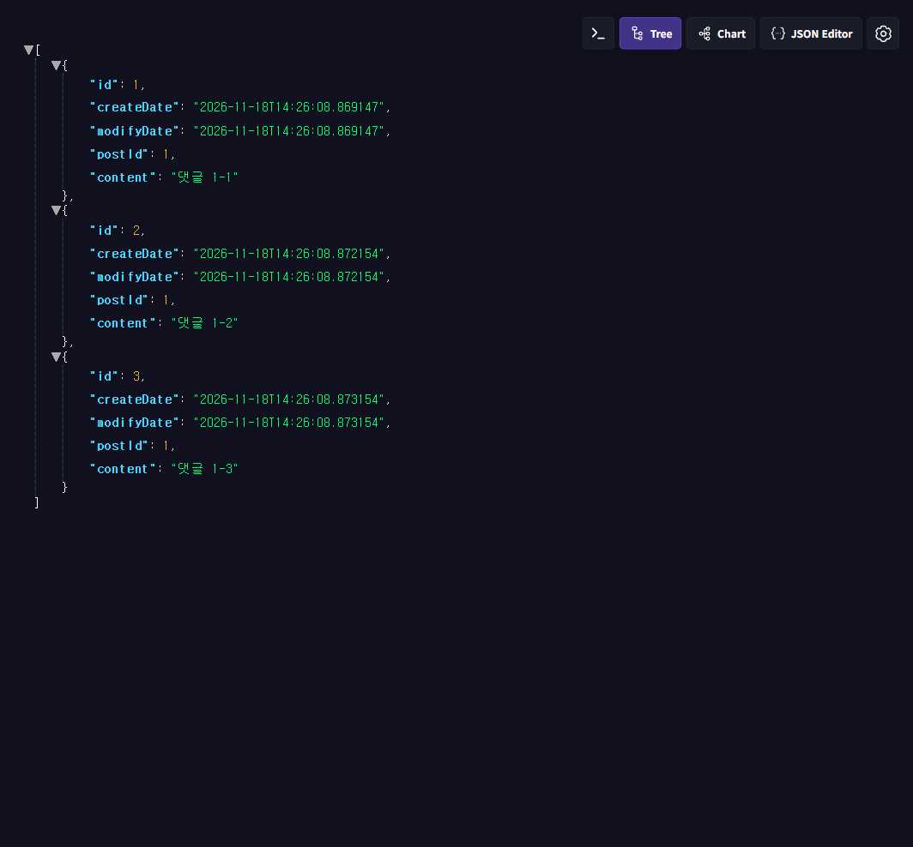

브라우저 `/api/v1/posts/3/comments` — 빈 배열

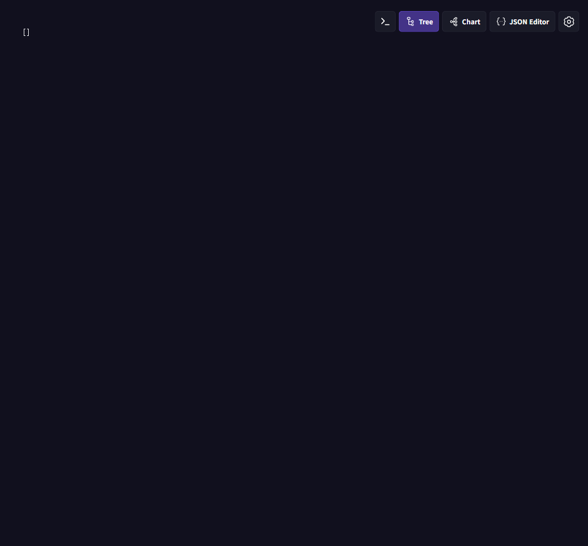

브라우저 `/api/v1/posts/1/comments/2` — 2번 댓글, `postId` 1


브라우저 `/api/v1/posts/1/comments/4` — 다른 글의 댓글이라 404


---

## 008 - 댓글 삭제 `DELETE /api/v1/posts/{postId}/comments/{id}` (강의 11~12강, 21강, 55강)

### 작업 내용

| 파일 | 변경 | 역할 |
|---|---|---|
| `ApiV1PostCommentController.java` | 수정 | `deleteItem()` 추가: `@DeleteMapping`, 성공 시 `RsData` 응답 |
| `Post.java` | 수정 | `deleteComment()` 추가(목록에서 빼기), `orphanRemoval = true` 추가 |
| `ApiV1PostCommentControllerTest.java` | 수정 | 삭제 성공(`t6`), 다른 글의 댓글 삭제 404(`t7`) 테스트 + `EntityManager` 로 DB 재조회 |

### 봐야 할 부분 (읽는 순서)

1. **[`ApiV1PostCommentControllerTest.java`](src/test/java/com/back/domain/post/postComment/controller/ApiV1PostCommentControllerTest.java) `t6`** — 응답 검증(②) 다음에 **DB 검증(③)** 이 있다. `em.flush()` + `em.clear()` 로 "자바 객체"가 아니라 "DB에 실제로 남은 것"을 다시 읽는다.
2. **[`ApiV1PostCommentController.java`](src/main/java/com/back/domain/post/postComment/controller/ApiV1PostCommentController.java) `deleteItem()`** — `repository.delete()` 를 부르지 않는다. `post.deleteComment()` 로 **목록에서 빼기만** 한다.
3. **[`Post.java`](src/main/java/com/back/domain/post/post/entity/Post.java) 의 `orphanRemoval = true`** — 목록에서 빠진 댓글을 DB에서 지우게 하는 한 단어. 아래 "함정" 참고.

### 핵심 포인트

- **`@DeleteMapping`**: HTTP 의 DELETE 방식. 같은 주소(`/posts/1/comments/1`)라도 GET 이면 조회, DELETE 면 삭제다. (강의 11강은 편의상 GET 으로 시작해 21강에서 DELETE 로 바꿨고, 여기서는 처음부터 DELETE)
- **성공도 `RsData`**: 삭제는 조회가 아니라서 "무슨 일이 일어났는지"를 `resultCode` + `msg` 로 알려 준다. 지운 데이터는 돌려줄 게 없으므로 `RsData<Void>`, `data` 는 `null`.
- **더티체킹(변경 감지)**: `@Transactional` 메서드 안에서 엔티티를 바꿔 두면, 메서드가 끝날 때 JPA 가 처음 상태와 비교해 바뀐 부분의 SQL 을 만들어 실행한다. 그래서 `save()` / `delete()` 를 부르지 않는다.
- **`orphanRemoval = true`**: 부모(글)의 목록에서 빠진 자식(댓글) = "고아". 고아를 DB에서 지운다.
- **`em.flush()` / `em.clear()`** (테스트): 테스트도 `@Transactional` 이라 DELETE 가 아직 DB로 안 갔을 수 있고, 같은 자바 객체를 다시 보면 "목록에서 빠진 상태"가 보일 뿐이다. flush 로 SQL 을 보내고, clear 로 객체를 버린 뒤 다시 읽어야 진짜 DB 상태다.
- **실패 처리는 여전히 0줄**: 없는 글·다른 글의 댓글은 `.get()` → 006 의 예외 처리기 → 404 (`t7`).

### 함정: `orphanRemoval` 이 없으면 목록에서만 빠지고 DB에는 남는다

처음에는 `deleteComment()`(목록에서 빼기)만 만들었다. 응답은 `200-1 "1번 댓글이 삭제되었습니다."` 로 성공처럼 보였지만,
DB를 다시 읽어 보니 1번 댓글이 그대로 있었다: `Expecting actual: [1L, 2L, 3L] to contain exactly: [2L, 3L]`

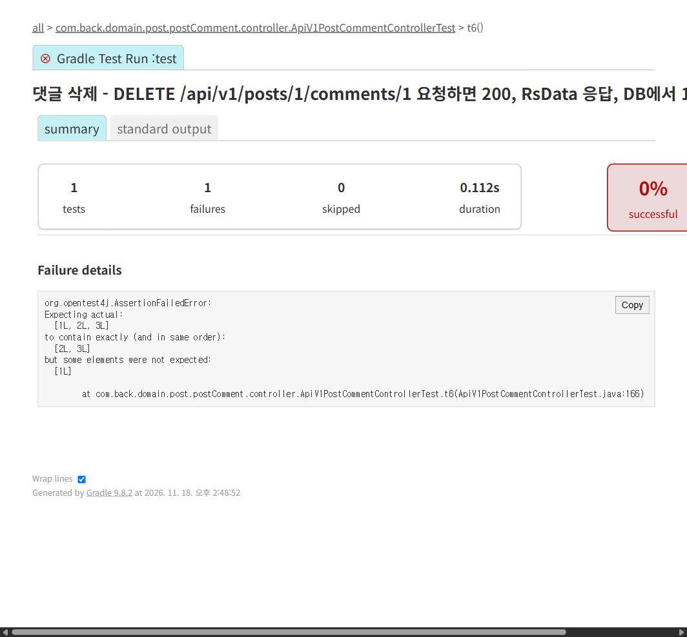

`orphanRemoval = true` 를 추가하자 트랜잭션 끝에 `delete from post_comment where id=?` 가 실행됐다.
(테스트 출력: 위쪽에 응답 본문, 노란색이 JPA가 만든 DELETE SQL)

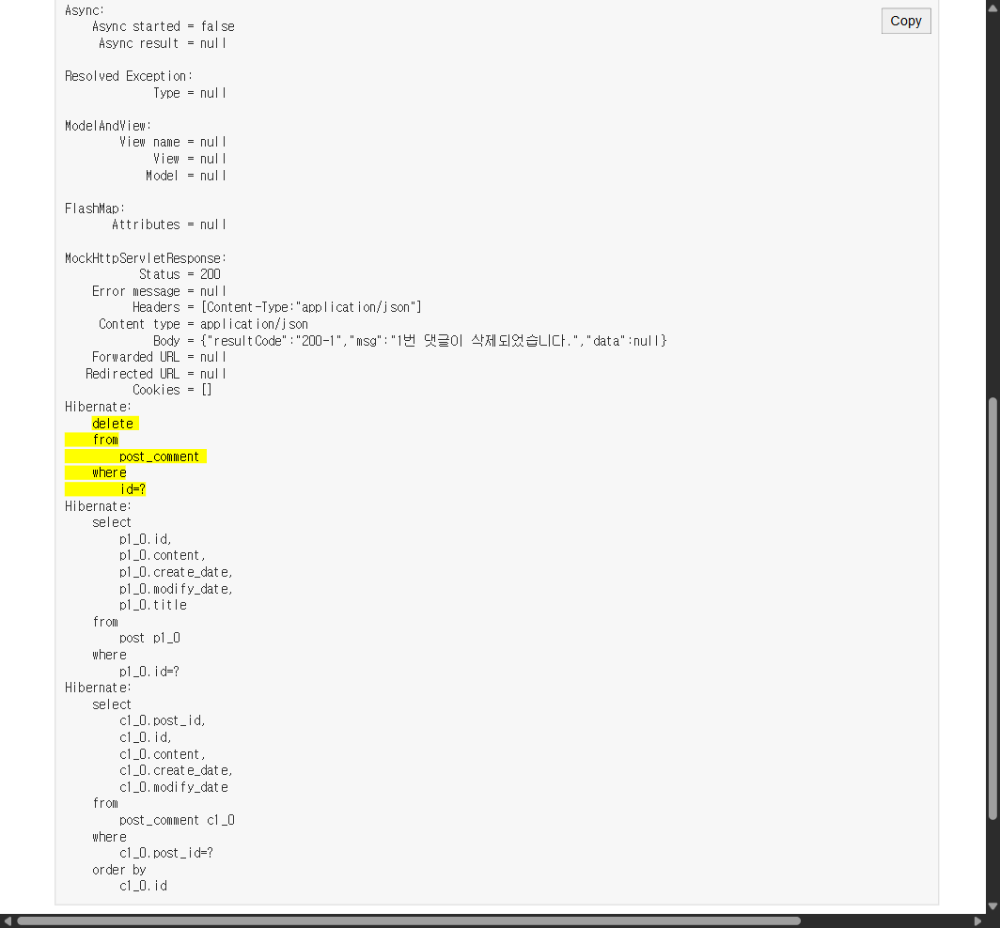

> 응답만 검사했다면 이 버그를 놓쳤다. **DB 상태까지 검증**해야 하는 이유.

### TDD 과정

**RED** — 테스트 2건 먼저 작성. `deleteItem` 이 없어서 2건 실패.

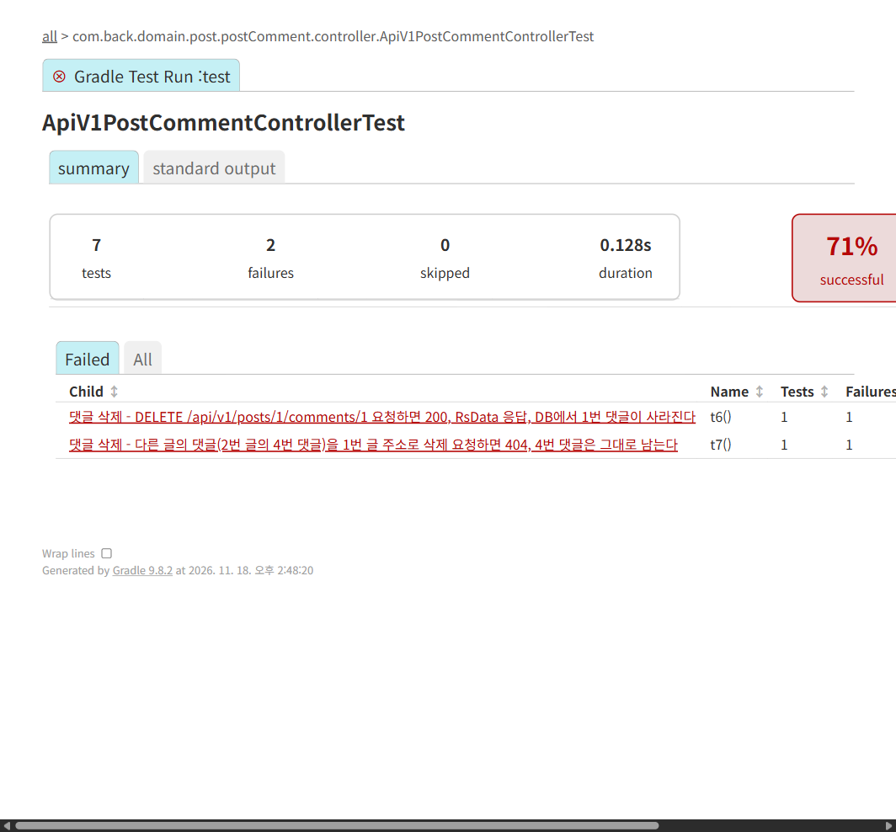

**함정** — `deleteComment()` + `deleteItem()` 만 구현 → `t6` 의 DB 검증 실패 (위 캡처).

**GREEN** — `orphanRemoval = true` 추가 후 통과.

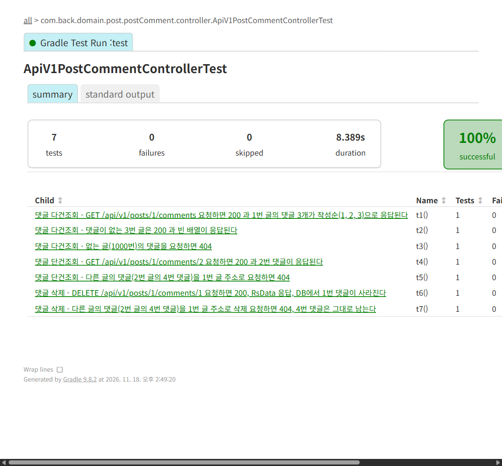

### 테스트

| 테스트 | 검증 내용 |
|---|---|
| `ApiV1PostCommentControllerTest.t6` | `DELETE /posts/1/comments/1` → 200, `200-1`, `1번 댓글이 삭제되었습니다.`, `data` = `null` / DB 재조회 시 1번 글 댓글이 `[2, 3]` |
| `ApiV1PostCommentControllerTest.t7` | `DELETE /posts/1/comments/4` → 404 / DB 재조회 시 2번 글 댓글이 `[4, 5]` 그대로 |

### 결과 스크린샷

전체 결과 — 18건 실행, 실패 0, 성공률 100%


> DELETE 요청은 브라우저 주소창으로 보낼 수 없어서, 브라우저 캡처 대신 위의 테스트 출력(응답 본문 + DELETE SQL) 캡처로 확인했다.

---

## 009 - 글 삭제 `DELETE /api/v1/posts/{id}` (강의 16강, 42강)

### 작업 내용

| 파일 | 변경 | 역할 |
|---|---|---|
| `ApiV1PostController.java` | 수정 | `deleteItem()` 추가: `@DeleteMapping("/{id}")`, 성공 시 `RsData` |
| `PostService.java` | 수정 | `delete(Post)` 추가 → `postRepository.delete()` |
| `ApiV1PostControllerTest.java` | 수정 | 댓글 달린 글 삭제(`t5`), 없는 글 삭제 404(`t6`) 테스트 |

### 봐야 할 부분 (읽는 순서)

1. **[`ApiV1PostControllerTest.java`](src/test/java/com/back/domain/post/post/controller/ApiV1PostControllerTest.java) `t5`** — 일부러 **댓글 3개가 달린 1번 글**을 지운다. DB 검증(③)에서 글뿐 아니라 댓글 1, 2, 3 도 사라졌는지, **다른 글의 댓글(4번)은 남았는지**까지 본다. `em.find(PostComment.class, 1L)` 은 "1번 댓글을 DB에서 직접 찾아라"(없으면 `null`).
2. **[`ApiV1PostController.java`](src/main/java/com/back/domain/post/post/controller/ApiV1PostController.java) `deleteItem()`** — 008 댓글 삭제와 모양이 거의 같다. 다른 점은 `post.deleteComment()` 대신 `postService.delete(post)`.
3. **[`Post.java`](src/main/java/com/back/domain/post/post/entity/Post.java) 의 `orphanRemoval = true`** — 008 에서 넣은 이 설정이 이번에도 일한다(아래).

### 핵심 포인트

- **외래키 때문에 순서가 중요하다**: `post_comment.post_id` 가 `post.id` 를 가리킨다. 댓글이 남아 있는데 글부터 지우면 "가리킬 대상이 없는 댓글"이 생기므로 DB가 거부한다(외래키 제약 위반). 그래서 **댓글 먼저, 글 나중**.
- **`orphanRemoval = true` 는 부모 삭제도 따라간다**: JPA 규칙상 `orphanRemoval = true` 인 관계는 부모(글)가 삭제될 때 자식(댓글)에게도 삭제가 전달된다. 그래서 008 에서 넣은 설정만으로 아래 순서의 SQL 이 자동으로 나온다.
  ```
  delete from post_comment where id=?   ← 1번 댓글
  delete from post_comment where id=?   ← 2번 댓글
  delete from post_comment where id=?   ← 3번 댓글
  delete from post where id=?           ← 1번 글
  ```
  (같은 효과를 `cascade = REMOVE` 로 명시할 수도 있다. 이 프로젝트는 `orphanRemoval` 하나로 "목록에서 빼기 → 삭제"와 "글 삭제 → 댓글 삭제"를 모두 처리한다.)
- **그래서 이번엔 함정 단계가 없다**: 003, 008 과 달리 구현 직후 바로 GREEN. 테스트가 "댓글까지 지워졌는지"를 검사하고 있어서, 혹시 나중에 `orphanRemoval` 을 지우면 이 테스트가 깨져서 알려 준다.
- **글은 `repository.delete()`, 댓글은 목록에서 빼기**: 글은 다른 엔티티에 딸린 게 아니라서 리포지터리로 직접 지운다. 댓글은 글에 딸려 있으니 글의 목록을 통해 지운다(008).

### TDD 과정

**RED** — `t5`, `t6` 먼저 작성. `deleteItem` 이 없어서 2건 실패.

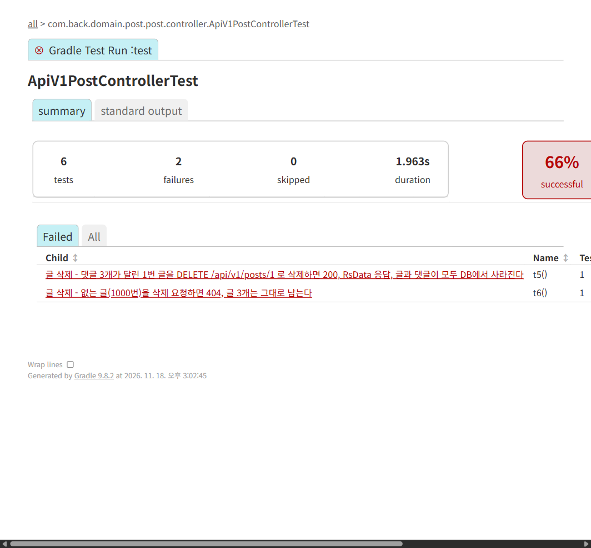

**GREEN** — `PostService.delete()`, `deleteItem()` 구현 후 바로 통과.

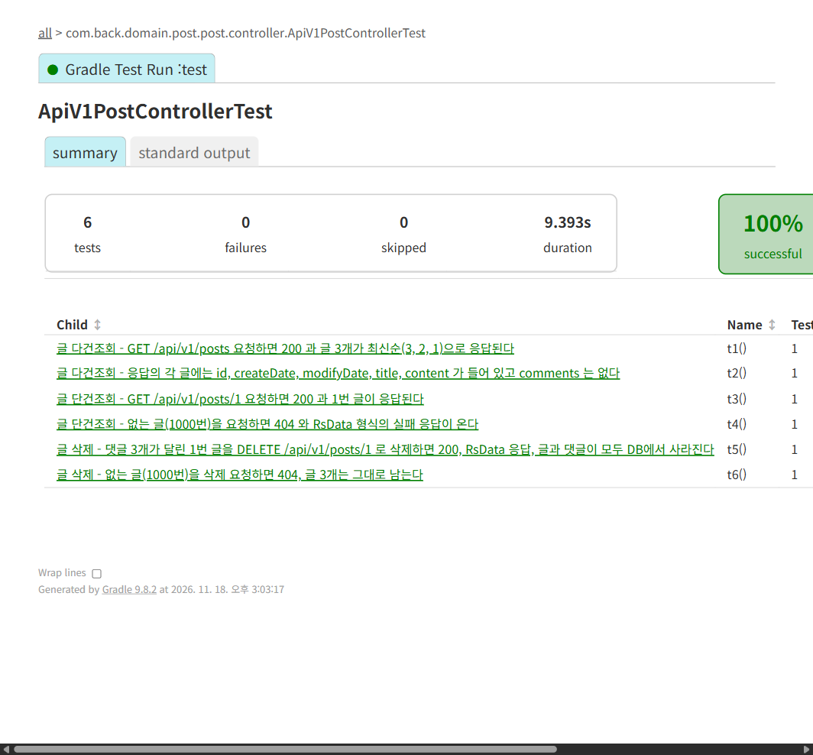

`t5` 테스트 출력: 응답 본문 다음에 댓글 3개 → 글 순서로 DELETE 실행 (노란색)

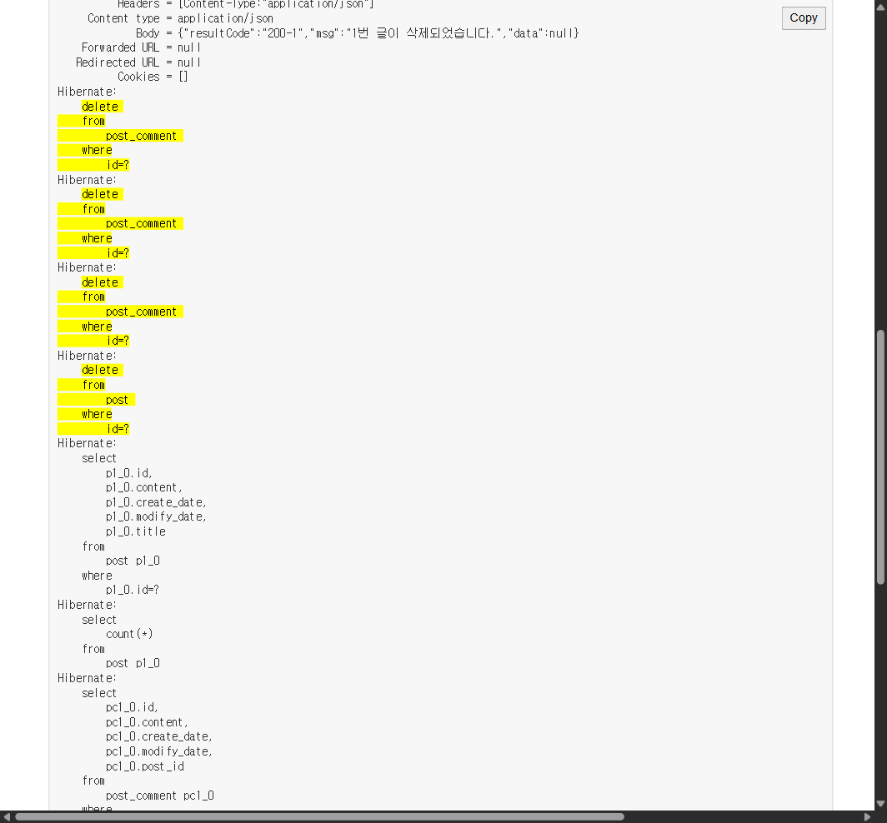

### 테스트

| 테스트 | 검증 내용 |
|---|---|
| `ApiV1PostControllerTest.t5` | `DELETE /posts/1` → 200, `200-1`, `1번 글이 삭제되었습니다.` / DB: 1번 글 없음, 글 2개, 댓글 1·2·3 없음, 댓글 4 있음 |
| `ApiV1PostControllerTest.t6` | `DELETE /posts/1000` → 404 / 글 3개 그대로 |

### 결과 스크린샷

전체 결과 — 20건 실행, 실패 0, 성공률 100%

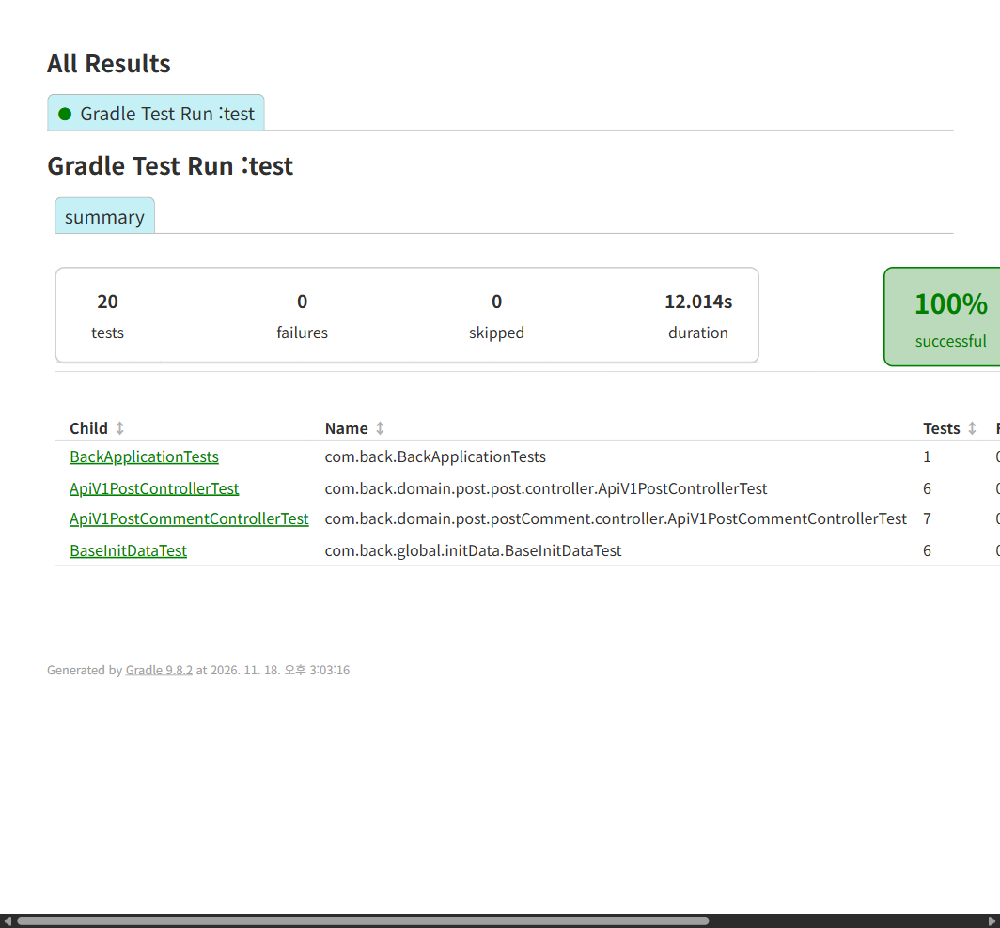

---

## 010 - 글 작성 `POST /api/v1/posts` + 입력값 검증 (강의 22~27강, 33강, 38강, 50~52강)

### 작업 내용

| 파일 | 변경 | 역할 |
|---|---|---|
| `build.gradle.kts` | 수정 | `spring-boot-starter-validation` 추가 (`@Valid`, `@NotBlank`, `@Size`) |
| `ApiV1PostController.java` | 수정 | `PostWriteReqBody`(요청 본문 record + 검증 규칙), `write()` 추가 |
| `GlobalExceptionHandler.java` | 수정 | 검증 실패(`MethodArgumentNotValidException`), JSON 오류(`HttpMessageNotReadableException`) → 400 |
| `PostRepository.java`, `PostService.java` | 수정 | `findFirstByOrderByIdDesc()`, `findLatest()`: 가장 최근 글 (테스트에서 사용) |
| `ApiV1PostControllerTest.java` | 수정 | 작성 성공(`t7`), 빈 제목 400(`t8`), JSON 문법 오류 400(`t9`) |

### 봐야 할 부분 (읽는 순서)

1. **[`ApiV1PostControllerTest.java`](src/test/java/com/back/domain/post/post/controller/ApiV1PostControllerTest.java) `t7`** — 처음으로 **요청 본문**을 보낸다: `.contentType(MediaType.APPLICATION_JSON)` + `.content("""{...}""")`. 응답은 `$.data.id` 처럼 `RsData` 안의 `data` 를 한 단계 더 들어가서 읽는다.
2. **같은 파일 `t8`, `t9`** — 실패 2가지: "JSON 은 읽혔지만 규칙 위반"(`t8`) vs "JSON 자체를 읽을 수 없음"(`t9`).
3. **[`ApiV1PostController.java`](src/main/java/com/back/domain/post/post/controller/ApiV1PostController.java) `PostWriteReqBody` + `write()`** — 메서드 안에 검증 코드(`if (title == null ...)`)가 **없다**. 규칙은 어노테이션으로 선언만 하고, 검사는 `@Valid` 가 한다.
4. **[`GlobalExceptionHandler.java`](src/main/java/com/back/global/globalExceptionHandler/GlobalExceptionHandler.java)** — 새로 추가된 두 `@ExceptionHandler`. 006 의 404 처리와 같은 구조다.

### 핵심 포인트

- **`@RequestBody`**: 요청 본문의 JSON 을 자바 객체(`PostWriteReqBody`)로 바꾼다. 이름이 같은 칸끼리 짝지어 넣는다(`"title"` → `title`).
- **요청이 메서드에 도착하기까지 3단계**:

  | 단계 | 실패하면 | 처리 |
  |---|---|---|
  | ① JSON → `PostWriteReqBody` 변환 (`@RequestBody`) | `HttpMessageNotReadableException` | 400 `요청 본문이 올바르지 않습니다.` (`t9`) |
  | ② 규칙 검사 (`@Valid` + `@NotBlank`, `@Size`) | `MethodArgumentNotValidException` | 400 `title-NotBlank-...` (`t8`) |
  | ③ `write()` 실행 | — | 200 `201-1` (`t7`) |

  ①②에서 실패하면 `write()` 는 **아예 실행되지 않는다**. 그래서 메서드 안에는 "규칙을 통과한 입력"만 들어온다.
- **`@NotBlank` vs `@Size`**: `""` 는 두 규칙을 동시에 어긴다(공백 불가 + 2자 미만). 그래서 `t8` 의 `msg` 가 두 줄이다. 줄을 **정렬**해서 이어 붙이기 때문에 메시지가 항상 같은 순서로 나온다.
- **검증 메시지가 영어인 이유**: 기본 메시지는 요청의 언어 설정을 따른다. MockMvc 요청은 기본이 영어라 `must not be blank` 로 나온다(강의와 같음). 한국어 브라우저에서 보내면 `공백일 수 없습니다` 처럼 바뀔 수 있다.
- **`RsData<PostDto>`**: 작성 성공 응답의 `data` 에 방금 만든 글을 담는다. 프론트는 다시 조회하지 않아도 새 글 번호(`data.id`)를 바로 쓸 수 있다.
- **아직 HTTP 는 200**: `resultCode` 를 `201-1` 로 적어도 HTTP 상태코드는 저절로 201 이 되지 않는다(강의 27강). `t7` 은 지금 `isOk()` 로 검사하고, **011 의 `ResponseAspect`** 에서 이 줄을 `isCreated()` 로 바꾸며 해결한다.
- **DTO 이름 `ReqBody`**: 화면의 "폼"이 아니라 HTTP 요청 본문을 받는 상자라서 `PostWriteForm` 보다 `PostWriteReqBody` 가 정확하다(강의 24강).

### TDD 과정

**RED** — `t7` ~ `t9` 먼저 작성 (테스트가 쓸 `findLatest()` 만 먼저 추가). `write` 가 없어서 3건 실패.

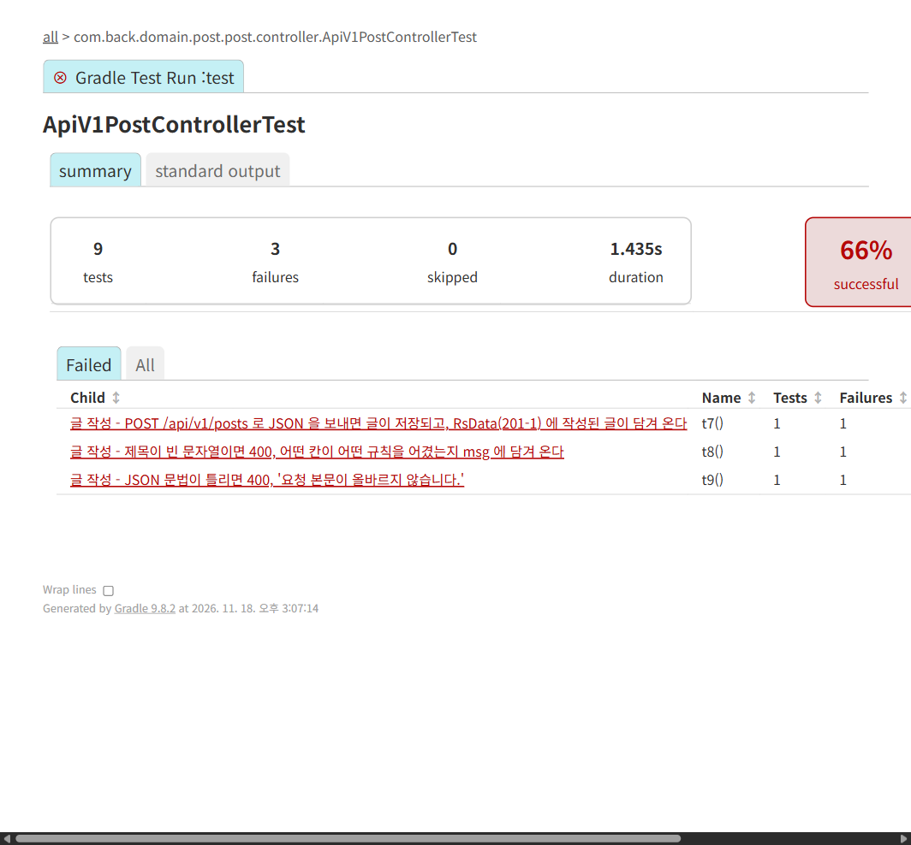

**GREEN** — validation 의존성, `PostWriteReqBody`, `write()`, 예외 처리기 2개 추가 후 통과.

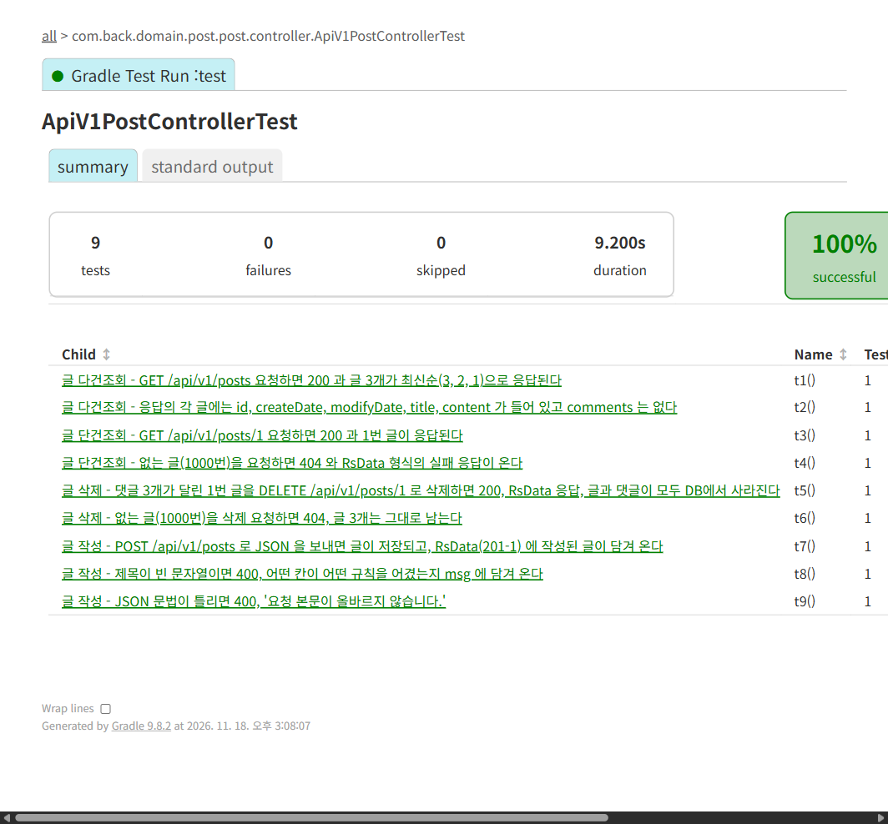

`t7` 테스트 출력: POST 요청 본문 → 응답 `201-1` + `data` 에 4번 글 (HTTP Status 는 아직 200)

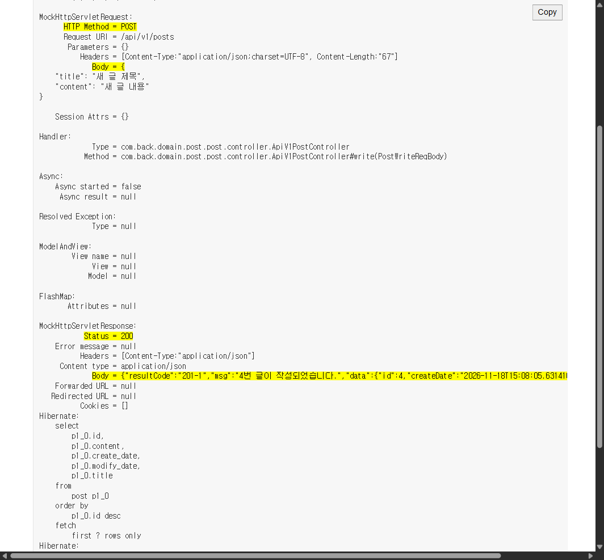

`t8` 테스트 출력: 빈 제목 → `MethodArgumentNotValidException` → 400, 규칙 위반 2줄

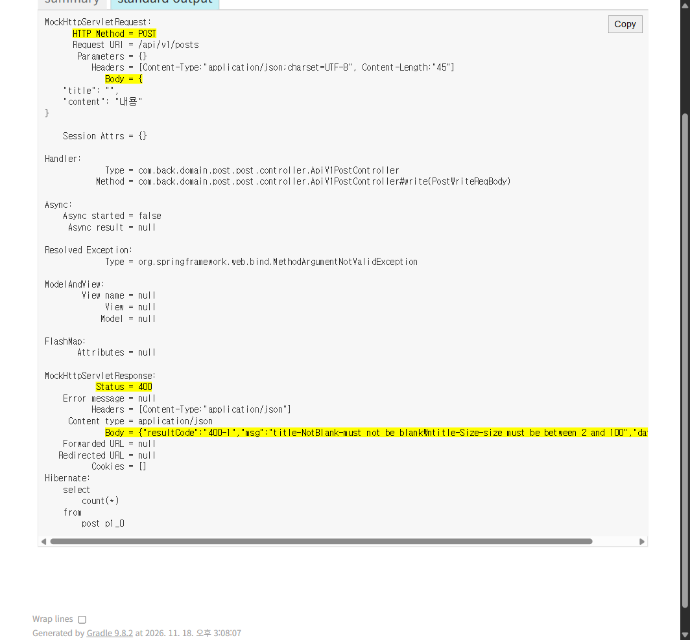

### 테스트

| 테스트 | 검증 내용 |
|---|---|
| `ApiV1PostControllerTest.t7` | `POST /posts` `{"title":"새 글 제목","content":"새 글 내용"}` → `201-1`, `n번 글이 작성되었습니다.`, `data` 의 모든 필드 / DB 글 4개 |
| `ApiV1PostControllerTest.t8` | `{"title":"","content":"내용"}` → 400, `400-1`, `title-NotBlank-...` + `title-Size-...` 두 줄 / DB 글 3개 그대로 |
| `ApiV1PostControllerTest.t9` | 문법이 틀린 JSON → 400, `400-1`, `요청 본문이 올바르지 않습니다.` |

### 결과 스크린샷

전체 결과 — 23건 실행, 실패 0, 성공률 100%


---

## 011 - `ResponseAspect`: `RsData` 의 `resultCode` 로 HTTP 상태코드 자동 설정 (강의 26~28강, 37강)

### 왜 필요한가
010 의 글 작성은 `resultCode` 가 `"201-1"` 인데 HTTP 상태코드는 **200** 이었다. 메서드가 객체만 돌려주면 스프링은 항상 200 으로 응답하기 때문이다(강의 27강).
`ResponseEntity.status(201).body(...)` 로 메서드마다 직접 정할 수도 있지만, 반환 타입이 바뀌고 코드가 길어진다(강의 28강: "가성비가 나쁘다").
그래서 **"RsData 를 돌려주는 모든 컨트롤러 메서드"를 감싸서, 끝난 뒤 상태코드를 맞춰 주는 Aspect** 를 한 번만 만든다.

### 작업 내용

| 파일 | 변경 | 역할 |
|---|---|---|
| `global/aspect/ResponseAspect.java` | 추가 | `@Aspect` + `@Around`: RsData 를 돌려주는 액션 메서드 실행 후 `response.setStatus(rsData.statusCode())` |
| `ApiV1PostControllerTest.java` | 수정 | `t7` 의 `status().isOk()` → `status().isCreated()` (**테스트 먼저**) |

> 의존성 추가 없음: AspectJ(`aspectjweaver`)는 `spring-boot-starter-data-jpa` 가 이미 가져온다 (`./gradlew dependencies` 로 확인, 강의 저장소도 동일).

### 봐야 할 부분 (읽는 순서)

1. **[`ApiV1PostControllerTest.java`](src/test/java/com/back/domain/post/post/controller/ApiV1PostControllerTest.java) `t7`** — 바뀐 것은 `isCreated()` 한 줄. 요구사항("작성 성공은 HTTP 201")을 테스트에 먼저 반영했다.
2. **[`ResponseAspect.java`](src/main/java/com/back/global/aspect/ResponseAspect.java)** — `@Around` 의 포인트컷(어디에 끼어들지)과 `handleResponse()` 의 3줄(① 원래 메서드 실행 ② 상태코드 설정 ③ 결과 그대로 반환).
3. **[`ApiV1PostController.java`](src/main/java/com/back/domain/post/post/controller/ApiV1PostController.java) `write()`** — **한 글자도 바뀌지 않았다.** 그런데 응답이 201 이 된다. 이것이 AOP.

### 핵심 포인트

- **AOP(관점 지향 프로그래밍)**: "여러 메서드에 공통으로 필요한 일"을 한곳에 모으고, "어디에 적용할지"만 선언한다. 스프링이 대상 메서드를 **대리 객체(프록시)로 감싸서** 앞뒤에 그 일을 끼워 넣는다. (003 의 `self.work1()` 에서 본 그 프록시)
- **`@Around`**: 대상 메서드의 **실행 전체를 감싼다**. `joinPoint.proceed()` 가 원래 메서드를 실행하는 줄이고, 그 앞뒤에 원하는 일을 넣는다.
- **포인트컷 3조건** (모두 만족해야 끼어든다):

  | 조건 | 뜻 | 걸러지는 예 |
  |---|---|---|
  | `execution(public ...RsData *(..))` | `RsData` 를 돌려주는 메서드 | `getItems()`(List), `getItem()`(DTO) 은 제외 |
  | `within(@Controller *) \|\| within(@RestController *)` | 컨트롤러 클래스 안 | 서비스·리포지터리 메서드는 제외 |
  | `@annotation(GetMapping) \|\| ...` | 요청을 받는 액션 메서드 | 컨트롤러 안의 일반 메서드는 제외 |

- **지금 적용되는 메서드**: 글 `write`(201-1 → 201), 글 `deleteItem`(200-1 → 200), 댓글 `deleteItem`(200-1 → 200). 앞으로 만들 수정·댓글 작성도 `RsData` 만 돌려주면 **자동으로** 적용된다.
- **실패 응답은 여기를 안 거친다**: 404, 400 은 예외로 끝나서 `proceed()` 다음 줄이 실행되지 않는다. 그 상태코드는 `GlobalExceptionHandler` 의 `ResponseEntity` 가 정한다(006, 010). (강의 49강에는 Aspect 를 예외 처리기에까지 넓히는 실험이 있지만, 여기서는 강의 본편대로 두었다)
- **처음에 물어본 "Aspect 로 예외 관리"와의 차이**: 이 Aspect 는 **성공 응답의 상태코드**를 맞추는 역할이다. 예외는 여전히 `@RestControllerAdvice` 가 맡는다. 둘 다 "컨트롤러 밖에서 공통 처리"라는 점은 같다.

### TDD 과정

**RED** — `t7` 을 `isCreated()` 로 먼저 바꾸고 실행. `Status expected:<201> but was:<200>`

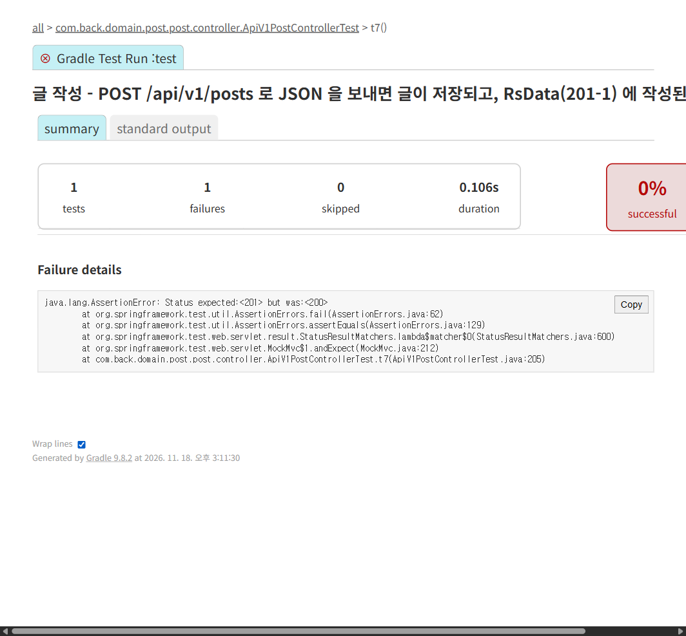

**GREEN** — `ResponseAspect` 추가 후 통과. 컨트롤러 코드는 그대로.

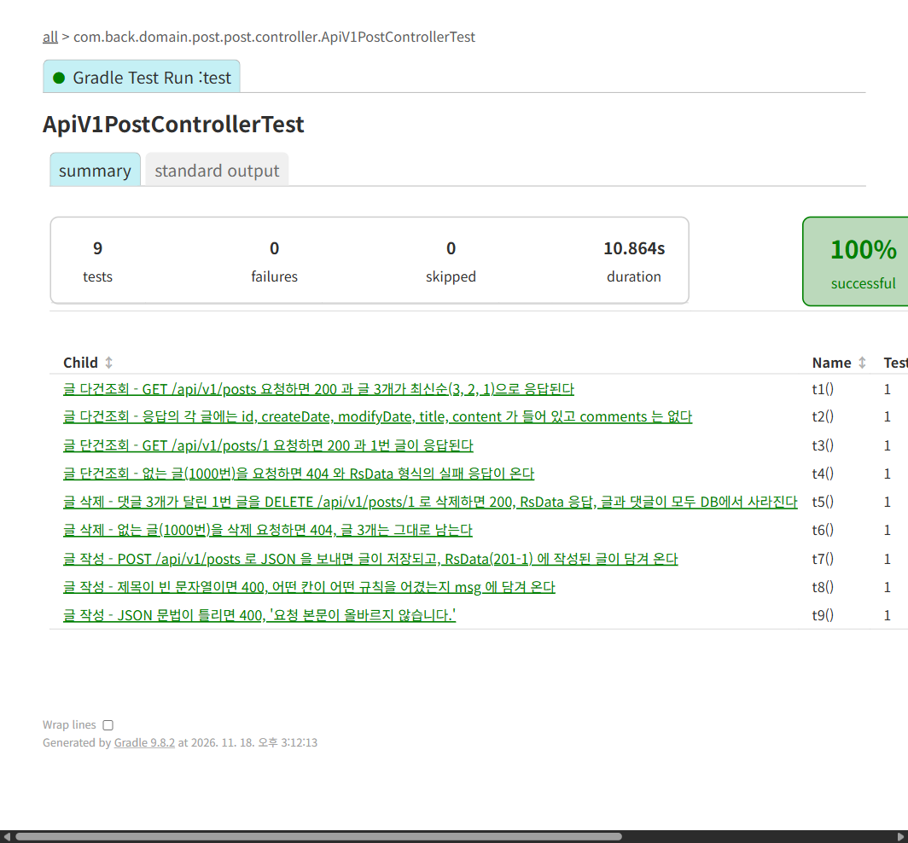

`t7` 테스트 출력: 같은 요청인데 이제 `Status = 201`

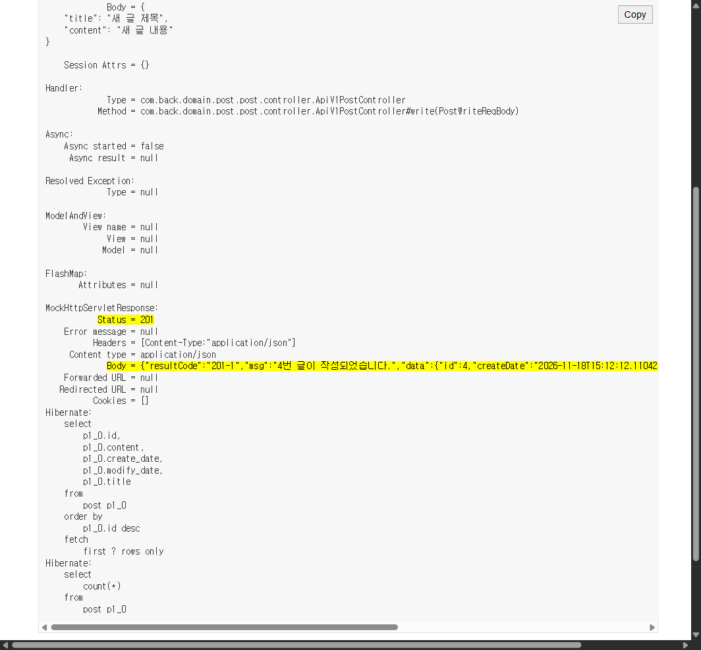

### 테스트

| 테스트 | 검증 내용 |
|---|---|
| `ApiV1PostControllerTest.t7` (수정) | 글 작성 → **HTTP 201**, `201-1`, 작성된 글 |
| 기존 삭제 테스트들 (`t5`, `t6`, 댓글 `t6`, `t7`) | Aspect 가 끼어든 뒤에도 200 / 404 그대로 → 다른 기능에 영향 없음 (강의 37강: 테스트가 안전망) |

### 결과 스크린샷

전체 결과 — 23건 실행, 실패 0, 성공률 100%


---

## 012 - 글 수정 `PUT /api/v1/posts/{id}` (강의 31강, 36강, 41강)

### 작업 내용

| 파일 | 변경 | 역할 |
|---|---|---|
| `ApiV1PostController.java` | 수정 | `PostModifyReqBody`(요청 본문 + 검증 규칙), `modify()` 추가: `@PutMapping("/{id}")` |
| `PostService.java` | 수정 | `modify(post, title, content)` → `post.modify(...)` |
| `Post.java` | 수정 | `modify(title, content)`: 필드 값만 바꾼다 |
| `ApiV1PostControllerTest.java` | 수정 | 수정 성공(`t10`), 없는 글 404(`t11`), 내용 1글자 400(`t12`) |

### 봐야 할 부분 (읽는 순서)

1. **[`ApiV1PostControllerTest.java`](src/test/java/com/back/domain/post/post/controller/ApiV1PostControllerTest.java) `t10`** — 요청 **전**의 작성일·수정일을 먼저 저장해 두고, 요청 **후** DB를 다시 읽어 비교한다: 제목·내용은 바뀌고, 작성일은 그대로, 수정일은 더 나중.
2. **[`ApiV1PostController.java`](src/main/java/com/back/domain/post/post/controller/ApiV1PostController.java) `modify()`** — 지금까지 만든 것들이 모두 모여 있다: `@RequestBody @Valid`(010), `.get()`(006), `RsData` + `ResponseAspect`(011). 새로운 것은 `@PutMapping` 하나.
3. **[`Post.java`](src/main/java/com/back/domain/post/post/entity/Post.java) `modify()`** — 대입 두 줄뿐. `save()` 가 어디에도 없다.

### 핵심 포인트

- **`@PutMapping`**: "이 주소의 자원을 보낸 내용으로 바꿔라". 같은 `/api/v1/posts/1` 이라도 GET 조회 / PUT 수정 / DELETE 삭제로 나뉜다. 이제 글 API 의 HTTP 방식 4가지가 모두 나왔다.

  | 방식 | 주소 | 기능 | 커밋 |
  |---|---|---|---|
  | GET | `/api/v1/posts`, `/api/v1/posts/{id}` | 조회 | 004, 005 |
  | POST | `/api/v1/posts` | 작성 | 010 |
  | PUT | `/api/v1/posts/{id}` | 수정 | 012 |
  | DELETE | `/api/v1/posts/{id}` | 삭제 | 009 |

- **더티체킹으로 UPDATE**: `@Transactional` 안에서 엔티티를 꺼내 값을 바꾸면, 트랜잭션이 끝날 때 JPA가 "처음 꺼냈을 때의 모습"과 비교해 달라졌으면 `UPDATE` 를 만든다. 그래서 `save()` 를 부르지 않는다.

  | 커밋 | 엔티티에 한 일 | JPA가 만든 SQL |
  |---|---|---|
  | 003 | 글의 댓글 목록에 **넣기** | `INSERT` (cascade PERSIST) |
  | 008 | 글의 댓글 목록에서 **빼기** | `DELETE` (orphanRemoval) |
  | 012 | 글의 제목·내용 **바꾸기** | `UPDATE` (더티체킹) |

- **수정일 자동 갱신**: `BaseEntity.modifyDate` 의 `@LastModifiedDate` 가 UPDATE 직전에 지금 시각을 넣는다(002 에서 만든 것). 컨트롤러·서비스는 날짜를 전혀 신경 쓰지 않는다.
- **UPDATE 에 모든 칸이 들어가는 이유**: 캡처의 SQL 은 `content, create_date, modify_date, title` 을 모두 설정한다. Hibernate 는 기본적으로 "바뀐 칸만"이 아니라 "모든 칸"으로 UPDATE 문을 미리 만들어 두고 재사용한다(바뀐 칸만 쓰게 하는 `@DynamicUpdate` 도 있지만 여기서는 기본값 사용).
- **`PostModifyReqBody` 를 작성용과 따로 둔 이유**: 지금은 규칙이 같지만, "수정할 때만 다른 규칙"이 생길 때 서로 영향을 주지 않는다(강의와 동일).
- **실패 처리 코드 0줄**: `t11`(404), `t12`(400) 은 006 · 010 에서 만든 예외 처리기가 그대로 처리한다. 새 기능을 추가할수록 공통 처리의 이득이 커진다.

### TDD 과정

**RED** — `t10` ~ `t12` 먼저 작성. `modify` 가 없어서 3건 실패.

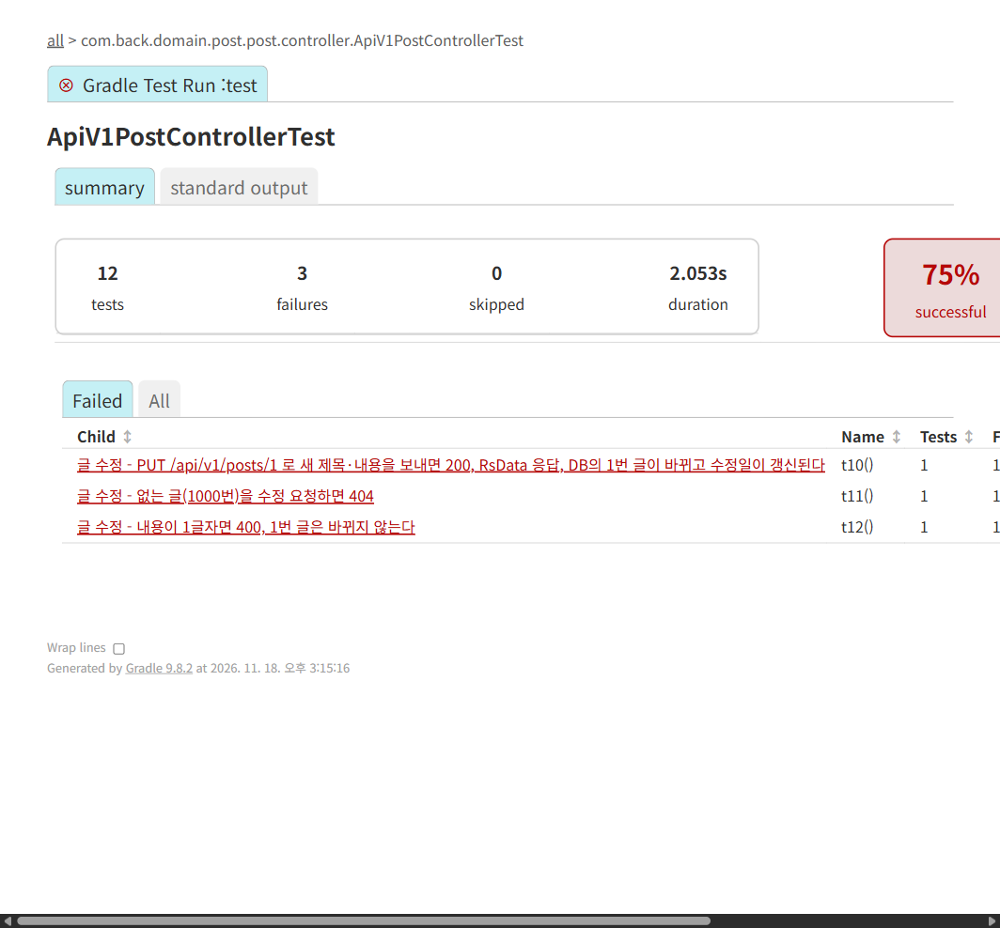

**GREEN** — `Post.modify()`, `PostService.modify()`, `PostModifyReqBody`, `modify()` 구현 후 통과.

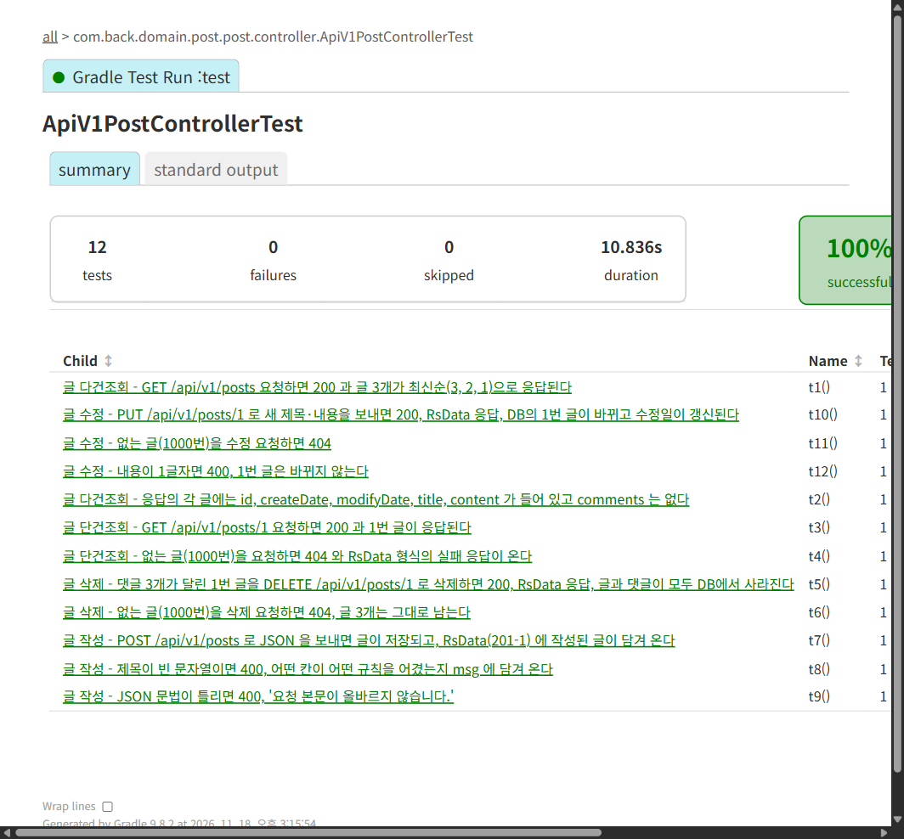

`t10` 테스트 출력: 응답 `200-1` 다음에, `save()` 없이 JPA가 만든 `update post set ... where id=?` (노란색)

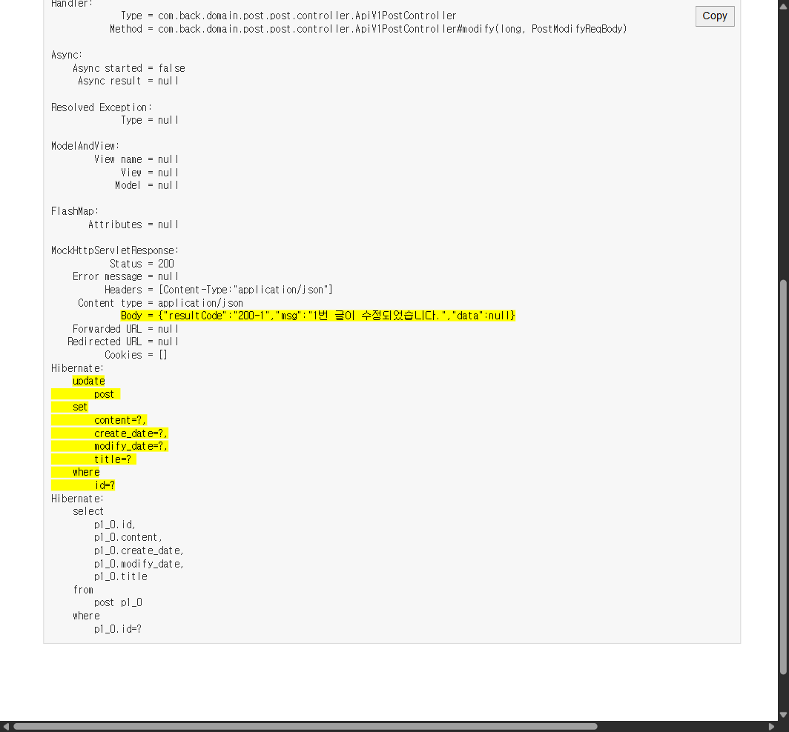

### 테스트

| 테스트 | 검증 내용 |
|---|---|
| `ApiV1PostControllerTest.t10` | `PUT /posts/1` → 200, `200-1`, `1번 글이 수정되었습니다.` / DB: 제목·내용 변경, 작성일 그대로, 수정일 갱신 |
| `ApiV1PostControllerTest.t11` | `PUT /posts/1000` → 404 |
| `ApiV1PostControllerTest.t12` | 내용 `"내"`(1글자) → 400, `content-Size-size must be between 2 and 5000` / DB: 1번 글 제목 그대로 |

### 결과 스크린샷

전체 결과 — 26건 실행, 실패 0, 성공률 100%


> PUT 요청도 브라우저 주소창으로 보낼 수 없어서, 위의 테스트 출력(응답 본문 + UPDATE SQL) 캡처로 확인했다.

---

## 013 - 댓글 수정 `PUT /api/v1/posts/{postId}/comments/{id}` (강의 32강, 55강)

### 작업 내용

| 파일 | 변경 | 역할 |
|---|---|---|
| `ApiV1PostCommentController.java` | 수정 | `PostCommentModifyReqBody`(내용 2 ~ 1000자), `modify()` 추가: `@PutMapping("/{id}")` |
| `PostService.java` | 수정 | `modifyComment(postComment, content)` |
| `PostComment.java` | 수정 | `modify(content)`: 내용만 바꾼다 |
| `ApiV1PostCommentControllerTest.java` | 수정 | 수정 성공(`t8`), 다른 글의 댓글 404(`t9`), 공백 내용 400(`t10`) |

### 봐야 할 부분 (읽는 순서)

1. **[`ApiV1PostCommentControllerTest.java`](src/test/java/com/back/domain/post/postComment/controller/ApiV1PostCommentControllerTest.java) `t8` ~ `t10`** — 012 의 글 수정 테스트와 나란히 놓고 보면 구조가 같다. 다른 점은 `t9` 의 "다른 글의 댓글"(007, 008 에 이어 세 번째).
2. **[`ApiV1PostCommentController.java`](src/main/java/com/back/domain/post/postComment/controller/ApiV1PostCommentController.java) `modify()`** — 012 의 글 `modify()` + 007 의 `post.findCommentById(id).get()`.
3. **[`PostComment.java`](src/main/java/com/back/domain/post/postComment/entity/PostComment.java) `modify()`** — 대입 한 줄. `PostComment` 도 `BaseEntity` 를 상속했으니 수정일이 자동으로 바뀐다.

### 핵심 포인트

- **새로운 개념은 없다**: 012(PUT + 더티체킹) + 007(그 글의 댓글만 찾기) + 010(`@Valid` 400) + 006(`.get()` 404) + 011(`ResponseAspect` 200)의 조합이다. 지금까지 만든 공통 장치 덕분에 컨트롤러 메서드는 **찾기 → 바꾸기 → 결과 알리기** 세 단계만 남았다.
- **`"   "` 은 왜 `NotBlank` 만 걸리나**: 공백 3개는 길이가 3이라 `@Size(min = 2)` 는 통과하고, "공백만 있음"이라 `@NotBlank` 만 어긴다. (010 의 `""` 는 길이 0이라 두 규칙을 모두 어겼다)
- **댓글 UPDATE 에도 `post_id` 가 들어간다**: 캡처의 `update post_comment set content=?, create_date=?, modify_date=?, post_id=? where id=?` — 012 에서 본 것처럼 Hibernate 는 기본적으로 모든 칸을 SET 한다. 값은 그대로라 소속 글이 바뀌지는 않는다.
- **댓글 서비스가 따로 없는 이유**: 댓글은 언제나 글을 거쳐 찾고(`post.findCommentById`) 다루므로, 지금 규모에서는 `PostService` 하나로 충분하다(007 과 같은 판단).

### TDD 과정

**RED** — `t8` ~ `t10` 먼저 작성. `modify` 가 없어서 3건 실패.

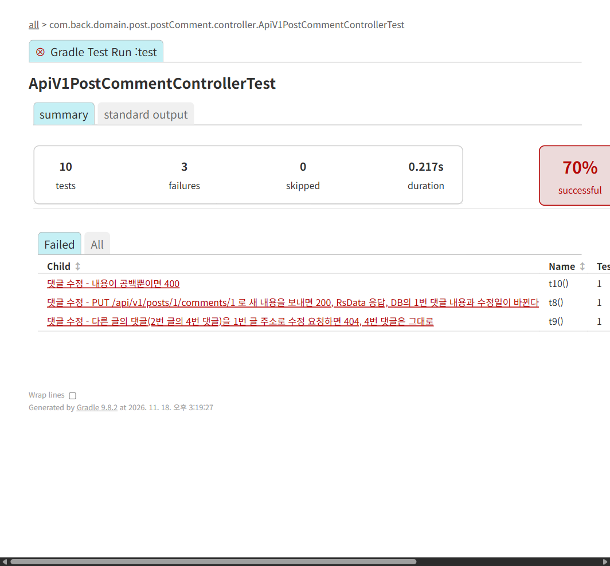

**GREEN** — `PostComment.modify()`, `PostService.modifyComment()`, `PostCommentModifyReqBody`, `modify()` 구현 후 통과.

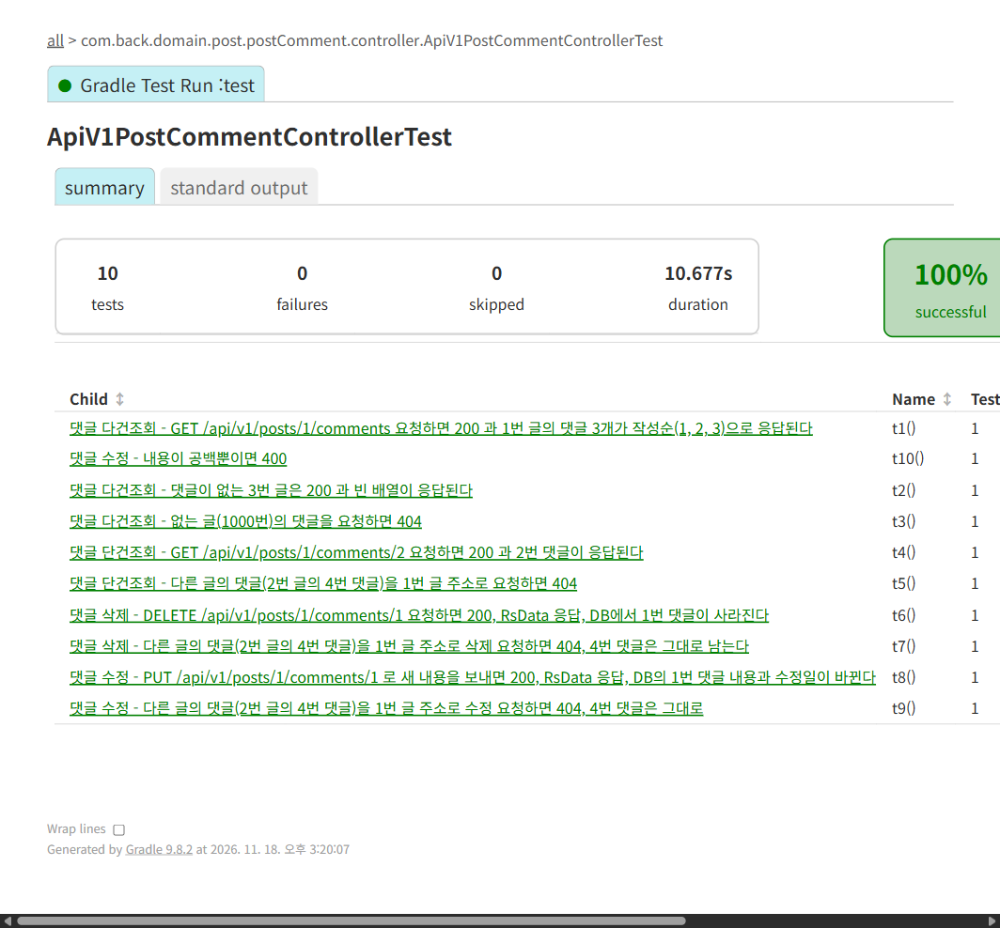

`t8` 테스트 출력: 응답 `200-1` 다음에 `update post_comment set ... where id=?` (노란색)

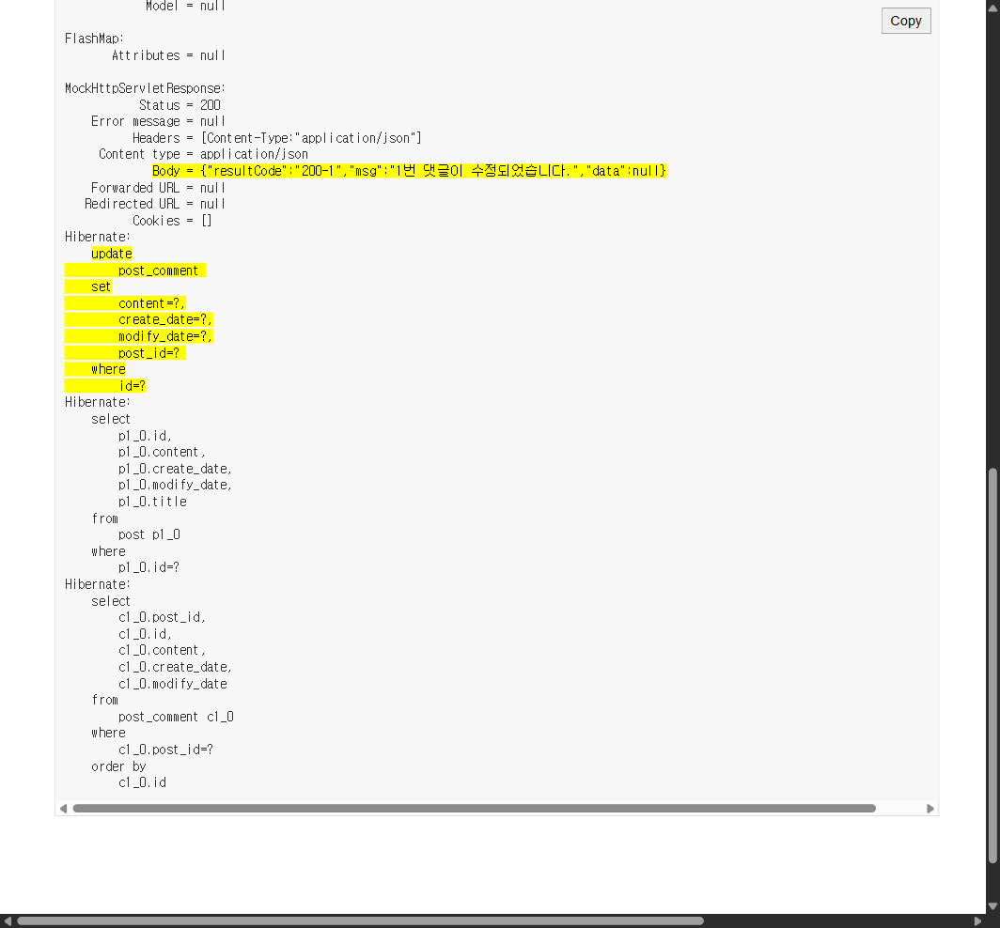

### 테스트

| 테스트 | 검증 내용 |
|---|---|
| `ApiV1PostCommentControllerTest.t8` | `PUT /posts/1/comments/1` `{"content":"댓글 수정"}` → 200, `200-1`, `1번 댓글이 수정되었습니다.` / DB: 내용 변경, 작성일 그대로, 수정일 갱신 |
| `ApiV1PostCommentControllerTest.t9` | `PUT /posts/1/comments/4` → 404 / DB: 4번 댓글 `댓글 2-1` 그대로 |
| `ApiV1PostCommentControllerTest.t10` | `{"content":"   "}` → 400, `content-NotBlank-must not be blank` |

### 결과 스크린샷

전체 결과 — 29건 실행, 실패 0, 성공률 100%


---

## 014 - 댓글 작성 `POST /api/v1/posts/{postId}/comments` (강의 56강)

### 작업 내용

| 파일 | 변경 | 역할 |
|---|---|---|
| `ApiV1PostCommentController.java` | 수정 | `PostCommentWriteReqBody`(내용 2 ~ 1000자), `write()` 추가: `@PostMapping` |
| `PostService.java` | 수정 | `writeComment(post, content)`: `post.addComment()` + **`postRepository.flush()`** |
| `ApiV1PostCommentControllerTest.java` | 수정 | 작성 성공(`t11`), 없는 글 404(`t12`), 내용 1글자 400(`t13`) |

### 봐야 할 부분 (읽는 순서)

1. **[`ApiV1PostCommentControllerTest.java`](src/test/java/com/back/domain/post/postComment/controller/ApiV1PostCommentControllerTest.java) `t11`** — 응답의 `msg` 와 `data.id` 를 **DB에 실제로 저장된 댓글 번호**와 비교한다. 이 검사 덕분에 아래 함정을 잡았다.
2. **[`PostService.java`](src/main/java/com/back/domain/post/post/service/PostService.java) `writeComment()`** — `postRepository.flush()` 한 줄이 왜 필요한지(주석).
3. **[`ApiV1PostCommentController.java`](src/main/java/com/back/domain/post/postComment/controller/ApiV1PostCommentController.java) `write()`** — 010 글 작성과 같은 모양. 다른 점은 `save()` 대신 `post.addComment()`(003 방식).

### 핵심 포인트

- **댓글은 `save()` 없이 저장된다**: `post.addComment()` 로 글의 댓글 목록에 넣으면 `cascade = PERSIST` 로 트랜잭션 끝에 `INSERT` 된다(003 샘플 댓글과 같은 방식).
- **문제: INSERT 가 "나중에" 일어난다**: 트랜잭션이 끝나는 시점은 `write()` 가 응답(`RsData`)을 **다 만든 뒤**다. 그래서 응답을 만들 때 댓글은 아직 DB에 없고, 번호(`id`)·작성일·수정일이 모두 `null` 이다.
- **해결: `flush()`**: "모아 둔 SQL 을 지금 DB로 보내라". `addComment()` 바로 뒤에 부르면 그 자리에서 `INSERT` 가 실행되고, DB가 매긴 번호가 객체에 채워진다. 트랜잭션은 끝나지 않으므로 이후에 문제가 생기면 여전히 롤백된다.
- **글 작성(010)은 왜 괜찮았나**: `postRepository.save(post)` 는 `IDENTITY` 방식(번호를 DB가 매김)이라 번호를 알기 위해 **즉시** `INSERT` 한다. 댓글은 `save()` 를 부르지 않으니 그런 일이 없다.

  | | 저장 방법 | INSERT 시점 | 응답 만들 때 id |
  |---|---|---|---|
  | 글 작성 (010) | `postRepository.save(post)` | `save()` 즉시 | 있음 |
  | 댓글 작성, flush 없음 | `post.addComment()` | 트랜잭션 끝 (응답 이후) | **`null`** |
  | 댓글 작성, flush 있음 (014) | `post.addComment()` + `flush()` | `flush()` 즉시 | 있음 |

### 함정: `flush()` 가 없으면 "null번 댓글이 작성되었습니다."

처음에는 `addComment()` 만 하고 바로 응답했다(강의 056-2 커밋과 같은 상태). 404·400 테스트는 통과했지만 `t11` 이 실패했다:
`JSON path "$.msg" expected:<6번 댓글이 작성되었습니다.> but was:<null번 댓글이 작성되었습니다.>`

응답 본문: `{"resultCode":"201-1","msg":"null번 댓글이 작성되었습니다.","data":{"id":null,"createDate":null,"modifyDate":null,"postId":1,"content":"새 댓글"}}`

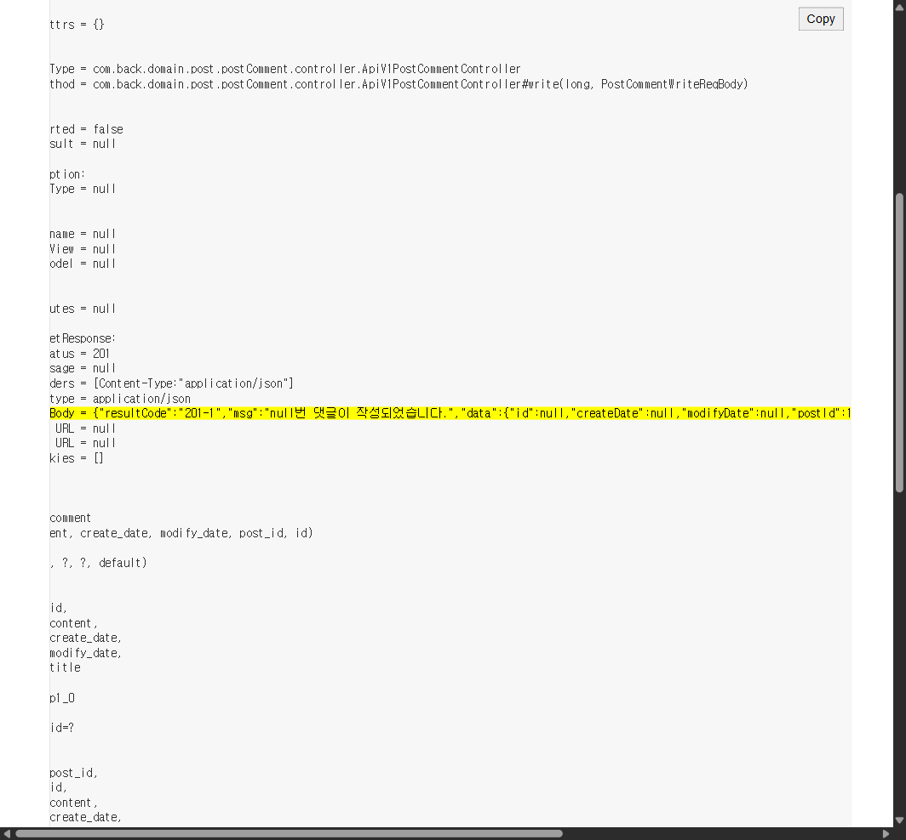

`flush()` 추가 후: 요청 처리 중에 `insert into post_comment ...` 가 먼저 실행되고, 응답에 `6번 댓글`, `"id":6` 이 담긴다 (노란색)

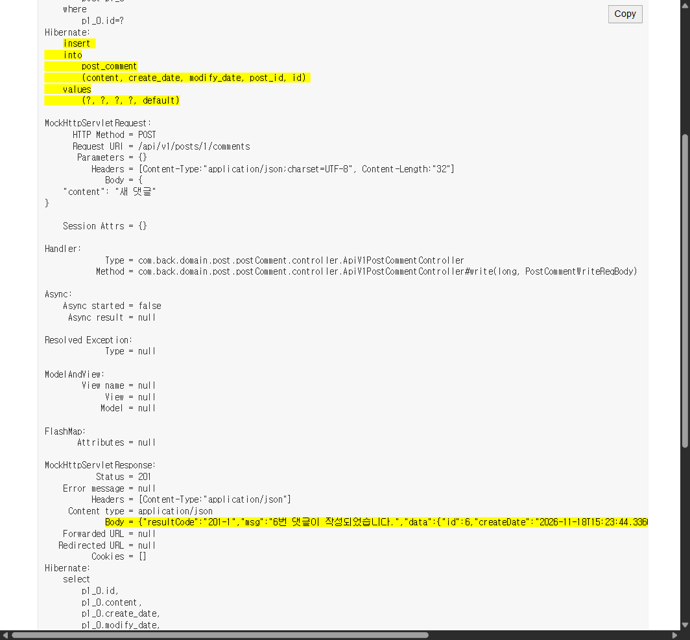

### TDD 과정

**RED** — `t11` ~ `t13` 먼저 작성. `write` 가 없어서 3건 실패.

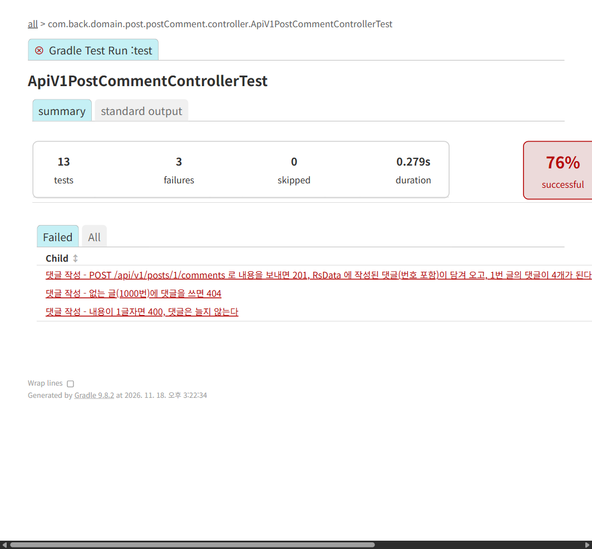

**함정** — `addComment()` 만으로 구현 → `t11` 실패 (번호가 `null`).

**GREEN** — `postRepository.flush()` 추가 후 통과.

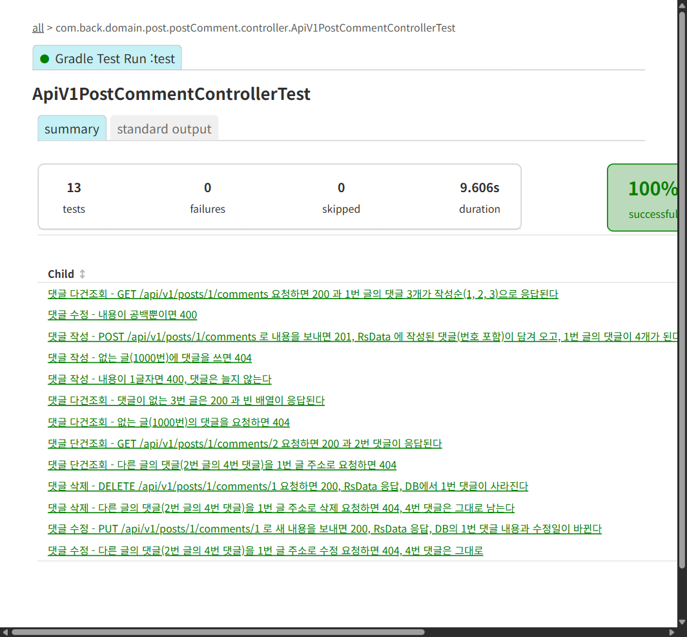

### 테스트

| 테스트 | 검증 내용 |
|---|---|
| `ApiV1PostCommentControllerTest.t11` | `POST /posts/1/comments` `{"content":"새 댓글"}` → **201**, `201-1`, `n번 댓글이 작성되었습니다.`(n = DB에 저장된 번호), `data` 의 모든 필드 / DB: 1번 글 댓글 4개 |
| `ApiV1PostCommentControllerTest.t12` | `POST /posts/1000/comments` → 404 |
| `ApiV1PostCommentControllerTest.t13` | `{"content":"새"}` → 400, `content-Size-size must be between 2 and 1000` / DB: 댓글 3개 그대로 |

---

## 최종 결과

**전체 테스트 32건, 모두 통과.** 글·댓글 각각 다건조회·단건조회·작성·수정·삭제 API 10개 완성.


### 완성된 API

| 메서드 | URL | 기능 | 성공 | 실패 | 태그 |
|---|---|---|---|---|---|
| GET | `/api/v1/posts` | 글 다건조회 (최신순) | 200, 글 배열 | — | `004` |
| GET | `/api/v1/posts/{id}` | 글 단건조회 | 200, 글 | 404 | `005`, `006` |
| POST | `/api/v1/posts` | 글 작성 | 201, `RsData<PostDto>` | 400 | `010`, `011` |
| PUT | `/api/v1/posts/{id}` | 글 수정 | 200, `RsData` | 400, 404 | `012` |
| DELETE | `/api/v1/posts/{id}` | 글 삭제 (댓글도 함께) | 200, `RsData` | 404 | `009` |
| GET | `/api/v1/posts/{postId}/comments` | 댓글 다건조회 (작성순) | 200, 댓글 배열 | 404 | `007` |
| GET | `/api/v1/posts/{postId}/comments/{id}` | 댓글 단건조회 | 200, 댓글 | 404 | `007` |
| POST | `/api/v1/posts/{postId}/comments` | 댓글 작성 | 201, `RsData<PostCommentDto>` | 400, 404 | `014` |
| PUT | `/api/v1/posts/{postId}/comments/{id}` | 댓글 수정 | 200, `RsData` | 400, 404 | `013` |
| DELETE | `/api/v1/posts/{postId}/comments/{id}` | 댓글 삭제 | 200, `RsData` | 404 | `008` |

### 테스트 구성

| 테스트 클래스 | 건수 | 다루는 것 |
|---|---|---|
| `BackApplicationTests` | 1 | 앱 실행 |
| `BaseInitDataTest` | 6 | 샘플 글 3개, 댓글 5개 |
| `ApiV1PostControllerTest` | 12 | 글 API 5개 (성공 + 404·400) |
| `ApiV1PostCommentControllerTest` | 13 | 댓글 API 5개 (성공 + 404·400·다른 글의 댓글) |

### 공통 장치 — 컨트롤러가 짧은 이유

| 장치 | 하는 일 | 처음 만든 커밋 |
|---|---|---|
| `PostDto`, `PostCommentDto` | 엔티티 대신 보여 줄 칸만 응답 (순환참조 방지) | `004`, `007` |
| `RsData` | 조회 외 응답을 `resultCode` / `msg` / `data` 로 통일 | `005` |
| `GlobalExceptionHandler` | `NoSuchElementException` → 404, 검증 실패·JSON 오류 → 400 | `005`, `006`, `010` |
| `ResponseAspect` | `RsData` 의 `resultCode` 앞 숫자로 HTTP 상태코드 설정 | `011` |
| `@Valid` + `@NotBlank` / `@Size` | 입력값 규칙을 선언만 하면 검사 | `010` |

덕분에 모든 컨트롤러 메서드는 **찾기(`.get()`) → 처리 → 결과 알리기(`RsData`)** 만 남았고, 실패 처리 코드가 한 줄도 없다.

### JPA 가 대신 만든 SQL — `save()` / `delete()` 없이

| 커밋 | 코드 | SQL | 이유 |
|---|---|---|---|
| `003`, `014` | `post.addComment()` | `INSERT` | `cascade = PERSIST` (+ `flush()` 로 즉시) |
| `008` | `post.deleteComment()` | `DELETE` | `orphanRemoval = true` |
| `009` | `postRepository.delete(post)` | 댓글 `DELETE` → 글 `DELETE` | `orphanRemoval` 이 부모 삭제를 자식에게 전달 |
| `012`, `013` | `post.modify()`, `postComment.modify()` | `UPDATE` | 더티체킹 (`@Transactional`) |

### 세 번의 함정 — 테스트가 잡아낸 것

| 커밋 | 증상 | 원인 | 해결 |
|---|---|---|---|
| `003` | 샘플 댓글 0개 | 트랜잭션 밖이라 `addComment()` 가 DB에 반영 안 됨 | `@Transactional` + `self` 호출 |
| `008` | 응답은 성공, DB엔 댓글 남음 | 목록에서만 빠지고 삭제 설정 없음 | `orphanRemoval = true` |
| `014` | `null번 댓글이 작성되었습니다.` | INSERT 가 응답 이후에 실행 | `flush()` |

세 경우 모두 **응답만 보면 그럴듯했지만**, 테스트가 DB 상태나 정확한 값을 확인해서 잡았다.
