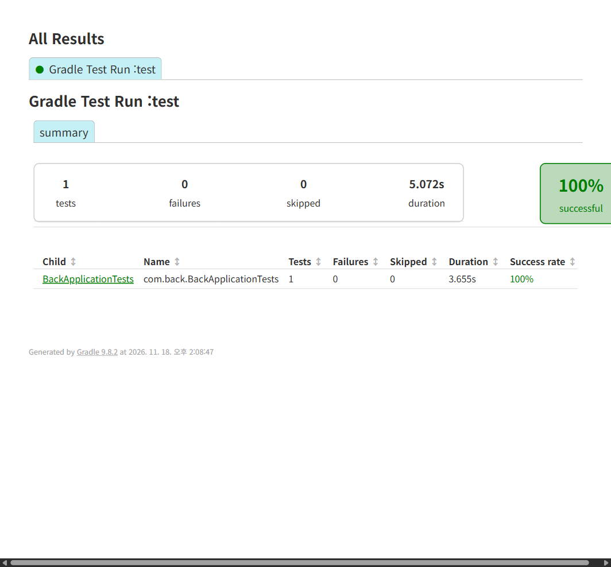
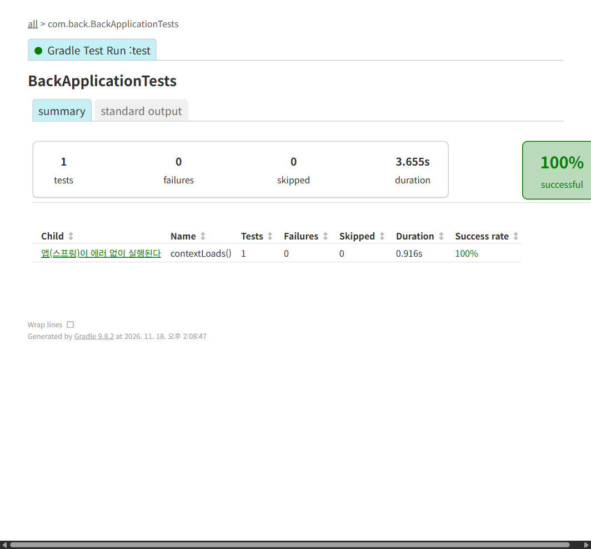

# POSTpractice3

글·댓글 게시판 REST API의 **CRUD(다건조회·단건조회·작성·수정·삭제)** 를 TDD로 만드는 실습입니다.
**기능 하나 = 커밋 하나**로 나누고, 커밋마다 `001`, `002` … 태그를 달아 나중에 그 시점의 코드를 바로 꺼내 볼 수 있게 했습니다.

- 참고: [slog.gg/p/14172](https://www.slog.gg/p/14172/raw) 2부(33강 ~ 56강) REST API by TDD
- 기술: Java 25, Spring Boot 4.1.2, Spring Data JPA, H2, Lombok, JUnit 5 + MockMvc
- 용어: [GLOSSARY.md](GLOSSARY.md)
- 테스트 실행: `./gradlew test` (리포트: `build/reports/tests/test/index.html`)
- 캡처 도구: ego lite 브라우저

## 코드 확인하는 법

| 보고 싶은 것 | 방법 |
|---|---|
| 지금(최신) 코드 | 이 폴더를 IntelliJ로 열기 |
| 특정 커밋에서 바뀐 내용 | `git show 003` |
| 특정 커밋 시점의 코드 전체 | `git checkout 003` → 다 보면 `git checkout main` |
| 커밋 목록 | `git log --oneline --decorate` |

## 진행 상황

| 태그 | 기능 | 상태 |
|---|---|---|
| `001` | 빈 Spring Boot 프로젝트 + 용어집 + README 뼈대 | ✅ 완료 |
| `002` | JPA·H2 설정 + `Post` 엔티티 + 샘플 글 3개 | ⏳ |
| `003` | `PostComment` 엔티티 + 샘플 댓글 5개 | ⏳ |
| `004` | 글 다건조회 | ⏳ |
| `005` | 글 단건조회 | ⏳ |
| `006` | 글 작성 (입력값 검증 포함) | ⏳ |
| `007` | 글 수정 (입력값 검증 포함) | ⏳ |
| `008` | 글 삭제 (댓글도 함께 삭제) | ⏳ |
| `009` | 댓글 다건조회 | ⏳ |
| `010` | 댓글 단건조회 | ⏳ |
| `011` | 댓글 작성 (입력값 검증 포함) | ⏳ |
| `012` | 댓글 수정 (입력값 검증 포함) | ⏳ |
| `013` | 댓글 삭제 + 최종 결과 정리 | ⏳ |

## 만들 API

| 메서드 | URL | 기능 | 성공 응답 | 태그 |
|---|---|---|---|---|
| GET | `/api/v1/posts` | 글 다건조회 (최신순) | 200, 글 배열 | `004` |
| GET | `/api/v1/posts/{id}` | 글 단건조회 | 200, 글 | `005` |
| POST | `/api/v1/posts` | 글 작성 | 201, `RsData` | `006` |
| PUT | `/api/v1/posts/{id}` | 글 수정 | 200, `RsData` | `007` |
| DELETE | `/api/v1/posts/{id}` | 글 삭제 | 200, `RsData` | `008` |
| GET | `/api/v1/posts/{postId}/comments` | 댓글 다건조회 (작성순) | 200, 댓글 배열 | `009` |
| GET | `/api/v1/posts/{postId}/comments/{id}` | 댓글 단건조회 | 200, 댓글 | `010` |
| POST | `/api/v1/posts/{postId}/comments` | 댓글 작성 | 201, `RsData` | `011` |
| PUT | `/api/v1/posts/{postId}/comments/{id}` | 댓글 수정 | 200, `RsData` | `012` |
| DELETE | `/api/v1/posts/{postId}/comments/{id}` | 댓글 삭제 | 200, `RsData` | `013` |

### 응답 규칙
- **조회 성공**: 데이터(DTO)를 그대로 응답한다.
- **조회 실패, 작성·수정·삭제**: `RsData` 로 감싼다. → `{"resultCode": "200-1", "msg": "1번 글이 수정되었습니다.", "data": null}`
- `resultCode` 는 `HTTP상태코드-세부번호` 형식이다.

| 상황 | HTTP | resultCode | msg 예시 |
|---|---|---|---|
| 작성 성공 | 201 | `201-1` | `4번 글이 작성되었습니다.` |
| 수정 성공 | 200 | `200-1` | `1번 글이 수정되었습니다.` |
| 삭제 성공 | 200 | `200-1` | `1번 글이 삭제되었습니다.` |
| 입력값 오류 | 400 | `400-1` | `title-Size-size must be between 2 and 100` |
| 없는 대상 | 404 | `404-1` | `1000번 글은 존재하지 않습니다.` |

### 입력값 규칙
| 항목 | 규칙 |
|---|---|
| 글 제목 | 공백 불가, 2 ~ 100자 |
| 글 내용 | 공백 불가, 2 ~ 5000자 |
| 댓글 내용 | 공백 불가, 2 ~ 1000자 |

---

## 001 - 빈 Spring Boot 프로젝트 + 용어집 + README 뼈대

### 작업 내용

| 파일 | 역할 |
|---|---|
| `build.gradle.kts` | 사용할 라이브러리 목록. 지금은 웹(`webmvc`), Lombok, DevTools, 테스트 라이브러리만 넣었다. DB(JPA·H2)는 002에서 추가한다. |
| `settings.gradle.kts` | 프로젝트 이름 `POSTpractice3` |
| `gradlew`, `gradlew.bat`, `gradle/wrapper/` | Gradle을 따로 설치하지 않아도 빌드할 수 있게 해 주는 래퍼 |
| `.gitignore`, `.gitattributes` | git에 올리지 않을 파일(빌드 결과, DB 파일 등)과 줄바꿈 규칙 |
| `src/main/resources/application.yaml` | 앱 설정. 지금은 앱 이름만 |
| `src/main/java/com/back/BackApplication.java` | 앱의 시작점(`main` 메서드) |
| `src/test/java/com/back/BackApplicationTests.java` | 앱이 에러 없이 뜨는지 확인하는 테스트 |
| `GLOSSARY.md` | 이 프로젝트에서 쓰는 말(글, 댓글, 다건조회, 단건조회, 샘플 데이터)의 뜻 |
| `README.md` | 전체 계획(API 목록, 응답·입력값 규칙)과 커밋별 기록 |

### 핵심 포인트
- `@SpringBootApplication` 이 붙은 클래스의 패키지(`com.back`) **아래에** 있는 클래스만 스프링이 찾아낸다. 그래서 앞으로 만들 모든 클래스는 `com.back.…` 안에 둔다.
- `@SpringBootTest` 는 테스트할 때 스프링을 실제 실행처럼 통째로 띄운다. 테스트 메서드가 비어 있어도, 띄우는 도중에 에러가 나면 실패한다.
- 이 단계는 아직 "기능"이 없어서 RED(실패) 단계가 없다. 앞으로 만들 모든 테스트의 출발점인 "앱이 뜬다"를 먼저 확인해 둔다.

### 테스트

| 테스트 | 검증 내용 |
|---|---|
| `BackApplicationTests.contextLoads` | 앱(스프링)이 에러 없이 실행된다 |

### 결과 스크린샷

전체 결과 — 1건 실행, 실패 0, 성공률 100%

`BackApplicationTests` 상세

