# POSTpractice3

글·댓글 게시판 REST API의 **CRUD(다건조회·단건조회·작성·수정·삭제)** 를 TDD로 만드는 실습입니다.
**기능 하나 = 커밋 하나**로 나누고, 커밋마다 `001`, `002` … 태그를 달아 나중에 그 시점의 코드를 바로 꺼내 볼 수 있게 했습니다.

- 참고: [slog.gg/p/14172](https://www.slog.gg/p/14172/raw) 1부(1강 ~ 32강) REST API, 2부(33강 ~ 56강) REST API by TDD
- 기술: Java 25, Spring Boot 4.1.2, Spring Data JPA, H2, Lombok, JUnit 5 + MockMvc
- 용어: [GLOSSARY.md](GLOSSARY.md)
- 테스트 실행: `./gradlew test` (리포트: `build/reports/tests/test/index.html`)
- 캡처 도구: ego lite 브라우저

## 코드 확인하는 법

| 보고 싶은 것 | 방법 |
|---|---|
| 지금(최신) 코드 | 이 폴더를 IntelliJ로 열기 |
| 특정 커밋에서 바뀐 내용 | `git show 003` |
| 특정 커밋 시점의 코드 전체 | `git checkout 003` → 다 보면 `git checkout main` |
| 커밋 목록 | `git log --oneline --decorate` |

## 진행 상황

> **006부터 강의 순서에 맞춰 계획을 바꿨다.** 001~005는 강의 4~9강과 내용이 같아 그대로 두고,
> 이후는 강의 목차 순서(댓글 조회 → 삭제 → 작성 → 수정)를 따른다. 단, 모든 커밋에서 테스트를 먼저 쓰는 방식은 유지한다.

| 태그 | 기능 | 강의 | 상태 |
|---|---|---|---|
| `001` | 빈 Spring Boot 프로젝트 + 용어집 + README 뼈대 | 1강 | ✅ 완료 |
| `002` | JPA·H2 설정 + `Post` 엔티티 + 샘플 글 3개 | 3강 | ✅ 완료 |
| `003` | `PostComment` 엔티티 + 샘플 댓글 5개 | 3강 | ✅ 완료 |
| `004` | 글 다건조회 | 4강, 8~9강, 45강 | ✅ 완료 |
| `005` | 글 단건조회 | 5강, 44강 | ✅ 완료 |
| `006` | 404 처리 리팩터링: 컨트롤러는 `.get()` 만, 예외 처리기가 `NoSuchElementException` 처리 | 48~49강 | ✅ 완료 |
| `007` | 댓글 다건조회, 단건조회 | 10강, 54강 | ✅ 완료 |
| `008` | 댓글 삭제 | 11~12강 | ⏳ |
| `009` | 글 삭제 (댓글도 함께 삭제) | 16강, 42강 | ⏳ |
| `010` | 글 작성 + 입력값 검증(400) | 22~24강, 50~52강 | ⏳ |
| `011` | `ResponseAspect`: `RsData` 의 `resultCode` 로 HTTP 상태코드 자동 설정 | 27~28강 | ⏳ |
| `012` | 글 수정 (입력값 검증 포함) | 31강, 36강 | ⏳ |
| `013` | 댓글 수정 (입력값 검증 포함) | 32강, 55강 | ⏳ |
| `014` | 댓글 작성 + 최종 결과 정리 | 56강 | ⏳ |

## 만들 API

| 메서드 | URL | 기능 | 성공 응답 | 태그 |
|---|---|---|---|---|
| GET | `/api/v1/posts` | 글 다건조회 (최신순) | 200, 글 배열 | `004` |
| GET | `/api/v1/posts/{id}` | 글 단건조회 | 200, 글 | `005` |
| GET | `/api/v1/posts/{postId}/comments` | 댓글 다건조회 (작성순) | 200, 댓글 배열 | `007` |
| GET | `/api/v1/posts/{postId}/comments/{id}` | 댓글 단건조회 | 200, 댓글 | `007` |
| DELETE | `/api/v1/posts/{postId}/comments/{id}` | 댓글 삭제 | 200, `RsData` | `008` |
| DELETE | `/api/v1/posts/{id}` | 글 삭제 | 200, `RsData` | `009` |
| POST | `/api/v1/posts` | 글 작성 | 201, `RsData` | `010` |
| PUT | `/api/v1/posts/{id}` | 글 수정 | 200, `RsData` | `012` |
| PUT | `/api/v1/posts/{postId}/comments/{id}` | 댓글 수정 | 200, `RsData` | `013` |
| POST | `/api/v1/posts/{postId}/comments` | 댓글 작성 | 201, `RsData` | `014` |

### 응답 규칙
- **조회 성공**: 데이터(DTO)를 그대로 응답한다.
- **조회 실패, 작성·수정·삭제**: `RsData` 로 감싼다. → `{"resultCode": "200-1", "msg": "1번 글이 수정되었습니다.", "data": null}`
- `resultCode` 는 `HTTP상태코드-세부번호` 형식이다.

| 상황 | HTTP | resultCode | msg 예시 |
|---|---|---|---|
| 작성 성공 | 201 | `201-1` | `4번 글이 작성되었습니다.` |
| 수정 성공 | 200 | `200-1` | `1번 글이 수정되었습니다.` |
| 삭제 성공 | 200 | `200-1` | `1번 글이 삭제되었습니다.` |
| 입력값 오류 | 400 | `400-1` | `title-Size-size must be between 2 and 100` |
| 없는 대상 | 404 | `404-1` | `해당 데이터가 존재하지 않습니다.` (006부터, 강의 48강) |

### 입력값 규칙
| 항목 | 규칙 |
|---|---|
| 글 제목 | 공백 불가, 2 ~ 100자 |
| 글 내용 | 공백 불가, 2 ~ 5000자 |
| 댓글 내용 | 공백 불가, 2 ~ 1000자 |

---

## 001 - 빈 Spring Boot 프로젝트 + 용어집 + README 뼈대

### 작업 내용

| 파일 | 역할 |
|---|---|
| `build.gradle.kts` | 사용할 라이브러리 목록. 지금은 웹(`webmvc`), Lombok, DevTools, 테스트 라이브러리만 넣었다. DB(JPA·H2)는 002에서 추가한다. |
| `settings.gradle.kts` | 프로젝트 이름 `POSTpractice3` |
| `gradlew`, `gradlew.bat`, `gradle/wrapper/` | Gradle을 따로 설치하지 않아도 빌드할 수 있게 해 주는 래퍼 |
| `.gitignore`, `.gitattributes` | git에 올리지 않을 파일(빌드 결과, DB 파일 등)과 줄바꿈 규칙 |
| `src/main/resources/application.yaml` | 앱 설정. 지금은 앱 이름만 |
| `src/main/java/com/back/BackApplication.java` | 앱의 시작점(`main` 메서드) |
| `src/test/java/com/back/BackApplicationTests.java` | 앱이 에러 없이 뜨는지 확인하는 테스트 |
| `GLOSSARY.md` | 이 프로젝트에서 쓰는 말(글, 댓글, 다건조회, 단건조회, 샘플 데이터)의 뜻 |
| `README.md` | 전체 계획(API 목록, 응답·입력값 규칙)과 커밋별 기록 |

### 핵심 포인트
- `@SpringBootApplication` 이 붙은 클래스의 패키지(`com.back`) **아래에** 있는 클래스만 스프링이 찾아낸다. 그래서 앞으로 만들 모든 클래스는 `com.back.…` 안에 둔다.
- `@SpringBootTest` 는 테스트할 때 스프링을 실제 실행처럼 통째로 띄운다. 테스트 메서드가 비어 있어도, 띄우는 도중에 에러가 나면 실패한다.
- 이 단계는 아직 "기능"이 없어서 RED(실패) 단계가 없다. 앞으로 만들 모든 테스트의 출발점인 "앱이 뜬다"를 먼저 확인해 둔다.

### 테스트

| 테스트 | 검증 내용 |
|---|---|
| `BackApplicationTests.contextLoads` | 앱(스프링)이 에러 없이 실행된다 |

### 결과 스크린샷

전체 결과 — 1건 실행, 실패 0, 성공률 100%

`BackApplicationTests` 상세

---

## 002 - JPA·H2 설정 + `Post` 엔티티 + 샘플 글 3개

### 작업 내용

| 파일 | 변경 | 역할 |
|---|---|---|
| `build.gradle.kts` | 수정 | JPA(`data-jpa`), H2 DB(`h2`), H2 웹 콘솔(`h2console`) 3줄 추가 |
| `src/main/resources/application.yaml` | 수정 | DB 접속 정보(`db_dev` 파일), H2 콘솔 켜기, 테이블 자동 생성(`ddl-auto: update`), SQL 출력 |
| `src/test/resources/application-test.yaml` | 추가 | 테스트 전용 설정. 파일 DB 대신 **메모리 DB** 사용, 테스트마다 테이블을 새로 만듦 |
| `BackApplication.java` | 수정 | `@EnableJpaAuditing` 추가 → 작성일·수정일 자동 기록 켜기 |
| `global/jpa/entity/BaseEntity.java` | 추가 | 모든 엔티티의 공통 칸: `id`, `createDate`, `modifyDate` |
| `domain/post/post/entity/Post.java` | 추가 | 글 엔티티 → DB의 `post` 테이블 (`title`, `content`) |
| `domain/post/post/repository/PostRepository.java` | 추가 | DB 접근 담당. 인터페이스만 선언하면 `save`, `count`, `findAll` 등이 생긴다 |
| `domain/post/post/service/PostService.java` | 추가 | 글 기능 담당: `count()`, `write()`, `findAll()` |
| `global/initData/BaseInitData.java` | 추가 | 앱이 시작되면 샘플 글 3개를 만든다 (이미 있으면 안 만든다) |
| `BackApplicationTests.java` | 수정 | `@ActiveProfiles("test")` 추가 → 메모리 DB 사용 |
| `global/initData/BaseInitDataTest.java` | 추가 | 샘플 글 3개 검증 테스트 3건 |

### 봐야 할 부분 (읽는 순서)

1. **[`BaseInitDataTest.java`](src/test/java/com/back/global/initData/BaseInitDataTest.java)** — 테스트를 **먼저** 읽는다. "앱이 시작되면 글이 3개 있어야 한다"는 기대가 코드로 적혀 있다. 테스트 안에서 글을 직접 만들지 않는다는 점이 핵심이다.
2. **[`BaseEntity.java`](src/main/java/com/back/global/jpa/entity/BaseEntity.java)** → **[`Post.java`](src/main/java/com/back/domain/post/post/entity/Post.java)** — 자바 클래스가 어떻게 DB 테이블이 되는지. `Post` 에는 `id` 가 안 보이는데 `BaseEntity` 를 상속해서 갖게 된다.
3. **[`PostRepository.java`](src/main/java/com/back/domain/post/post/repository/PostRepository.java)** → **[`PostService.java`](src/main/java/com/back/domain/post/post/service/PostService.java)** — 몸통 없는 인터페이스 하나로 `save()`, `count()` 를 쓸 수 있는 이유.
4. **[`BaseInitData.java`](src/main/java/com/back/global/initData/BaseInitData.java)** — RED를 GREEN으로 바꾼 **유일한 코드**. 이 파일만 없으면 테스트가 실패한다.
5. **[`application-test.yaml`](src/test/resources/application-test.yaml)** — 테스트가 개발용 DB 파일을 건드리지 않는 이유.

### 핵심 포인트

- **엔티티 = 테이블**: `@Entity` 를 붙이면 JPA가 클래스를 보고 `CREATE TABLE post (id, create_date, modify_date, title, content)` 를 대신 실행한다(`ddl-auto`). SQL을 직접 쓰지 않는다.
- **`@MappedSuperclass`**: `BaseEntity` 는 테이블이 되지 않고, 자기 칸(`id`, 날짜 2개)을 자식 엔티티 테이블에 물려준다. 003의 댓글도 이걸 상속한다.
- **`@NoArgsConstructor(access = PROTECTED)`**: JPA는 DB에서 꺼낸 값을 담으려고 빈 생성자가 필요하다. 하지만 우리가 `new Post()` 로 제목 없는 글을 만들면 안 되므로 `protected` 로 막고, 밖에서는 `new Post(title, content)` 만 쓰게 한다.
- **`JpaRepository<Post, Long>`**: "Post를 다루고 id는 Long" 이라고만 알려 주면 스프링이 구현 클래스를 자동으로 만든다.
- **계층**: `BaseInitData` → `PostService` → `PostRepository` → DB. 004부터는 맨 앞에 컨트롤러가 붙는다.
- **`ApplicationRunner`**: 앱이 다 뜬 직후 1번 실행된다. 테스트에서 `@SpringBootTest` 로 스프링을 띄울 때도 실행되기 때문에, 테스트가 글을 직접 만들지 않아도 3개가 있다.
- **`if (count() > 0) return;`**: 개발용 DB(`db_dev.mv.db`)는 파일이라 앱을 껐다 켜도 남는다. 이 줄이 없으면 재시작할 때마다 글이 3개씩 늘어난다.
- **`@ActiveProfiles("test")` + `application-test.yaml`**: 테스트는 메모리 DB(`jdbc:h2:mem:db_test`)를 쓴다. 그래서 테스트가 아무리 글을 지우고 바꿔도 개발용 DB는 그대로다.
- **`@Transactional` (테스트 클래스)**: 테스트 메서드가 끝나면 그 안에서 바꾼 DB 내용을 되돌린다(롤백). 테스트끼리 서로 영향을 주지 않는다.

### TDD 과정

**RED** — `BaseInitDataTest` 를 먼저 쓰고 실행. 샘플 데이터를 만드는 코드가 없어서 3건 모두 실패.
`t1` 실패 메시지: `expected: 3L but was: 0L` → "글이 3개여야 하는데 0개다"

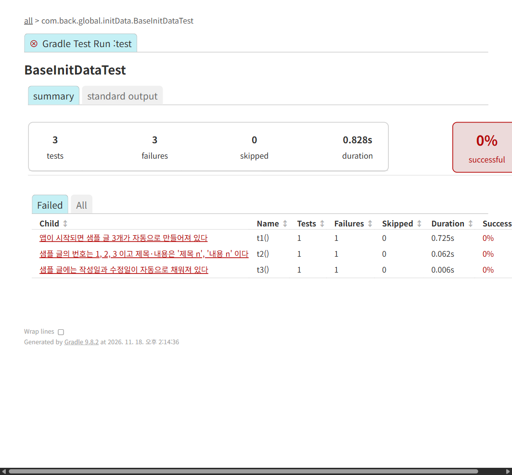

**GREEN** — `BaseInitData` 추가 후 다시 실행. 3건 모두 통과.

### 테스트

| 테스트 | 검증 내용 |
|---|---|
| `BaseInitDataTest.t1` | 앱이 시작되면 샘플 글 3개가 자동으로 만들어져 있다 |
| `BaseInitDataTest.t2` | 샘플 글의 번호는 1, 2, 3 이고 제목·내용은 '제목 n', '내용 n' 이다 |
| `BaseInitDataTest.t3` | 샘플 글에는 작성일과 수정일이 자동으로 채워져 있다 |

### 결과 스크린샷

전체 결과 — 4건 실행, 실패 0, 성공률 100%

---

## 003 - `PostComment` 엔티티 + 샘플 댓글 5개

### 작업 내용

| 파일 | 변경 | 역할 |
|---|---|---|
| `domain/post/postComment/entity/PostComment.java` | 추가 | 댓글 엔티티 → DB의 `post_comment` 테이블 (`post_id`, `content`) |
| `domain/post/post/entity/Post.java` | 수정 | `comments` 목록(`@OneToMany`) + 댓글을 만드는 `addComment()` 추가 |
| `global/initData/BaseInitData.java` | 수정 | 샘플 댓글 5개 생성, `@Transactional` + `self` 호출로 변경 |
| `global/initData/BaseInitDataTest.java` | 수정 | 샘플 댓글 검증 테스트 3건(`t4` ~ `t6`) 추가 |

### 봐야 할 부분 (읽는 순서)

1. **[`BaseInitDataTest.java`](src/test/java/com/back/global/initData/BaseInitDataTest.java) `t4` ~ `t6`** — 댓글이 "몇 개", "어느 글에", "몇 번으로" 저장되어야 하는지.
2. **[`PostComment.java`](src/main/java/com/back/domain/post/postComment/entity/PostComment.java)** 의 `@ManyToOne private Post post;` — DB의 `post_id` 외래키가 되는 필드.
3. **[`Post.java`](src/main/java/com/back/domain/post/post/entity/Post.java)** 의 `@OneToMany(mappedBy = "post", cascade = PERSIST)` 와 `addComment()` — 글과 댓글을 양쪽에서 이어 주는 방법.
4. **[`BaseInitData.java`](src/main/java/com/back/global/initData/BaseInitData.java)** 의 `@Transactional` 과 `self.work1()` — 아래 "함정"에서 왜 필요한지 확인.

### 핵심 포인트

- **관계의 주인은 댓글**: DB에서 "이 댓글은 몇 번 글 것인가"는 `post_comment.post_id` 칸에 적힌다. 그 칸을 만드는 건 `PostComment.post` 필드(`@ManyToOne`)다. `Post.comments` 는 `mappedBy = "post"` 라서 칸을 만들지 않고, 자바에서 "이 글의 댓글 목록"을 편하게 보려고 둔 거울이다.
- **`addComment()` 로만 댓글을 만든다**: 한쪽만 연결하면(예: `post_id` 만 넣고 `comments` 목록엔 안 넣으면) 같은 트랜잭션 안에서 `post.getComments()` 가 비어 보인다. 양쪽을 한 메서드에서 같이 연결해 실수를 막는다.
- **`cascade = PERSIST`**: 글이 저장될 때 `comments` 에 새로 들어온 댓글도 같이 저장한다. 그래서 댓글은 `save()` 를 따로 부르지 않는다.
- **`fetch = LAZY`**: 댓글을 꺼낼 때 글은 바로 가져오지 않고, `comment.getPost()` 로 실제로 쓸 때 가져온다(필요할 때만 SQL 실행).

### 함정: `@Transactional` 이 없으면 댓글이 저장되지 않는다

처음에는 `work1()` 에 `addComment()` 다섯 줄만 추가했다. 그런데 테스트는 그대로 실패했다(`expected: 5 but was: 0`).

| | 트랜잭션 없음 (실패) | 트랜잭션 있음 (성공) |
|---|---|---|
| `postService.write()` | `save()` 한 번 = 작은 트랜잭션 하나가 열리고 바로 닫힌다 | `work1()` 전체가 트랜잭션 하나 |
| `post1` 상태 | 트랜잭션이 끝나 JPA가 **더 이상 지켜보지 않는** 객체 | 트랜잭션 안이라 JPA가 **계속 지켜보는** 객체 |
| `addComment()` | 자바 리스트에 넣기만 하고 끝 → DB 변화 없음 | 트랜잭션이 끝날 때 JPA가 바뀐 것을 발견 → cascade로 `INSERT` 5번 |

- **왜 `self.work1()` 인가**: `@Transactional` 은 스프링이 만든 대리 객체(프록시)를 거쳐 호출해야 동작한다. 같은 클래스 안에서 `work1()`(= `this.work1()`)로 부르면 프록시를 안 거쳐서 어노테이션이 무시된다. 그래서 자기 자신을 프록시로 주입받아(`self`) 그걸로 부른다.
- **`@Lazy`**: 자기 자신을 주입받으면 "나를 만들려면 내가 필요한" 순환이 생긴다. `@Lazy` 로 실제로 쓸 때 주입받아 이 문제를 피한다.

### TDD 과정

**RED** — 댓글 테스트 3건을 먼저 쓰고 실행. 샘플 댓글이 없어서 3건 실패 (`expected: 5 but was: 0`).

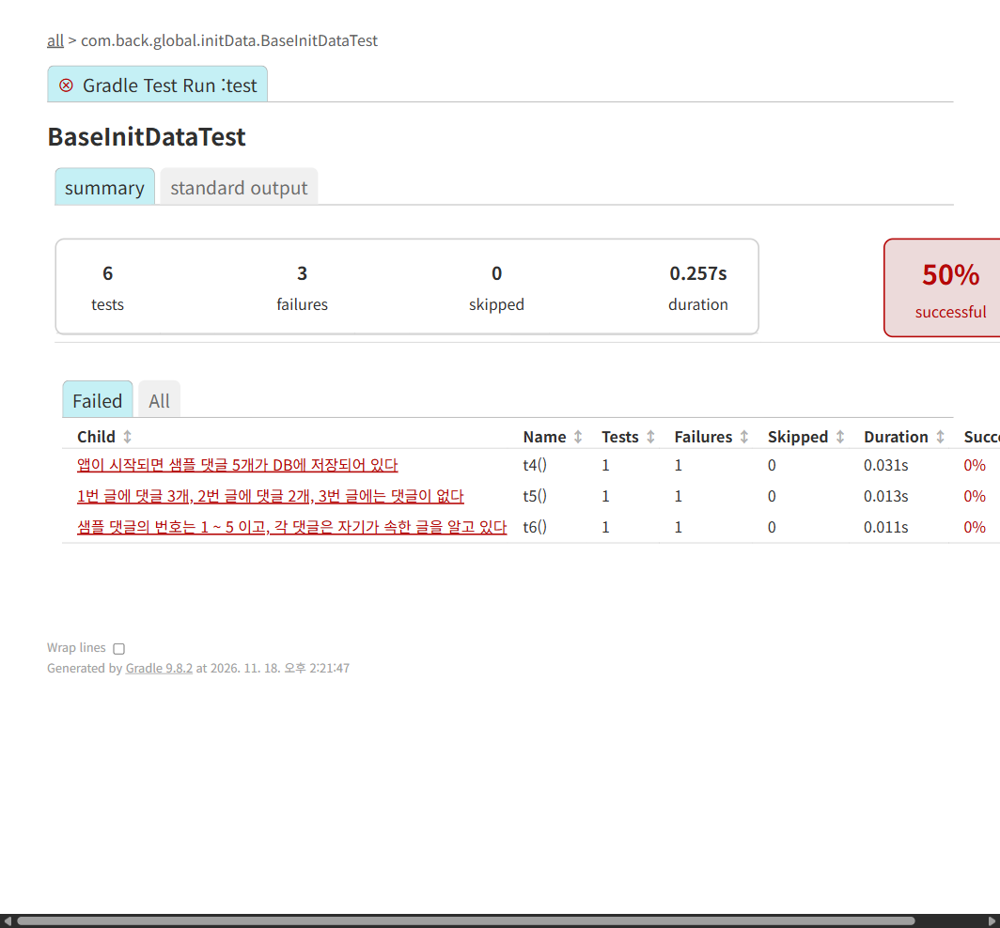

**GREEN** — `@Transactional` + `self.work1()` 로 고친 뒤 실행. 모두 통과.

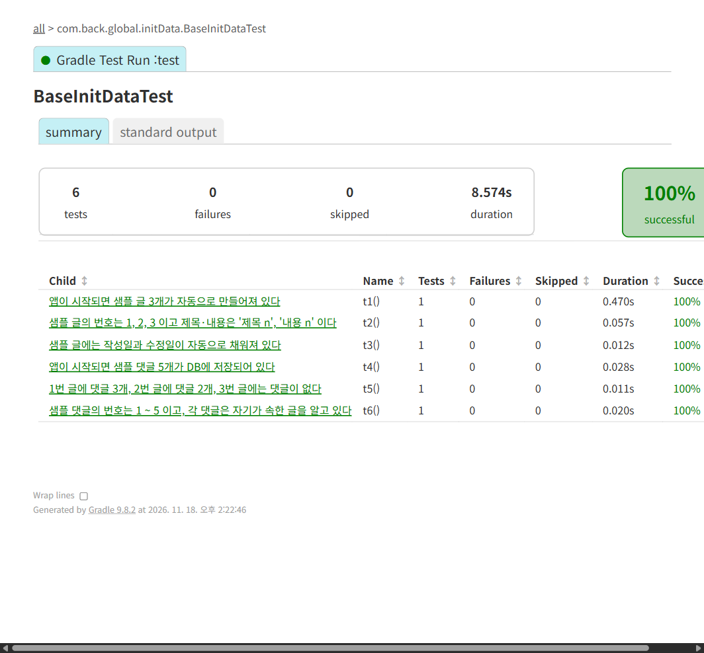

### 테스트

| 테스트 | 검증 내용 |
|---|---|
| `BaseInitDataTest.t4` | 앱이 시작되면 샘플 댓글 5개가 DB에 저장되어 있다 |
| `BaseInitDataTest.t5` | 1번 글에 댓글 3개, 2번 글에 댓글 2개, 3번 글에는 댓글이 없다 |
| `BaseInitDataTest.t6` | 샘플 댓글의 번호는 1 ~ 5 이고, 각 댓글은 자기가 속한 글을 알고 있다 |

### 결과 스크린샷

전체 결과 — 7건 실행, 실패 0, 성공률 100%

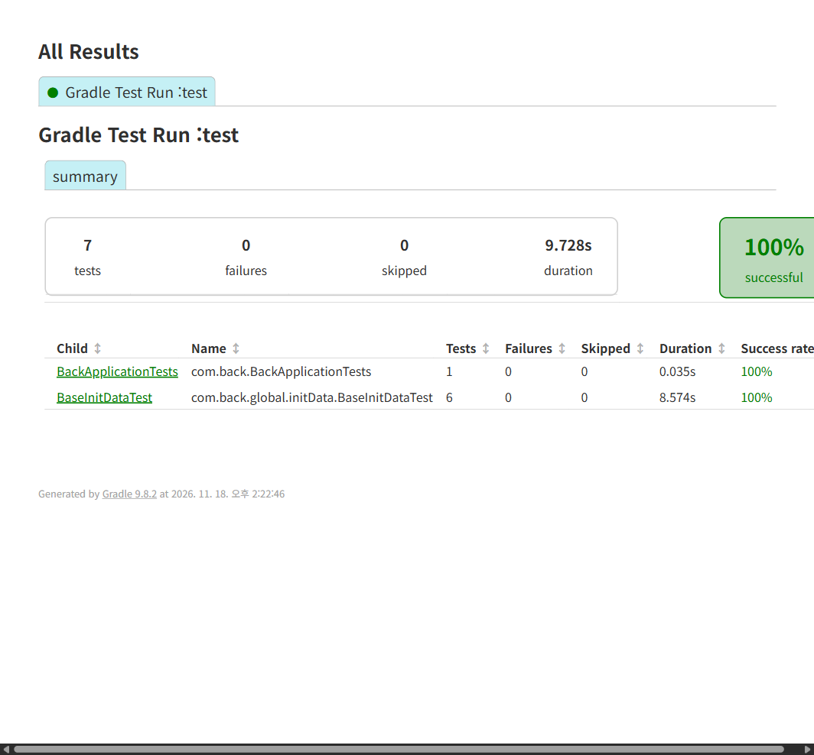

---

## 004 - 글 다건조회 `GET /api/v1/posts`

### 작업 내용

| 파일 | 변경 | 역할 |
|---|---|---|
| `domain/post/post/controller/ApiV1PostController.java` | 추가 | 글 API 컨트롤러. `getItems()` 가 `GET /api/v1/posts` 를 처리 |
| `domain/post/post/dto/PostDto.java` | 추가 | 응답용 글 데이터(record): `id`, `createDate`, `modifyDate`, `title`, `content` |
| `domain/post/post/repository/PostRepository.java` | 수정 | `findAllByOrderByIdDesc()` 추가 → 최신순 조회 |
| `domain/post/post/service/PostService.java` | 수정 | `findAllNewestFirst()` 추가 |
| `domain/post/post/controller/ApiV1PostControllerTest.java` | 추가 | MockMvc 로 API 를 호출해 응답을 검증하는 테스트 2건 |

### 봐야 할 부분 (읽는 순서)

1. **[`ApiV1PostControllerTest.java`](src/test/java/com/back/domain/post/post/controller/ApiV1PostControllerTest.java) `t1`** — 컨트롤러 테스트의 2단계 구조: ① `mvc.perform(get(...))` 로 요청 → ② `andExpect(...)` 로 응답 검증. `jsonPath("$[*].id").value(contains(3, 2, 1))` 이 "최신순"을 검증하는 줄.
2. **같은 파일 `t2`** — 응답의 모든 필드를 DB 값과 비교하고, `comments` 가 **없음**을 확인(`doesNotExist()`).
3. **[`ApiV1PostController.java`](src/main/java/com/back/domain/post/post/controller/ApiV1PostController.java)** — `@RestController`, `@RequestMapping`, `@GetMapping` 세 어노테이션이 "주소 → 메서드"를 연결하는 방법. 그리고 엔티티 목록을 `PostDto` 목록으로 바꾸는 `stream().map(PostDto::new)`.
4. **[`PostDto.java`](src/main/java/com/back/domain/post/post/dto/PostDto.java)** — 엔티티를 바로 응답하지 않고 DTO 로 바꾸는 이유(주석).
5. **[`PostRepository.java`](src/main/java/com/back/domain/post/post/repository/PostRepository.java)** — 메서드 **이름**만으로 `ORDER BY id DESC` 쿼리가 만들어지는 쿼리 메서드.

### 핵심 포인트

- **`@RestController`** = `@Controller` + `@ResponseBody`. 메서드가 돌려준 `List<PostDto>` 를 Jackson 이 JSON 배열로 바꿔 응답 본문에 넣는다.
- **`@RequestMapping("/api/v1/posts")` + `@GetMapping`**: 클래스의 주소 접두어 + 메서드의 HTTP 방식. 합쳐서 "GET /api/v1/posts 가 오면 `getItems()` 실행".
- **DTO 를 쓰는 이유**: `Post` 엔티티를 그대로 응답하면 `post.comments` → `comment.post` → `post.comments` … 로 무한히 이어져 JSON 변환이 터진다(순환참조). 또 엔티티에 칸을 추가하면 API 응답까지 바뀐다. 그래서 **보여 줄 칸만 고른 상자(`PostDto`)** 에 옮겨 담는다.
- **조회 성공은 `RsData` 로 감싸지 않는다**: 데이터 자체가 결과라서 `resultCode`/`msg` 가 필요 없다. (README 응답 규칙)
- **쿼리 메서드**: `findAll` + `By` + `OrderBy` + `Id` + `Desc` → 스프링이 이름을 읽고 `SELECT * FROM post ORDER BY id DESC` 를 만든다. 구현 코드를 쓰지 않는다.
- **`@Transactional(readOnly = true)`**: 읽기만 하는 작업이라고 알려 준다. JPA 가 "바뀐 데이터가 있나" 검사(변경 감지)를 건너뛰어 조금 가벼워진다.
- **MockMvc**: 서버(8080)를 실제로 켜지 않고 컨트롤러에 HTTP 요청을 흉내 내서 보낸다. 빠르고, 응답 상태코드·JSON 을 그대로 검증할 수 있다.
- **`handler().handlerType(...)`, `handler().methodName(...)`**: "어느 컨트롤러의 어느 메서드가 처리했는가"까지 검증한다. 이 줄 때문에 컨트롤러 클래스 껍데기를 먼저 만들었다(없으면 테스트가 컴파일되지 않는다).

### TDD 과정

**RED** — 비어 있는 `ApiV1PostController` 껍데기 + 테스트를 먼저 작성. 2건 실패.
실패 메시지: `Handler type expected: ApiV1PostController but was: ResourceHttpRequestHandler` → "이 주소를 처리할 컨트롤러 메서드가 없어서 정적 파일 처리기로 넘어갔다(=404)"

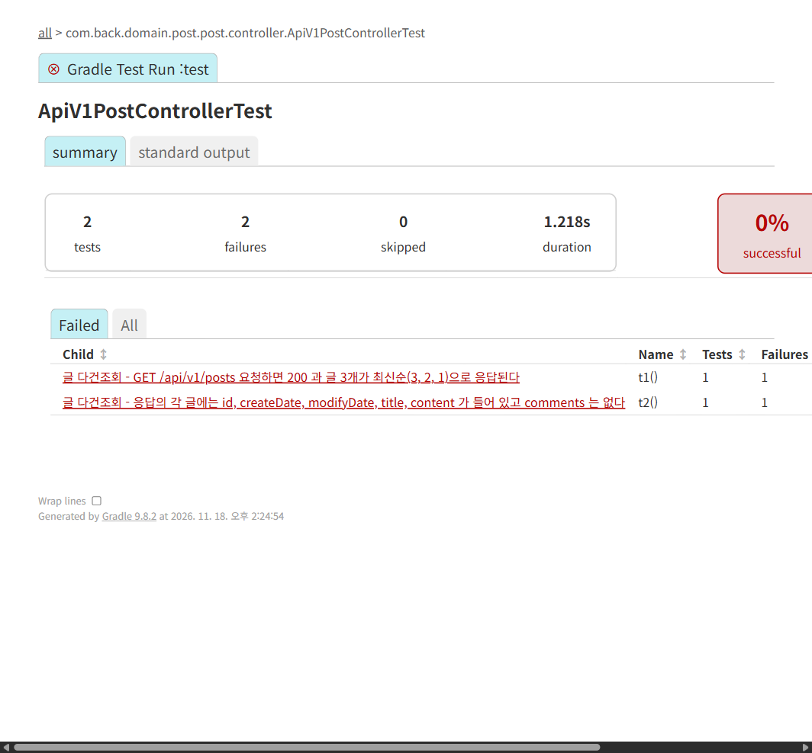

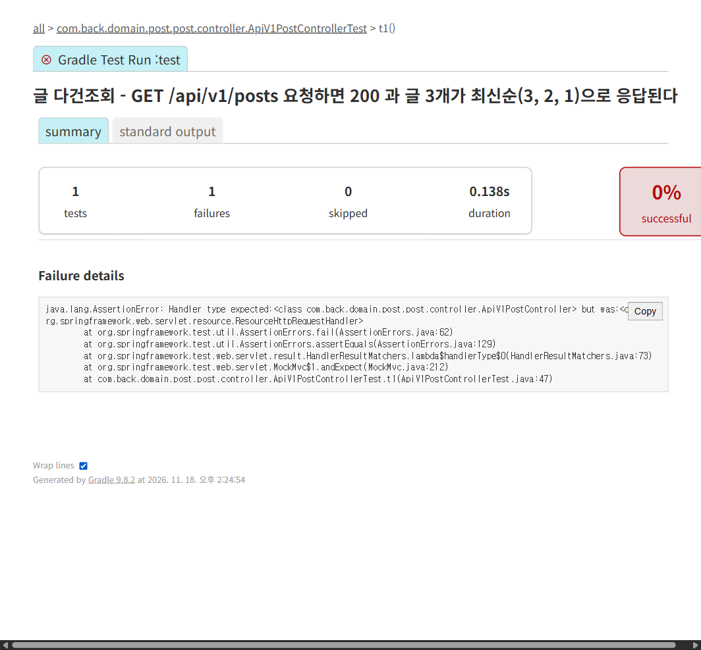

**GREEN** — `PostDto`, `findAllByOrderByIdDesc()`, `findAllNewestFirst()`, `getItems()` 구현 후 통과.

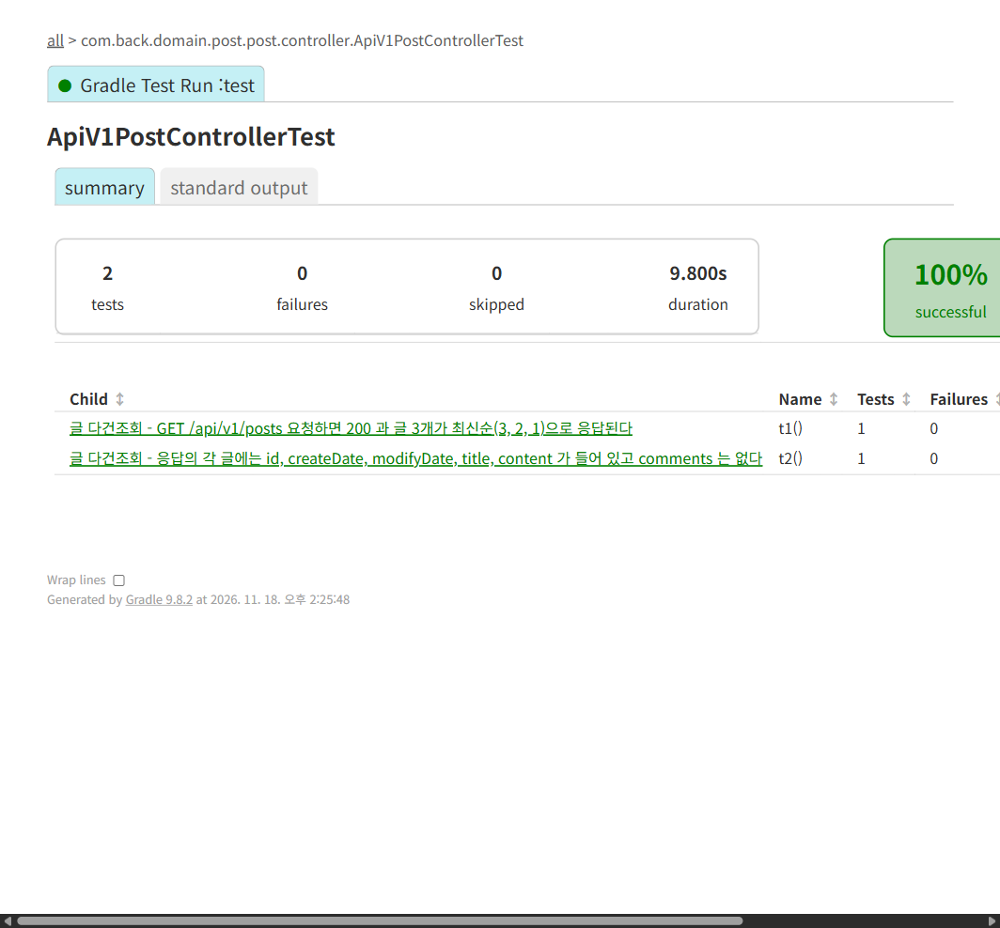

### 테스트

| 테스트 | 검증 내용 |
|---|---|
| `ApiV1PostControllerTest.t1` | `GET /api/v1/posts` → 200, 글 3개, 번호가 3, 2, 1 순서(최신순) |
| `ApiV1PostControllerTest.t2` | 각 글의 `id`, `createDate`, `modifyDate`, `title`, `content` 가 DB 값과 같고 `comments` 는 없다 |

### 결과 스크린샷

전체 결과 — 9건 실행, 실패 0, 성공률 100%

앱 실행 후 브라우저에서 `http://localhost:8080/api/v1/posts` 접속 — 3번 글이 맨 위(최신순), `comments` 없음

---

## 005 - 글 단건조회 `GET /api/v1/posts/{id}` + 404 처리(`RsData`)

### 작업 내용

| 파일 | 변경 | 역할 |
|---|---|---|
| `domain/post/post/controller/ApiV1PostController.java` | 수정 | `getItem()` 추가: `GET /api/v1/posts/{id}`. 없으면 `ServiceException` 던짐 |
| `domain/post/post/service/PostService.java` | 수정 | `findById()` 추가 → `Optional<Post>` |
| `global/rsData/RsData.java` | 추가 | 결과 응답 상자: `resultCode`, `msg`, `data` |
| `global/exception/ServiceException.java` | 추가 | "처리할 수 없다"를 알리는 예외. `resultCode` 와 `msg` 를 들고 다닌다 |
| `global/globalExceptionHandler/GlobalExceptionHandler.java` | 추가 | `ServiceException` 을 받아 HTTP 상태코드 + `RsData` 응답으로 바꾼다 |
| `ApiV1PostControllerTest.java` | 수정 | 단건조회 성공(`t3`), 없는 글 404(`t4`) 테스트 추가 |

### 봐야 할 부분 (읽는 순서)

1. **[`ApiV1PostControllerTest.java`](src/test/java/com/back/domain/post/post/controller/ApiV1PostControllerTest.java) `t3`, `t4`** — 성공은 `$.id` 처럼 객체를 바로 읽고, 실패는 `$.resultCode`, `$.msg`, `$.data` 를 읽는다. 응답 **모양이 다르다**는 것이 핵심.
2. **[`ApiV1PostController.java`](src/main/java/com/back/domain/post/post/controller/ApiV1PostController.java) `getItem()`** — `@PathVariable` 로 주소의 숫자를 받고, `orElseThrow()` 로 "없으면 예외" 를 한 줄에 처리.
3. **[`ServiceException.java`](src/main/java/com/back/global/exception/ServiceException.java)** → **[`GlobalExceptionHandler.java`](src/main/java/com/back/global/globalExceptionHandler/GlobalExceptionHandler.java)** — 던진 예외가 어디서 받아져서 404 응답이 되는지 따라가 보기.
4. **[`RsData.java`](src/main/java/com/back/global/rsData/RsData.java)** — `"404-1"` 에서 `404` 를 뽑는 `statusCode()` 와, 그게 JSON 에 안 나오게 하는 `@JsonIgnore`.

### 핵심 포인트

- **`@GetMapping("/{id}")` + `@PathVariable long id`**: 주소의 `{id}` 자리에 온 값(`/api/v1/posts/1` → `1`)을 메서드 매개변수로 받는다.
- **`Optional`**: "있을 수도, 없을 수도 있는 값"을 담는 상자. `findById(1000)` 은 빈 상자를 돌려준다. `orElseThrow(() -> 예외)` 는 "비어 있으면 이 예외를 던지고, 있으면 꺼내 줘".
- **예외로 흐름 끊기**: 컨트롤러는 실패 응답을 직접 만들지 않는다. `throw` 하면 메서드가 그 자리에서 끝나고, 스프링이 `@RestControllerAdvice` 에서 그 예외를 처리하는 `@ExceptionHandler` 메서드를 찾아 실행한다. 컨트롤러 코드는 "성공 흐름"만 남아 짧아진다.
- **`ResponseEntity`**: 응답 본문만 돌려주면 상태코드는 항상 200 이다. 404 를 보내려면 `ResponseEntity.status(404).body(...)` 로 상태코드까지 정해야 한다.
- **`RsData` 의 `resultCode` 형식 `"404-1"`**: 앞은 HTTP 상태코드, 뒤는 같은 상태코드 안에서 상황을 구분하는 번호. `statusCode()` 가 앞부분을 잘라 실제 HTTP 상태코드로 쓴다.
- **`@JsonIgnore`**: record 는 메서드도 JSON 칸으로 내보낼 수 있다. `statusCode()` 는 내부용이라 JSON 에서 뺀다. (브라우저 캡처에 `statusCode` 칸이 없는 것으로 확인)
- **성공과 실패의 모양이 다르다**: 성공은 `{"id":1, ...}`, 실패는 `{"resultCode":"404-1", ...}`. 조회 성공은 데이터 자체가 결과라서 감싸지 않는다(README 응답 규칙). 006 작성부터는 성공도 `RsData` 로 감싼다.
- **`GlobalExceptionHandler` 는 앞으로 계속 재사용된다**: 007 수정, 008 삭제, 009 ~ 013 댓글 API 에서 "없는 대상"은 모두 `throw new ServiceException("404-1", ...)` 한 줄로 끝난다.

### TDD 과정

**RED** — `t3`, `t4` 를 먼저 작성. `getItem` 메서드가 없어서 2건 실패.

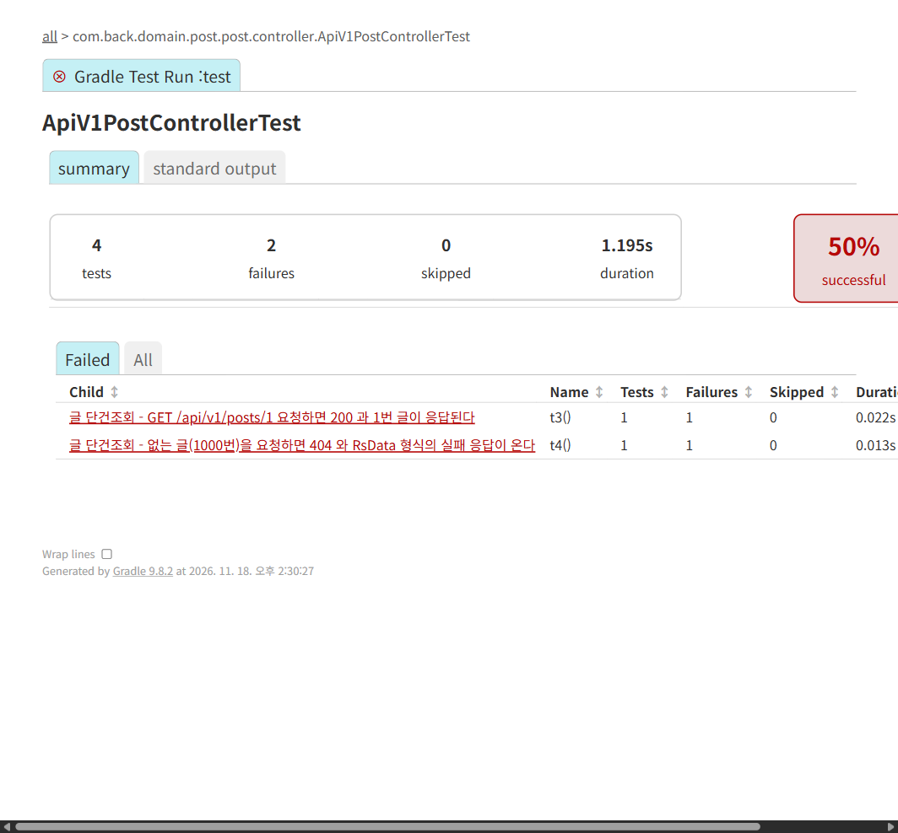

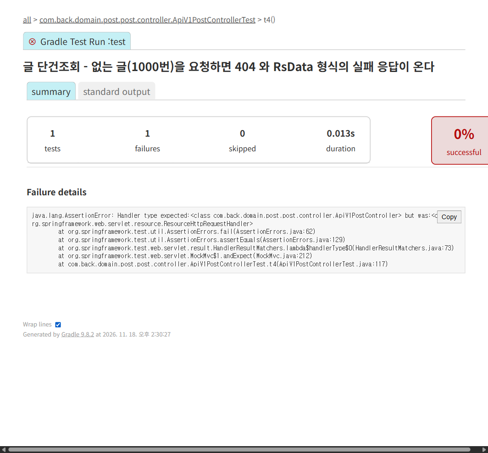

**GREEN** — `findById()`, `getItem()`, `RsData`, `ServiceException`, `GlobalExceptionHandler` 구현 후 통과.

### 테스트

| 테스트 | 검증 내용 |
|---|---|
| `ApiV1PostControllerTest.t3` | `GET /api/v1/posts/1` → 200, 1번 글의 모든 필드, `comments` 없음 |
| `ApiV1PostControllerTest.t4` | `GET /api/v1/posts/1000` → 404, `resultCode` = `404-1`, `msg` = `1000번 글은 존재하지 않습니다.`, `data` = `null` |

### 결과 스크린샷

전체 결과 — 11건 실행, 실패 0, 성공률 100%

브라우저 `http://localhost:8080/api/v1/posts/1` — 1번 글 객체 하나

브라우저 `http://localhost:8080/api/v1/posts/1000` — 404, `RsData` 형식 (`statusCode` 칸은 나오지 않음)

---

## 006 - 404 처리 리팩터링: 컨트롤러는 예외 처리를 하지 않는다 (강의 48~49강)

### 왜 바꿨나
005에서는 컨트롤러가 `orElseThrow(() -> new ServiceException("404-1", "1000번 글은 ..."))` 로 실패 응답을 직접 준비했다.
강의(48강)는 컨트롤러가 `.get()` 만 부르고, 데이터가 없을 때 저절로 나는 `NoSuchElementException` 을 **전역 예외 처리기가 받아서** 404 로 바꾼다.
컨트롤러에는 "성공 흐름"만 남고, "없을 때 어떻게 응답하나"는 한곳(`GlobalExceptionHandler`)에서만 정한다.
이 커밋부터 진행 순서도 강의 목차에 맞췄다(위 "진행 상황" 표 참고).

### 작업 내용

| 파일 | 변경 | 역할 |
|---|---|---|
| `ApiV1PostControllerTest.java` | 수정 | `t4` 의 기대 메시지를 `해당 데이터가 존재하지 않습니다.` 로 **먼저** 변경 |
| `ApiV1PostController.java` | 수정 | `getItem()`: `orElseThrow(...)` → `.get()`. 예외 관련 코드 제거 |
| `GlobalExceptionHandler.java` | 수정 | 처리 대상 `ServiceException` → `NoSuchElementException`, 공통 메시지 |
| `global/exception/ServiceException.java` | 삭제 | 더 이상 쓰는 곳이 없음 |
| `README.md` | 수정 | 006 ~ 014 계획을 강의 순서로 변경, 404 메시지 규칙 변경 |

### 봐야 할 부분 (읽는 순서)

1. **[`ApiV1PostControllerTest.java`](src/test/java/com/back/domain/post/post/controller/ApiV1PostControllerTest.java) `t4` 의 `$.msg` 줄** — 바뀐 것은 이 한 줄뿐. **요구사항이 바뀌면 테스트부터 고친다**(강의 40강).
2. **[`ApiV1PostController.java`](src/main/java/com/back/domain/post/post/controller/ApiV1PostController.java) `getItem()`** — 005 와 비교해 보기: `git diff 005 006 -- src/main`
3. **[`GlobalExceptionHandler.java`](src/main/java/com/back/global/globalExceptionHandler/GlobalExceptionHandler.java)** — `@ExceptionHandler(NoSuchElementException.class)` 로 받는 예외가 바뀐 부분.

### 핵심 포인트

- **`Optional.get()`**: 값이 있으면 꺼내고, **비어 있으면 `NoSuchElementException` 을 던진다.** 그래서 컨트롤러가 `if` 나 `orElseThrow` 를 쓰지 않아도 "없음"이 예외로 표현된다.
- **예외는 위로 올라간다**: `getItem()` 안에서 난 예외를 아무도 잡지 않으면 스프링 MVC 까지 올라가고, 스프링은 `@RestControllerAdvice` 에서 그 예외 타입을 처리하는 `@ExceptionHandler` 메서드를 찾아 실행한다.
- **공통 메시지의 대가**: 예외 처리기는 "몇 번 무엇이" 없었는지 모른다. 그래서 메시지가 `해당 데이터가 존재하지 않습니다.` 로 일반적이 된다. 대신 앞으로 만들 댓글 조회·삭제·수정의 "없음"도 **컨트롤러 코드 추가 없이** 같은 404 응답을 받는다.
- **리팩터링과 테스트**: 성공 응답(`t1` ~ `t3`)은 바뀌지 않았고 그대로 통과한다. 테스트가 있어서 "다른 기능을 망가뜨리지 않았다"를 바로 확인할 수 있다(강의 37강).

### TDD 과정

**RED** — `t4` 의 기대 메시지만 먼저 바꾸고 실행. 1건 실패.
`JSON path "$.msg" expected:<해당 데이터가 존재하지 않습니다.> but was:<1000번 글은 존재하지 않습니다.>`

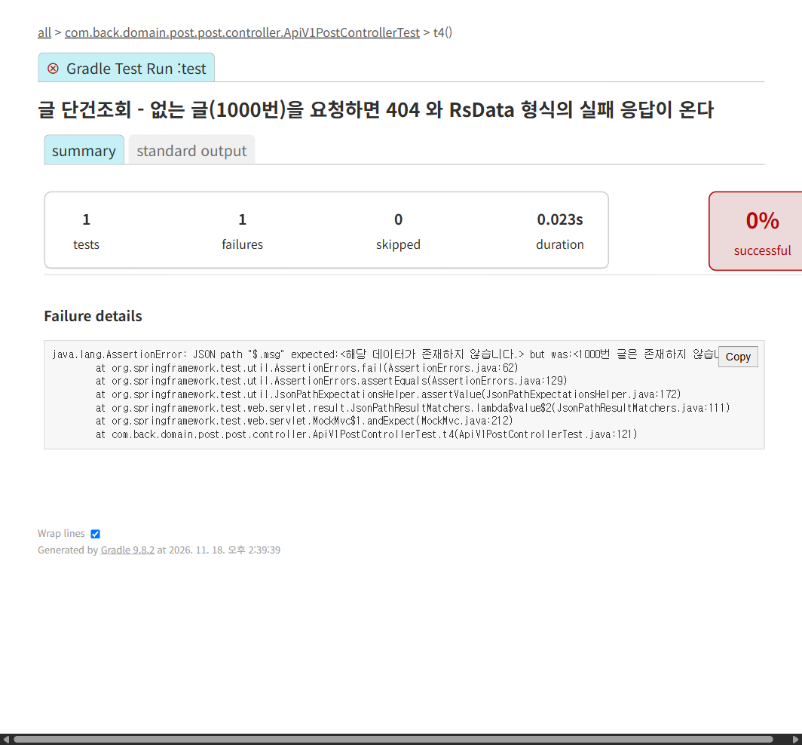

**GREEN** — 컨트롤러를 `.get()` 으로, 예외 처리기를 `NoSuchElementException` 으로 바꾼 뒤 통과.

### 테스트

| 테스트 | 검증 내용 |
|---|---|
| `ApiV1PostControllerTest.t4` (수정) | `GET /api/v1/posts/1000` → 404, `404-1`, `해당 데이터가 존재하지 않습니다.`, `data` = `null` |

### 결과 스크린샷

전체 결과 — 11건 실행, 실패 0, 성공률 100%

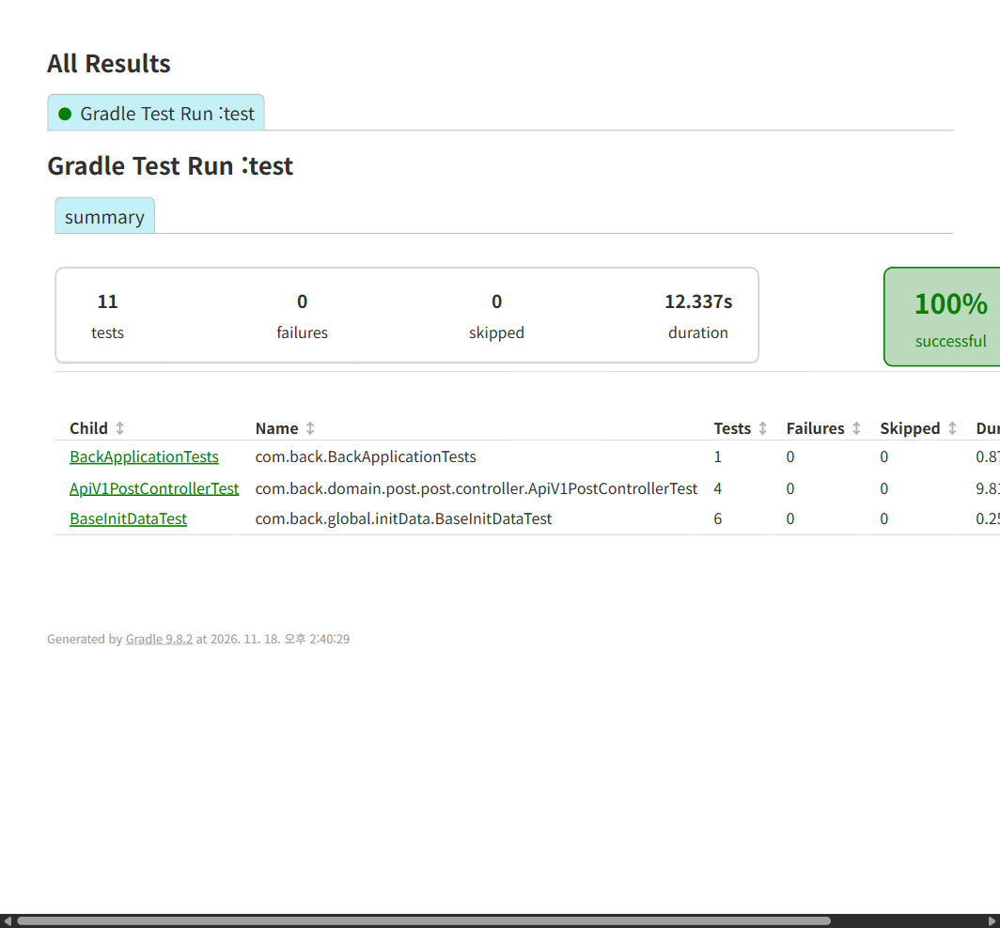

브라우저 `http://localhost:8080/api/v1/posts/1000`

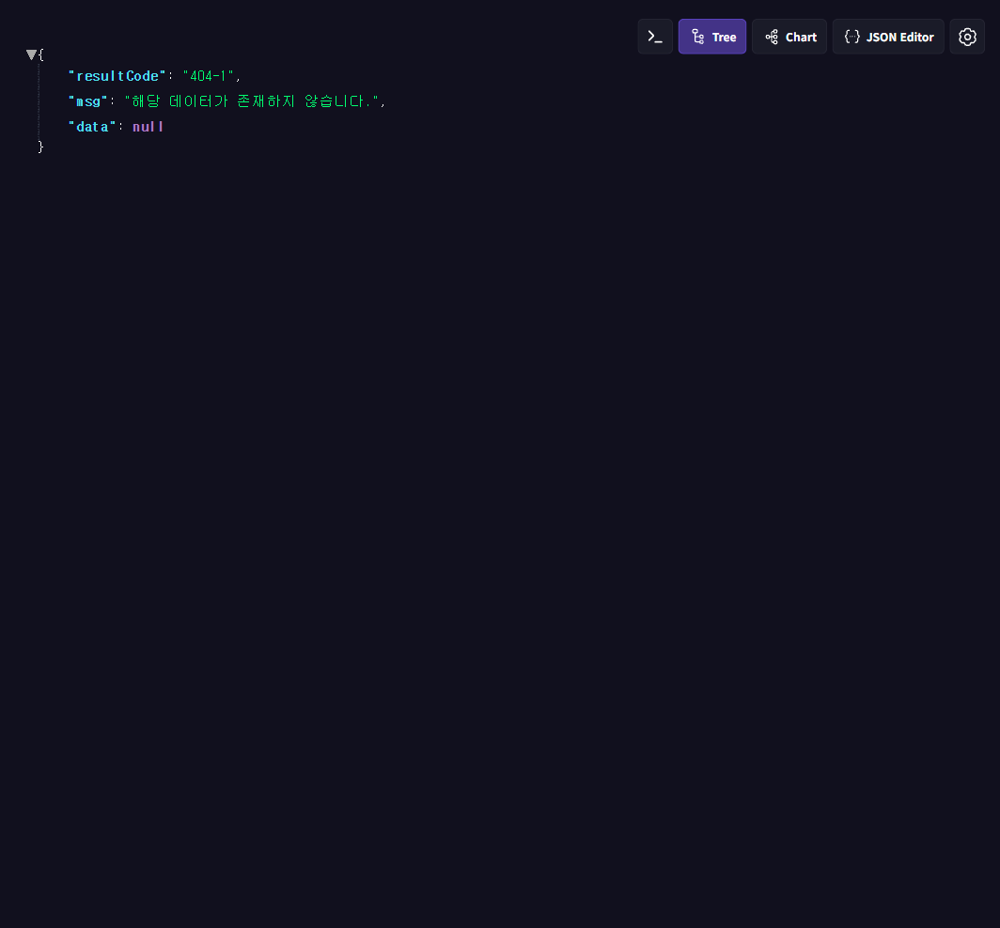

---

## 007 - 댓글 다건조회 `GET /api/v1/posts/{postId}/comments`, 단건조회 `GET /api/v1/posts/{postId}/comments/{id}` (강의 10강, 54강)

### 작업 내용

| 파일 | 변경 | 역할 |
|---|---|---|
| `domain/post/postComment/controller/ApiV1PostCommentController.java` | 추가 | 댓글 API. `getItems()`(다건), `getItem()`(단건) |
| `domain/post/postComment/dto/PostCommentDto.java` | 추가 | 응답용 댓글 데이터: `id`, `createDate`, `modifyDate`, `postId`, `content` |
| `domain/post/post/entity/Post.java` | 수정 | `@OrderBy("id ASC")` 로 댓글 순서 고정, `findCommentById()` 추가 |
| `domain/post/postComment/controller/ApiV1PostCommentControllerTest.java` | 추가 | 댓글 조회 테스트 5건 |

### 봐야 할 부분 (읽는 순서)

1. **[`ApiV1PostCommentControllerTest.java`](src/test/java/com/back/domain/post/postComment/controller/ApiV1PostCommentControllerTest.java)** — 5개 상황을 표로 정리하면:

   | 요청 | 상황 | 결과 |
   |---|---|---|
   | `/posts/1/comments` | 댓글 3개인 글 | 200, `[1, 2, 3]` |
   | `/posts/3/comments` | 댓글 없는 글 | 200, `[]` |
   | `/posts/1000/comments` | 없는 글 | 404 |
   | `/posts/1/comments/2` | 1번 글의 2번 댓글 | 200 |
   | `/posts/1/comments/4` | 4번 댓글은 있지만 **2번 글** 것 | 404 |

2. **[`ApiV1PostCommentController.java`](src/main/java/com/back/domain/post/postComment/controller/ApiV1PostCommentController.java)** — 클래스 주소에 `{postId}` 가 들어간 것, 그리고 `.get()` 두 번(글, 댓글)으로 404 가 저절로 처리되는 것.
3. **[`Post.java`](src/main/java/com/back/domain/post/post/entity/Post.java) `findCommentById()`** — "그 글의 댓글 중에서만" 찾기 때문에 `t5` 가 404 가 된다.
4. **[`PostCommentDto.java`](src/main/java/com/back/domain/post/postComment/dto/PostCommentDto.java)** — 글 객체 대신 `postId` 숫자만 담는 이유.

### 핵심 포인트

- **주소 설계**: 댓글은 글에 속하므로 `/posts/{postId}/comments` 처럼 "글 아래"에 둔다. 주소만 봐도 "몇 번 글의 댓글"인지 보인다.
- **`[]` 는 실패가 아니다**: 3번 글은 존재하고 댓글이 0개일 뿐이다. 404 는 "글 자체가 없을 때"만.
- **다른 글의 댓글은 404**: 4번 댓글이 DB에 있어도 `post1.findCommentById(4)` 는 1번 글의 댓글 목록에서만 찾으므로 빈 `Optional` → `.get()` → `NoSuchElementException` → 404. 006 에서 만든 예외 처리기 덕분에 **컨트롤러에 실패 처리 코드가 하나도 없다.**
- **`@OrderBy("id ASC")`**: JPA가 댓글 목록을 불러올 때 `ORDER BY id ASC` 를 붙인다. 이게 없으면 DB가 주는 순서를 믿어야 해서 "작성순"이 보장되지 않는다.
- **`@Transactional(readOnly = true)` 가 꼭 필요한 이유**: `comments` 는 LAZY 라서 `post.getComments()` 를 처음 쓸 때 DB에서 불러온다. 트랜잭션(=DB 연결)이 끝난 뒤라면 불러올 수 없어 에러가 난다.
- **`PostCommentDto` 에 `post` 대신 `postId`**: 글 객체를 넣으면 글 → 댓글들 → 글 … 순환참조가 생긴다. 프론트에는 "몇 번 글의 댓글인지"만 알려 주면 충분하다.
- **댓글 서비스는 아직 없다**: 댓글은 언제나 글을 통해 꺼내므로(`post.getComments()`) `PostService` 로 충분하다.

### TDD 과정

**RED** — 빈 `ApiV1PostCommentController` 껍데기 + 테스트 5건 먼저 작성. 5건 모두 실패.

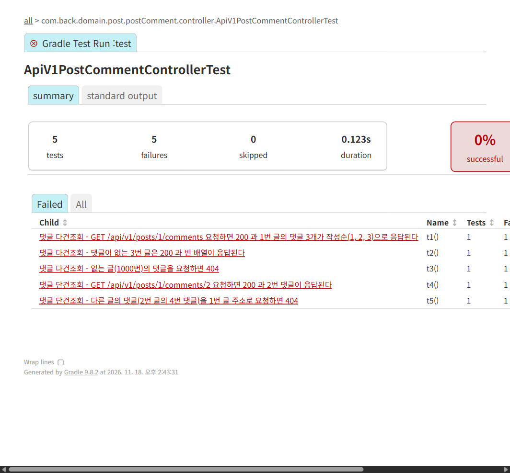

**GREEN** — `PostCommentDto`, `@OrderBy`, `findCommentById()`, `getItems()`, `getItem()` 구현 후 통과.

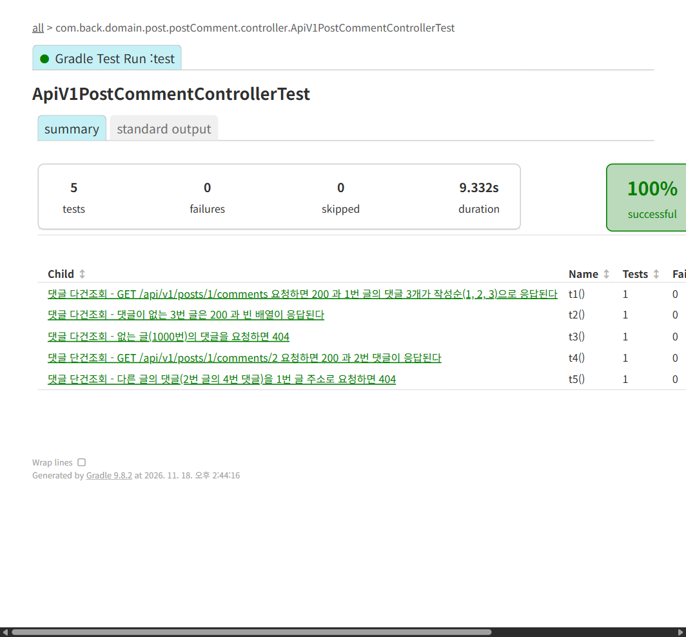

### 테스트

| 테스트 | 검증 내용 |
|---|---|
| `ApiV1PostCommentControllerTest.t1` | `/posts/1/comments` → 200, 댓글 3개가 1, 2, 3 순서, 모든 필드가 DB 값과 같고 `post` 객체는 없음 |
| `ApiV1PostCommentControllerTest.t2` | `/posts/3/comments` → 200, 빈 배열 |
| `ApiV1PostCommentControllerTest.t3` | `/posts/1000/comments` → 404, `404-1` |
| `ApiV1PostCommentControllerTest.t4` | `/posts/1/comments/2` → 200, 2번 댓글(`댓글 1-2`)의 모든 필드 |
| `ApiV1PostCommentControllerTest.t5` | `/posts/1/comments/4` → 404 (4번 댓글은 2번 글 소속) |

### 결과 스크린샷

전체 결과 — 16건 실행, 실패 0, 성공률 100%

브라우저 `/api/v1/posts/1/comments` — 1번 글의 댓글 3개, 작성순

브라우저 `/api/v1/posts/3/comments` — 빈 배열

브라우저 `/api/v1/posts/1/comments/2` — 2번 댓글, `postId` 1

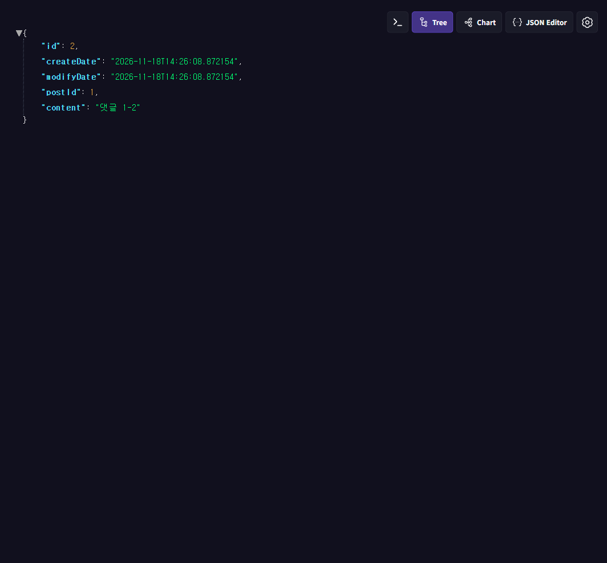

브라우저 `/api/v1/posts/1/comments/4` — 다른 글의 댓글이라 404

